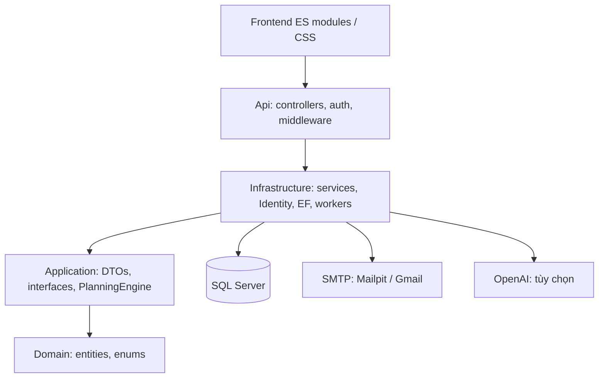

# Phân tích PLANORA/SPWPOS và chuyển sang .NET 8

Ngày rà soát: 06/10/2026. Phạm vi: toàn bộ 7 project, SDK/NuGet, API, persistence/migrations, planner, frontend, scripts và CI. Kết luận dựa trên đọc mã và kiểm thử, không phải benchmark tải hay chứng nhận bảo mật production.

## 1. Bản chất và kiến trúc

Ứng dụng lập kế hoạch khối lượng công việc cá nhân này có CRUD làm nền tảng và các luồng nghiệp vụ: kiểm tra phụ thuộc, đề xuất lịch, áp dụng kế hoạch một lần, chống kế hoạch lỗi thời, theo dõi thực hiện, học từ thời gian thực tế và đánh giá rủi ro. Planner hoạt động độc lập với AI; AI hỗ trợ nhập công việc/chia nhỏ sau khi người dùng đồng ý.

Đây là monolith phân lớp: ASP.NET Core API phục vụ static frontend và chạy background workers. Web không cần Node/npm; Node dùng cho kiểm thử frontend.



| Project | Trách nhiệm |
|---|---|
| SPWPOS.Domain | Entity tài khoản, security, task, lịch, plan, execution và history; dùng ASP.NET FrameworkReference do IdentityUser |
| SPWPOS.Application | Hợp đồng authentication/workspace, DTO, validation và PlanningEngine |
| SPWPOS.Infrastructure | Identity/JWT/OTP/Argon2id, EF SQL Server, SMTP, services và workers |
| SPWPOS.Api | HTTP endpoint, DI, authorization, cookie session, rate limit, ProblemDetails, Swagger, wwwroot |
| SPWPOS.TestSupport | TestClock, email giả, SQLite relational và database SQL Server test riêng |
| SPWPOS.UnitTests | Authentication, security, planner, services và regression |
| SPWPOS.IntegrationTests | HTTP, phân quyền, JWT, migrations và concurrency SQL Server |

## 2. Các nhóm chức năng

| Nhóm | Hành vi và dữ liệu |
|---|---|
| Account | Đăng ký, OTP/email verification, login, refresh/logout, reset/change password, profile/avatar |
| Task | Categories, task/subtask, deadline cứng/mềm, priority, progress, estimate, soft delete, dependency |
| Time | Weekly availability, exceptions, fixed events, timezone, minimum/maximum session và break |
| Planning | Preview → proposal có expiry/revision → apply; giữ phiên khóa/đang chạy, lập lại phần bị ảnh hưởng |
| Execution | Start/pause/resume/complete/skip, execution segments, actual time và điều chỉnh actual |
| Intelligence | Bias estimate/actual, capacity, workload theo horizon, risk và reason codes |
| Scenario/Capture | Mô phỏng không persist; nhập tiếng Việt/Anh bằng rules/AI, cần xác nhận trước khi lưu |
| Notification | Nhắc deadline/phiên, workload/thay đổi lịch, dedupe và đánh dấu đọc |
| Administration | Tìm user, lock/unlock/revoke, audit trạng thái và system status |

Các trang today, tasks, calendar, time, insights, scenario, notifications, settings và admin dùng chung shell. UI xanh–trắng/liquid glass và responsive được giữ khi chuyển framework.

## 3. Persistence và tính nhất quán

Controller nhận DTO, xác định user từ claims rồi gọi service. `WorkspaceService.Mutate` kiểm tra account, mở transaction, lấy account lock, thực hiện thay đổi, cập nhật revision/learning/risk khi cần rồi commit. Query theo UserId; nhiều FK composite `(UserId, Id)` ngăn tham chiếu task/category/parent/dependency/session giữa các tài khoản.

SQL Server dùng `sp_getapplock` theo normalized email. Unique filtered indexes bảo vệ một phiên Running/Paused mỗi user, một execution segment đang mở và các quan hệ duy nhất. Proposal dùng revision, expiry và trạng thái áp dụng để chống áp dụng hai lần hoặc ghi đè dữ liệu mới. SQLite phục vụ test relational thường; concurrency được kiểm tra trên SQL Server thật.

Năm migration giữ nguyên ID và Up/Down. `docs/schema.sql` được sinh lại bằng EF Core 8; annotation ProductVersion trong snapshot/designer được đồng bộ thành 8.0.31. Database hiện có không bị drop/recreate; startup EF 8 báo database đã up to date, không áp dụng migration mới.

## 4. Planner và learning

`PlanningEngine` dựng khoảng rảnh theo timezone, trừ events/exceptions và phiên cần giữ. Chu trình được kiểm tra cả dependency và quan hệ hoàn thành cha/con. Lịch theo thứ tự tiền nhiệm, deadline, priority và khoảng phù hợp; task cha có con là container để tránh tính workload hai lần.

Planner xét session bounds, splittable, preferred hours, break và hard deadline. Bias cần 3 mẫu, dùng tối đa 50 mẫu gần nhất, giới hạn 0.5–3; capacity cần 5 phiên đủ điều kiện, cold start 80%, giới hạn 25–100%. Horizon tối đa 30 ngày. Deadline ngoài horizon có reason riêng và không bị suy diễn thành thiếu capacity trước deadline.

Thuật toán là heuristic xác định, có giải thích và test. Chưa có bằng chứng nghiệm tối ưu toàn cục hoặc cải thiện năng suất người dùng thực tế.

## 5. Authentication, API và workers

- Identity dùng Argon2id qua Sodium.Core; password PHC, constant-time comparison và chặn tham số hash quá lớn. Format password không đổi khi hạ framework.
- OTP theo purpose, HMAC, expiry, attempts và cooldown; reset ticket dùng một lần.
- JWT kiểm tra HS256/signature/issuer/audience/lifetime; mỗi request còn kiểm tra account active và refresh family hiệu lực.
- Browser cookie Secure/HttpOnly/SameSite, response browser-session không lộ token. Rotation/reuse detection giữ nguyên; Web Locks phối hợp refresh giữa các tab.
- Cookie mutation kiểm tra `X-SPWPOS`/Origin. HTTPS, explicit CORS, body tối đa 3 MB, CSP/security headers, rate limit theo IP/account và giới hạn 2–8 phép tính mật khẩu đồng thời.
- Role Admin bảo vệ quản trị; lock user revoke session. Bootstrap admin chỉ Development. Secrets nằm ngoài Git; UserSecretsId giữ nguyên để dùng lại SQL/SMTP/JWT/OTP.

Password notification có outbox/worker. Notification worker quét mỗi 60 giây, cô lập lỗi từng account và ghi job status. Retention dọn theo batch diagnostics hoàn tất và risk snapshot cũ quá 30 ngày, giữ security/business history.

## 6. Các giới hạn và hướng cải thiện

`WorkspaceService` vẫn là partial class lớn; nên tách theo task/time/plan/execution/notification khi mở rộng. Domain phụ thuộc Identity nên chưa độc lập hoàn toàn với ASP.NET.

Workspace tải tới 5.000 task và 10.000 session vào bộ nhớ, ưu tiên dữ liệu hoạt động; cần đo tải và phân trang/truy vấn theo khoảng khi lịch sử dài. Worker quét mọi account active mỗi phút; nhiều instance cần đánh giá điều phối job và chi phí scan. Avatar trả cùng workspace có thể tăng băng thông.

Runtime startup có EF warning về một số truy vấn Take không OrderBy, ví dụ batch retention. Nên thêm thứ tự rõ ràng khi tối ưu khả năng xử lý công bằng; đây khác với build warnings (Release build bằng 0).

Lần này chưa gọi AI/SMTP provider thật, kiểm tra browser trực quan, benchmark tải, backup/restore production hoặc chạy publish trên Linux. CI đã đổi sang SDK 8 nhưng chưa có kết quả GitHub Actions cho thay đổi này.

## 7. Các thay đổi tương thích

| Thành phần | Sau chuyển đổi |
|---|---|
| TargetFramework của 7 project | net8.0 |
| global.json | SDK 8.0.425, latestFeature trong nhánh 8.0 |
| Analyzer | 8.0 |
| Solution | SPWPOS.sln thay SPWPOS.slnx |
| EF SQL Server/Design/SQLite | 8.0.31 |
| Identity EF/JwtBearer/Mvc.Testing | 8.0.31 |
| dotnet-ef | 8.0.31 |
| CI setup-dotnet | 8.0.x |
| ForwardedHeadersOptions | KnownNetworks thay KnownIPNetworks |
| Test persistence setup | Bỏ IDbContextOptionsConfiguration của EF mới; remove context/options trước AddDbContext EF 8 |
| CLI audit | Bỏ flag list package --no-restore không được SDK 8 hỗ trợ |

Sodium.Core 1.4.1, MailKit 4.17.0, Swashbuckle 10.2.3 và test packages giữ vì restore/build/tests net8.0 thành công. Số major của thư viện độc lập không tương ứng trực tiếp major .NET. Cả 7 NuGet lock files được cập nhật; locked restore pass.

Startup/SMTP restart chỉ nhận diện apphost net8 thuộc đúng checkout. File build và tham chiếu framework cũ trong workspace đã được dọn. SDK chính thức đã kiểm tra SHA-512 rồi cài riêng tại `%LOCALAPPDATA%\SPWPOS\dotnet8`.

Theo yêu cầu dọn dự án: đã xóa 30 thư mục build framework cũ, 39 báo cáo test cũ và output publish cũ; bỏ fallback SDK cũ trong script và đồng bộ metadata migration thành 8.0.31. SDK/runtime cài trên Windows được giữ theo lựa chọn của người dùng. Sau dọn: Release build 0 warnings/errors, model consistency pass, ca nâng cấp dữ liệu SQL Server và 10 script fixtures pass.

## 8. Kết quả kiểm chứng

| Kiểm tra | Kết quả |
|---|---|
| Release build, SDK 8.0.425 | Pass; 0 warnings/errors |
| Locked restore / EF tool restore | Pass; EF 8.0.31 |
| EF has-pending-model-changes | Không có thay đổi |
| Unit/service/planner | 68 passed |
| HTTP + SQL integration | 47 passed, 0 skipped, gồm 8 SQL Server cases |
| Node frontend modules | 9 passed |
| PowerShell 5.1 SMTP/startup fixtures | 10 cases passed, không dùng email/secrets thật |
| NuGet audit top-level/transitive | 0 dependency entries có vulnerability đã công bố |
| SQL schema generation | Pass, EF Core 8 |
| Release publish | Pass; runtimeconfig net8.0, native libsodium có trong output |
| Localhost API thực tế | Apphost net8.0; homepage/Swagger HTTP 200; endpoint bảo vệ HTTP 401 |
| Database development khi khởi động EF 8 | Up to date; không áp dụng migration mới |

Process localhost được xác nhận nạp `coreclr.dll` từ `dotnet8/shared/Microsoft.NETCore.App/8.0.31`; Swagger có 60 paths. SQL schema mới tương đương bản trước sau khi bỏ batch separator GO và khác biệt ProductVersion trong migration history.

TRX: `TestResults/net8/*.trx`; audit: `TestResults/net8/package-audit.json`, được gitignore. Test factory chỉ tạo/xóa `SPWPOS_Tests_<Guid>`; test upgrade xác minh dữ liệu legacy và backfill profile/plan/execution/observation.

## 9. Chạy hệ thống

Cài SDK 8.0.425 trở lên trong nhánh 8.0 từ Microsoft và chạy Docker Desktop Linux engine. Trong repository:

```powershell
powershell.exe -NoProfile -ExecutionPolicy Bypass -File .\scripts\Start-Development.ps1
```

Nếu HTTPS certificate đã trust, thêm `-SkipCertificateTrust`. Mở https://localhost:7043/ và `/swagger`. Khi muốn dùng dotnet trực tiếp trong terminal mới:

```powershell
Set-ExecutionPolicy -Scope Process -ExecutionPolicy Bypass
. .\scripts\Initialize-Dotnet.ps1
dotnet --version
dotnet restore --locked-mode
dotnet build -c Release --no-restore
dotnet test -c Release --no-build
```

Các ca SQL mặc định skip nếu thiếu `SPWPOS_TEST_SQLSERVER`; dùng connection test qua environment và `scripts/Test-BeforeMerge.ps1 -RequireSqlServer` để kiểm tra đầy đủ. Không đặt secret trong source hay lệnh chia sẻ.

## 10. Nguồn đối chiếu

- [Microsoft: SDK 8.0.425/runtime 8.0.31](https://dotnet.microsoft.com/en-us/download/dotnet/8.0), xác minh 06/10/2026.
- [NuGet: EF Core SQL Server 8.0.31 target net8.0](https://www.nuget.org/packages/Microsoft.EntityFrameworkCore.SqlServer/8.0.31).
- [Microsoft: CLI hỗ trợ SLNX từ SDK 9.0.200](https://devblogs.microsoft.com/dotnet/introducing-slnx-support-dotnet-cli/), vì vậy repo chuyển về SLN.
- [Microsoft support policy](https://dotnet.microsoft.com/en-us/platform/support/policy/dotnet-core): .NET 8 đang maintenance và kết thúc hỗ trợ **10/11/2026**. Kế hoạch production dài hạn cần tính đến mốc này.
