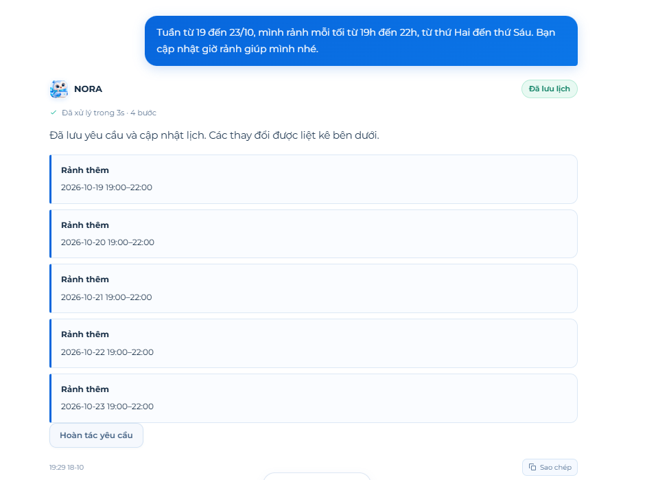
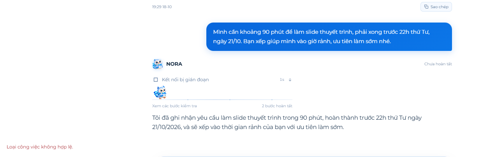
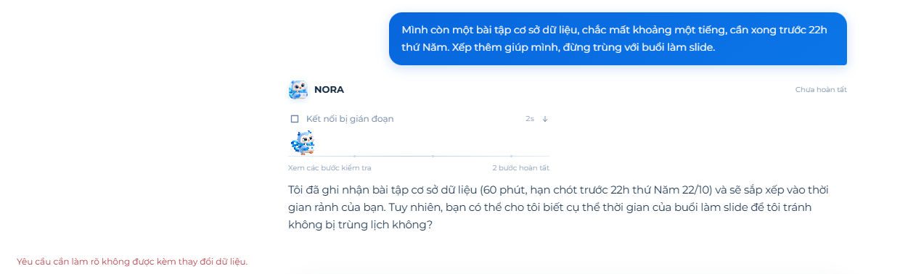
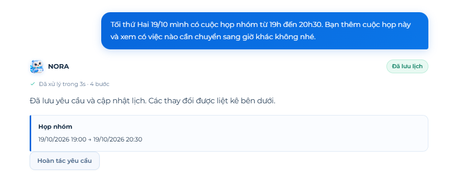
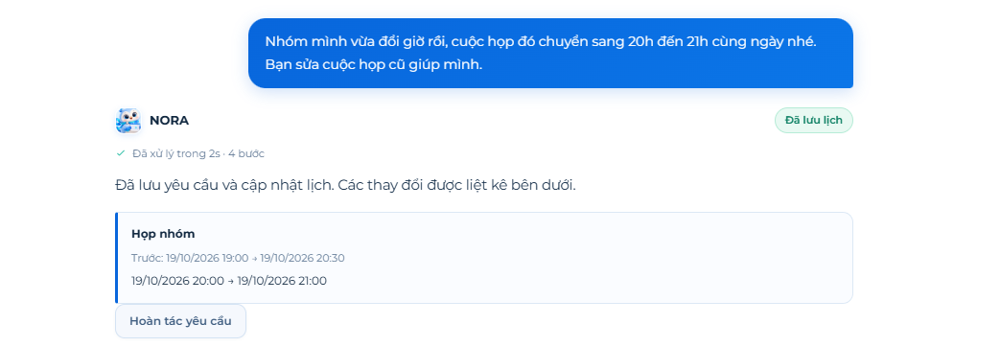
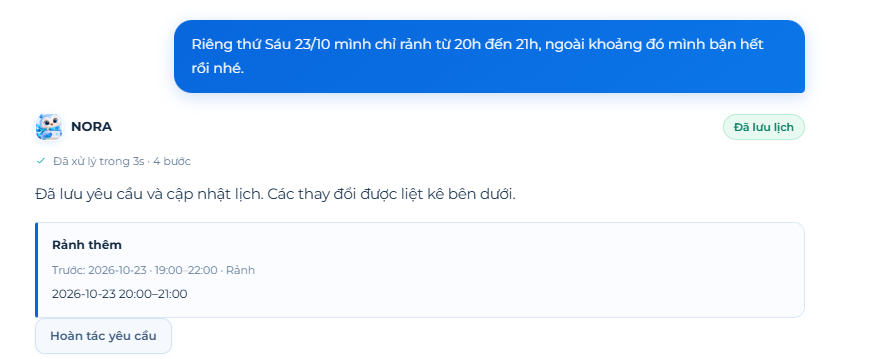
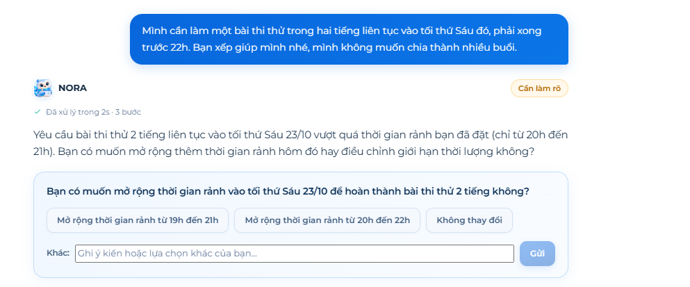
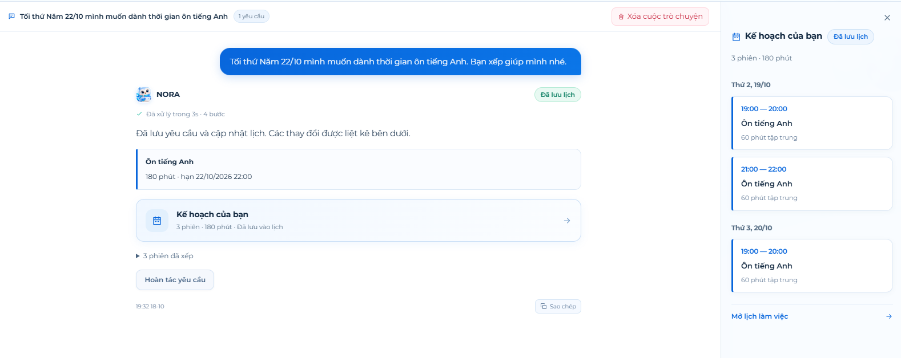
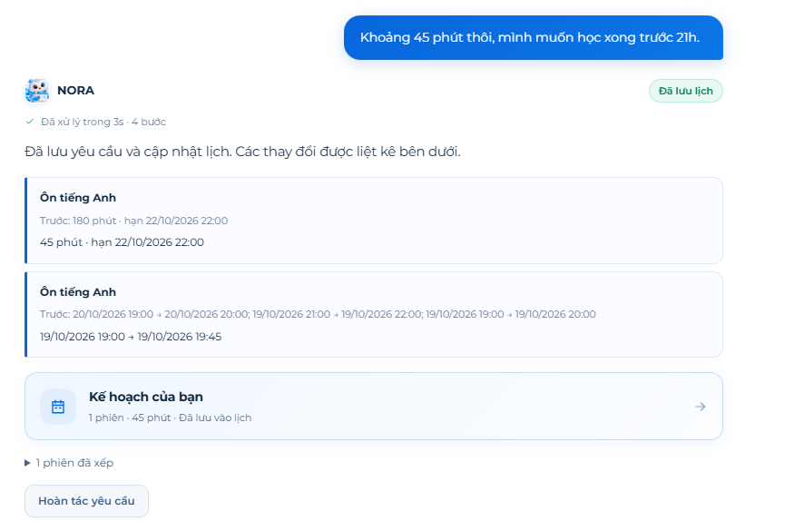
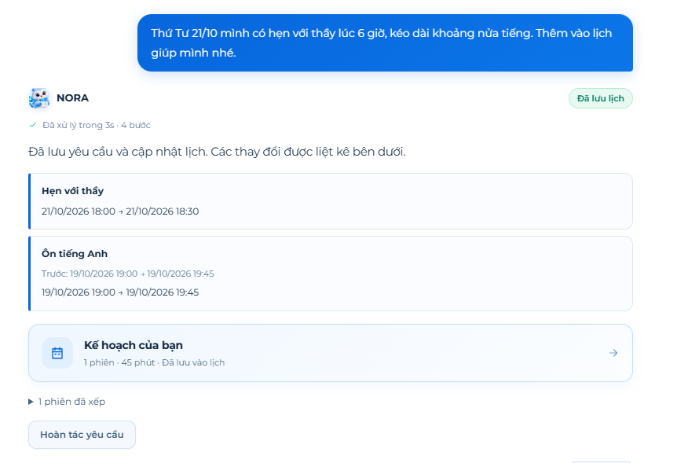

# NORA request/response quality report

**Product:** PLANORA / SPWPOS — NORA scheduling assistant  
**Review date:** 18 October 2026, Asia/Saigon  
**Evidence:** 12 user-supplied screenshots, supported by inspection of the current local source  
**Review type:** Manual behavioral assessment and implementation review  
**Status:** Findings and proposed remediation; fixes have not been implemented or verified by this report

## 1. Overall assessment

NORA handled date-specific availability and meeting creation/editing well in the visible tests. It also recognized that a continuous two-hour task could not fit into a one-hour availability window and asked before expanding that window.

The tests exposed material weaknesses in task creation, clarification handling, interpretation of requested work dates, follow-up updates, and the accuracy of status messages. The most serious visible outcome was a request to study on Thursday evening becoming an automatically saved three-hour task scheduled on Monday and Tuesday. An ambiguous appointment time was also saved without clarification.

The Vietnamese requests are natural and suitable for testing. They should remain in the regression set. Improving reliability requires changes to the model instructions, structured output contract, backend planning/validation, conversation context, and frontend status handling.

| Outcome | Count | Cases |
|---|---:|---|
| Pass within visible evidence | 5 | T01, T04, T05, T07, T08 |
| Partial pass | 2 | T10, T12 |
| Fail | 5 | T02, T03, T06, T09, T11 |

These are review classifications for one supplied test sequence, not a measured production success rate. Some later cases depend on earlier requests and cannot be treated as independent experiments.

## 2. Scope, evidence, and limitations

- Test requests and displayed responses are transcribed from screenshots. Descriptions identify shortened or summarized output.
- Screenshots are preserved under `docs/evidence/nora-quality-2026-10-18/`, numbered T01–T12 in the order supplied.
- The requests refer to 19–23 October 2026. The interface displays dates in 2026. Account timezone settings were not independently inspected during this review.
- Several screenshots show **Đã lưu lịch**, confirming that the interface presented the result as applied. Although the original test instructions recommended preview mode, the supplied run visibly exercised automatic saving for these cases.
- T09 visibly starts a conversation containing one request. Conversation boundaries for every other screenshot are not fully established. Calendar data can persist across conversations; conversation history and saved calendar state must be assessed separately.
- Runtime database records, raw model-generated JSON, provider settings, and network traces were not captured for this report. A saved badge is evidence of the displayed outcome, not an independent database audit.
- Source inspection explains implementation risks but does not establish that the running build exactly matched the inspected checkout. The local checkout had unrelated existing changes; this report does not attribute them to NORA defects.
- No live AI requests, schedule mutations, application fixes, or regression tests were run as part of preparing this report.

**Assessment criteria:** correct intent and dates; no invented consequential details; feasible scheduling; preservation of follow-up constraints; clarification before ambiguous writes; truthful reporting of saved/failed state; and clear, useful Vietnamese responses.

## 3. Detailed test record

### T01 — Set availability for a specific week

**Request**

> Tuần từ 19 đến 23/10, mình rảnh mỗi tối từ 19h đến 22h, từ thứ Hai đến thứ Sáu. Bạn cập nhật giờ rảnh giúp mình nhé.

**Observed output**

NORA displays **Đã lưu lịch** and:

> Đã lưu yêu cầu và cập nhật lịch. Các thay đổi được liệt kê bên dưới.

Five **Rảnh thêm** cards list 19:00–22:00 for 2026-10-19, 20, 21, 22, and 23. An undo button is available.

**Screenshot description:** One availability card per requested date; no visible extra dates or hours.

**Assessment: Pass within visible evidence.** The date-specific interpretation fits “tuần từ 19 đến 23/10.” Representing this as dated exceptions avoids assuming a permanent recurring weekly change. The screenshot does not establish whether other pre-existing availability was retained or whether persistence was correct.

**Expected behavior:** Save or preview exactly the five requested windows and describe their date-limited scope.

### T02 — Create and schedule a 90-minute slide task

**Request**

> Mình cần khoảng 90 phút để làm slide thuyết trình, phải xong trước 22h thứ Tư, ngày 21/10. Bạn xếp giúp mình vào giờ rảnh, ưu tiên làm sớm nhé.

**Observed output**

> Tôi đã ghi nhận yêu cầu làm slide thuyết trình trong 90 phút, hoàn thành trước 22h thứ Tư ngày 21/10/2026, và sẽ xếp vào thời gian rảnh của bạn với ưu tiên làm sớm.

The turn shows **Chưa hoàn tất**, **Kết nối bị gián đoạn**, and the error:

> Loại công việc không hợp lệ.

**Screenshot description:** A streamed acknowledgment remains visible above a task-type validation error; no successful schedule is shown.

**Assessment: Fail.** The natural-language acknowledgment understands the duration and deadline, but execution fails. The connection label misidentifies the visible validation failure. “Đã ghi nhận” may also be understood as successful storage when the turn did not finish.

**Expected behavior:** Select a valid active task category, create a 90-minute task, and schedule feasible work before 21/10/2026 22:00. If execution fails, clearly state that the requested task/schedule was not saved and offer an actionable retry.

**Source finding:** The prompt allows `DESIGN`, while the inspected database seed omits it. This is a confirmed contract inconsistency and a plausible trigger for this error. The screenshot does not reveal the emitted category, so `DESIGN` is not proven to be the runtime value.

### T03 — Add a database assignment and avoid the slide session

**Request**

> Mình còn một bài tập cơ sở dữ liệu, chắc mất khoảng một tiếng, cần xong trước 22h thứ Năm. Xếp thêm giúp mình, đừng trùng với buổi làm slide.

**Observed output**

> Tôi đã ghi nhận bài tập cơ sở dữ liệu (60 phút, hạn chót trước 22h thứ Năm 22/10) và sẽ sắp xếp vào thời gian rảnh của bạn. Tuy nhiên, bạn có thể cho tôi biết cụ thể thời gian của buổi làm slide để tôi tránh không bị trùng lịch không?

The turn shows **Chưa hoàn tất**, **Kết nối bị gián đoạn**, and:

> Yêu cầu cần làm rõ không được kèm thay đổi dữ liệu.

**Screenshot description:** NORA asks a follow-up question, but the backend rejects the response rather than presenting a usable clarification state.

**Assessment: Fail.** A clarification and proposed mutations were combined in an invalid intent. The backend guard correctly rejects that combination. The response also fails to explain that the immediately preceding slide request was unsuccessful, assuming these screenshots reflect consecutive requests without an intervening successful retry.

**Expected behavior:** Use saved sessions to avoid overlap. If the referenced slide task is missing, explain that it is not currently saved and ask whether the user wants to retry/create it. A clarification response must contain no mutation commands or rescheduling request.

### T04 — Add a Monday meeting

**Request**

> Tối thứ Hai 19/10 mình có cuộc họp nhóm từ 19h đến 20h30. Bạn thêm cuộc họp này và xem có việc nào cần chuyển sang giờ khác không nhé.

**Observed output**

The interface displays **Đã lưu lịch**, the standard save confirmation, and a **Họp nhóm** card:

> 19/10/2026 19:00 → 19/10/2026 20:30

**Screenshot description:** One meeting is shown with the requested date and exact start/end time.

**Assessment: Pass within visible evidence.** Event creation appears correct. There is no evidence here that conflicting task sessions were moved, because the earlier task requests failed and no conflicting saved session is shown.

**Expected behavior:** Add the meeting and move only affected flexible sessions when necessary. A short statement such as “Không có phiên làm việc đã lưu nào cần chuyển” would make the conflict-check result clearer when true.

### T05 — Move the existing meeting using a contextual reference

**Request**

> Nhóm mình vừa đổi giờ rồi, cuộc họp đó chuyển sang 20h đến 21h cùng ngày nhé. Bạn sửa cuộc họp cũ giúp mình.

**Observed output**

The meeting card shows:

> Trước: 19/10/2026 19:00 → 19/10/2026 20:30  
> 19/10/2026 20:00 → 19/10/2026 21:00

The interface displays **Đã lưu lịch**.

**Screenshot description:** Before/after values indicate editing the existing meeting rather than displaying a newly created second meeting.

**Assessment: Pass within visible evidence.** NORA resolves “cuộc họp đó” and “cùng ngày,” including the newly specified one-hour duration.

**Expected behavior:** Update the same event ID, preserve unspecified fields, and avoid duplicates. Database identity and duplicate counts remain unverified by screenshots alone.

### T06 — Check whether the slide and assignment still meet deadlines

**Request**

> Sau khi đổi giờ họp, lịch làm slide và bài tập của mình còn kịp deadline không? Nếu cần thì đề xuất xếp lại giúp mình.

**Observed output**

> Dựa trên lịch hiện tại, không có công việc hay bài tập nào đang bị kẹt deadline hoặc xung đột với giờ họp mới. Tất cả các mốc thời gian vẫn được đảm bảo an toàn.

The turn is marked **Đã trả lời**.

**Screenshot description:** A confident all-clear response contains no named task status, session times, or explanation of the earlier failures.

**Assessment: Fail in the supplied sequence.** Absence of a conflicting saved task does not establish that the requested work has been scheduled or will meet its deadline. Given T02 and T03, NORA should identify missing/uncreated work before reassuring the user. If tasks were created separately between screenshots, their actual schedules would need inspection before confirming this assessment.

**Expected response example**

> Mình chưa thấy công việc làm slide và bài tập cơ sở dữ liệu được lưu trong lịch hiện tại. Hai yêu cầu trước chưa hoàn tất, nên mình chưa thể xác nhận chúng sẽ kịp deadline. Bạn muốn mình thử tạo và xếp lịch lại cho hai việc này không?

**Source finding:** Failed turns are excluded from model history. This limits awareness of unsuccessful requests; it does not by itself prove why the model produced this specific answer.

### T07 — Narrow Friday availability

**Request**

> Riêng thứ Sáu 23/10 mình chỉ rảnh từ 20h đến 21h, ngoài khoảng đó mình bận hết rồi nhé.

**Observed output**

An availability card shows:

> Trước: 2026-10-23 · 19:00–22:00 · Rảnh  
> 2026-10-23 20:00–21:00

The interface displays **Đã lưu lịch**.

**Screenshot description:** The previous three-hour date-specific availability is replaced visibly with one hour.

**Assessment: Pass within visible evidence.** The displayed edit correctly narrows the existing exception rather than appending another free period.

**Expected behavior:** Effective Friday availability must be only 20:00–21:00. A regression test must also cover accounts with overlapping recurring weekly availability, because editing one exception alone may not establish that all other sources of availability are excluded.

### T08 — Request an impossible continuous two-hour task

**Request**

> Mình cần làm một bài thi thử trong hai tiếng liên tục vào tối thứ Sáu đó, phải xong trước 22h. Bạn xếp giúp mình nhé, mình không muốn chia thành nhiều buổi.

**Observed output**

> Yêu cầu bài thi thử 2 tiếng liên tục vào tối thứ Sáu 23/10 vượt quá thời gian rảnh bạn đã đặt (chỉ từ 20h đến 21h). Bạn có muốn mở rộng thêm thời gian rảnh hôm đó hay điều chỉnh giới hạn thời lượng không?

The status is **Cần làm rõ**. Options offered are:

- Mở rộng thời gian rảnh từ 19h đến 21h
- Mở rộng thời gian rảnh từ 20h đến 22h
- Không thay đổi

**Screenshot description:** A clarification panel explains the one-hour shortage and offers alternatives without showing a saved schedule.

**Assessment: Pass for conflict recognition and seeking permission before changes.** NORA respects the continuous-work requirement and does not visibly split or force the task into unavailable time.

**Improvement:** Distinguish insufficient free time from maximum session length. Suggest changing a session-duration setting only if that setting is actually restrictive. The user already said other Friday hours are busy, so acknowledge that expanding availability requires a change to their stated constraint. Options are proposals, not proven feasible schedules; 20:00–22:00 may also need clarification if “trước 22h” is treated as a strict earlier-than deadline.

**Expected response example**

> Tối thứ Sáu bạn chỉ rảnh 20h–21h, nên hiện chưa có khoảng đủ 2 tiếng liên tục. Mình chưa lưu bài thi vào lịch. Bạn muốn đổi sang ngày khác, hay có thể thay đổi một khoảng bận hôm đó?

### T09 — Request Thursday-evening English study without duration

**Request**

> Tối thứ Năm 22/10 mình muốn dành thời gian ôn tiếng Anh. Bạn xếp giúp mình nhé.

**Observed output**

NORA displays **Đã lưu lịch** and creates:

> Ôn tiếng Anh  
> 180 phút · hạn 22/10/2026 22:00

The plan contains three 60-minute sessions:

| Date | Time |
|---|---|
| Monday 19/10 | 19:00–20:00 |
| Monday 19/10 | 21:00–22:00 |
| Tuesday 20/10 | 19:00–20:00 |

**Screenshot description:** The right-side plan panel makes the mismatch explicit: a Thursday-evening request is distributed over Monday and Tuesday. The conversation header shows one request.

**Assessment: Fail; highest-priority behavioral defect.** The request supplies neither duration nor an explicit completion deadline. NORA invents 180 minutes and a 22:00 deadline, then treats the requested work period as a latest completion date. The interface presents these assumptions as saved changes.

**Expected response example**

> Bạn muốn dành khoảng bao nhiêu phút để ôn tiếng Anh vào tối thứ Năm 22/10? Mình sẽ giữ việc học trong tối hôm đó.

**Source finding:** `AgentTaskCommand` contains deadline and duration fields but no task-specific allowed work window. The agent service starts planning from the current time plus five minutes. Consequently, a deadline alone cannot enforce “work on Thursday evening.” This is a representation/enforcement gap, not a wording issue alone.

### T10 — Correct duration and request completion before 21:00

**Request**

> Khoảng 45 phút thôi, mình muốn học xong trước 21h.

**Observed output**

The task changes from 180 to 45 minutes, but the deadline remains:

> Trước: 180 phút · hạn 22/10/2026 22:00  
> 45 phút · hạn 22/10/2026 22:00

The previous three sessions are replaced with:

> 19/10/2026 19:00 → 19/10/2026 19:45

**Screenshot description:** The before/after card confirms duration correction but unchanged deadline. The study session remains on Monday.

**Assessment: Partial pass with material unresolved errors.** NORA identifies the existing English task and changes its duration correctly. It fails to update the explicit completion time to 21:00 and fails to preserve/recover the Thursday-evening constraint. A Monday session ending before 21:00 does not satisfy the original Thursday request.

**Expected behavior:** Merge the clarification with the original intent: English study on Thursday 22/10, duration 45 minutes, completed before 21:00. For example, Thursday 19:00–19:45 is acceptable only if availability, breaks, and other constraints permit it. The task deadline should reflect 22/10/2026 21:00.

### T11 — Add an appointment at ambiguous “6 giờ”

**Request**

> Thứ Tư 21/10 mình có hẹn với thầy lúc 6 giờ, kéo dài khoảng nửa tiếng. Thêm vào lịch giúp mình nhé.

**Observed output**

NORA displays **Đã lưu lịch** and:

> Hẹn với thầy  
> 21/10/2026 18:00 → 21/10/2026 18:30

It also lists the English session with identical before/after values:

> Trước: 19/10/2026 19:00 → 19/10/2026 19:45  
> 19/10/2026 19:00 → 19/10/2026 19:45

**Screenshot description:** The appointment is saved at 18:00 without a clarification question. An unrelated unchanged session is displayed as a change.

**Assessment: Fail.** “6 giờ” is ambiguous between 06:00 and 18:00. The inspected system prompt explicitly requires clarification for this example, but the observed response chooses an interpretation and saves it. Listing an unchanged English session adds misleading change noise; the screenshot alone does not prove whether its underlying row was recreated.

**Expected response example**

> Bạn hẹn với thầy lúc 6 giờ sáng hay 18 giờ chiều ngày 21/10? Buổi hẹn kéo dài 30 phút, đúng không?

No event mutation should be emitted until the time is resolved. Unaffected work should not appear in the change list.

### T12 — Clarify that the appointment is at 18:00

**Request**

> À, 6 giờ chiều nhé.

**Observed output**

NORA displays **Đã lưu lịch** and:

> Hẹn với thầy  
> Trước: 21/10/2026 18:00 → 21/10/2026 18:30  
> 21/10/2026 18:00 → 21/10/2026 18:30

**Screenshot description:** Before/after appointment values are identical, but the UI announces a saved change and offers undo.

**Assessment: Partial pass.** The intended evening time is correct, but it was guessed in T11. This follow-up therefore reveals missing no-change handling rather than demonstrating a successful ask-and-answer clarification flow. No duplicate appointment is visible; database duplicate checks remain necessary.

**Expected response example for the state actually shown**

> Buổi hẹn với thầy hiện đã ở 18h–18h30 ngày 21/10, nên mình không cần thay đổi lịch.

In a corrected T11 flow, this reply would instead resolve the pending clarification and create the event once.

## 4. Main findings and implementation evidence

Source references identify the reviewed components and methods. Runtime causal claims remain qualified where generated JSON or database state was unavailable.

| Finding | Evidence and confidence | Implication |
|---|---|---|
| F01 — Task-type contract inconsistency | Confirmed in source: `AgentInterpreter.cs` instructions include `DESIGN`; `WorkloadHistoryModel.cs` seeds PROGRAMMING, WRITING, STUDY, MEETING_PREP, ADMIN, OTHER. `AgentSchema()` uses an unrestricted string. `BuildAgentChangesAsync()` rejects inactive/unknown types. Exact T02 emitted category is unknown. | A model can follow the prompt and still produce an invalid task type. Active runtime categories should be authoritative. |
| F02 — Invalid clarification/mutation combination | Confirmed visible error in T03; `ValidateIntent()` rejects questions combined with mutation arrays or rescheduling. The prompt already asks for empty mutations during clarification. | Keep the backend guard; strengthen output structure and recovery rather than allowing ambiguous writes. |
| F03 — Invented task details | Confirmed visible in T09: 180 minutes and 22:00 were not supplied. Existing instructions prohibit invented duration/deadline. | Prompt compliance alone is insufficient, particularly with auto-apply. Missing details need a required clarification state. |
| F04 — Requested work window is lost | Confirmed visible in T09/T10. `AgentTaskCommand` has no task-specific earliest start or allowed window. Agent planning uses `Now.AddMinutes(5)` plus a horizon. | A deadline cannot represent “only Thursday evening.” Constraints need to survive interpretation, planning, preview, apply, and later replanning. |
| F05 — Follow-up only partially applied | T10 changes duration while retaining the old deadline and wrong work day. `BuildAgentChangesAsync()` supports updating `Deadline` when supplied, so the ignored 21:00 value cannot be attributed solely to a missing deadline-update capability. | Investigate emitted intent/context; preserve unresolved original constraints alongside new information. |
| F06 — Failed-request awareness and unsupported reassurance | T06 gives an all-clear after visible T02/T03 failures. `SendAgentTurnCoreAsync` history query excludes FAILED and PROCESSING turns. | Include sanitized failure outcomes and distinguish “not saved” from “saved without conflicts.” Excluding failures is a contributing risk, not a proven sole cause. |
| F07 — Ambiguous AM/PM accepted | T11 saves 18:00 for “6 giờ,” despite an explicit clarification rule in the current prompt. | Ambiguous high-impact fields need enforceable resolution rather than inferred values. |
| F08 — Failure category mislabeled | T02/T03 show validation messages with a connection-interruption label. `NoraProgress` uses that label whenever processing is no longer busy and was not cancelled. | Users receive contradictory explanations and may retry an issue unrelated to connectivity. |
| F09 — Unchanged values shown as mutations | T11/T12 display identical before/after values. Event/task summaries are added without equivalent-value suppression; movement summaries do not filter equal time sets. | Change summaries overstate changes. Investigate unnecessary persistence and revision/session churn separately. |
| F10 — Successful saves lose request-specific explanations | `ApplyAgentTurnAsync()` replaces the reply with a generic save confirmation, matching several screenshots. | Users must infer fulfillment from cards. A concise summary should identify what changed and what was checked. |

### Reviewed source locations

- `src/SPWPOS.Infrastructure/Workspace/AgentInterpreter.cs` — `AgentSchema()`, interpreter instructions, structured-output parsing and validation.
- `src/SPWPOS.Application/Workspace/AgentContracts.cs` — `AgentTaskCommand`, `AgentIntent`, `AgentMessage`, and stream/result contracts.
- `src/SPWPOS.Infrastructure/Workspace/AgentContext.cs` — saved task, session, availability, event, and scope context sent to the interpreter.
- `src/SPWPOS.Infrastructure/Workspace/AgentService.cs` — history selection, intent validation, candidate changes, engine invocation, summary generation, apply and undo.
- `src/SPWPOS.Infrastructure/Persistence/Configurations/WorkloadHistoryModel.cs` — seeded task categories.
- `frontend/src/agent.jsx` — stream error handling and pending result state.
- `frontend/src/agent-stream.js` — server error events and transport failures.
- `frontend/src/nora-progress.jsx` — connection-interruption label.

## 5. Proposed remediation

Priority **P1** means incorrect scheduling or a blocked core workflow. **P2** means state reporting, recovery, or presentation defects. These are proposed priorities, not implementation completion claims.

| Fix | Priority | Proposed change | Acceptance condition |
|---|---|---|---|
| R01 — Authoritative task types | P1 | Load active type codes from the database into context; constrain generated output with the supported schema enum where possible; retain backend validation. Remove the stale hardcoded category list or generate it from the same source. | T02 creates a valid task; unknown/inactive categories are never saved; prompt/schema/database agree. |
| R02 — Clarification as a distinct result | P1 | Represent clarification, read-only answers, and mutation intents as distinct result kinds. Use schema discrimination where provider support permits and enforce it in backend validation. Allow a bounded repair/clarification recovery before any mutation if the model mixes states. | T03 becomes a usable question with empty mutations and false mutation flags; no partial data changes. |
| R03 — Enforce task-specific work windows | P1 | Add normalized allowed date/time windows or equivalent constraints to the command/plan contract. Persist them for as long as the user intends them to apply. Enforce them during candidate generation and apply-time validation, including timezone handling. | T09/T10 can never schedule the English activity outside Thursday evening, including subsequent replans. |
| R04 — Require missing task details | P1 | Track which consequential values are supplied, inherited from saved state, explicitly accepted, or still unknown. Ask for missing duration and any genuinely required completion deadline. Do not infer task duration from free-window size. | T09 asks for duration and does not auto-create a 180-minute task. |
| R05 — Merge follow-up constraints | P1 | Keep structured pending intent with entity references and unresolved fields. Apply explicit follow-up changes to both duration and deadline while preserving the requested work window and unrelated properties. Revalidate the complete request. | T10 resolves to 45 minutes on Thursday, finished before 21:00. |
| R06 — Resolve AM/PM before writes | P1 | Keep time ambiguity explicit through interpretation and validation. Use conservative handling for unresolved natural-language time; avoid treating availability as evidence of AM/PM. Ask when confidence is insufficient. | T11 asks 06:00 or 18:00 and saves nothing; T12 creates exactly one 18:00 event after clarification. |
| R07 — Truthful failure and existence context | P1 | Include bounded, sanitized failure summaries and saved entity IDs/statuses in context. Resolve referenced work against actual saved entities; report missing/failed requests explicitly. Use deterministic feasibility checks before making deadline guarantees. | T06 names the missing tasks or evaluates actual saved tasks; it never equates absence with deadline safety. |
| R08 — Correct frontend failure states | P2 | Carry failure category/code into pending state; distinguish validation, provider, transport, timeout, cancellation, and stale-data errors. Show provisional streamed text as unfinished until the authoritative result arrives. | T02/T03 display a validation failure and truthful save status rather than “connection interrupted.” |
| R09 — Detect no-change requests | P2 | Compare normalized effective values before summaries and persistence. Omit unchanged session/event cards; avoid revision bumps, unnecessary replacements, and undo entries when no real mutation is required. | T12 returns an answer without a save/undo claim; unrelated English work stays untouched in T11. |
| R10 — Grounded completion summaries | P2 | Compose brief Vietnamese confirmation from validated/applied results: changed entities, real schedule times, constraints met, and any missing work. Use immutable backend result data as the source of save claims. | Successful responses state what was saved; failed or read-only turns cannot imply applied changes. |

**Recommended order:** align task types and clarification handling first; add enforceable work windows and follow-up constraint preservation; address ambiguity and failure-aware answers; then refine UI errors, no-change handling, and confirmations. Keep auto-apply disabled in the regression account until P1 acceptance cases pass.

## 6. Proposed instruction reinforcement

The current prompt already contains useful rules about missing durations, ambiguous times, empty mutations during clarification, and truthful save claims. Preserve those rules and add precise examples and a field-consistency check. The following is proposed instruction text, not a complete replacement system prompt:

> **Chi tiết bắt buộc:** Với công việc mới, không tự đặt thời lượng hoặc deadline mà người dùng chưa cung cấp hoặc chưa đồng ý. Nếu thiếu thông tin cần thiết, hỏi một câu ngắn gọn. Khoảng giờ rảnh không phải là thời lượng công việc.
>
> **Ngày thực hiện và hạn hoàn thành:** “Ôn tiếng Anh vào tối thứ Năm” yêu cầu học trong tối thứ Năm; không có nghĩa là có thể học bất cứ ngày nào trước thứ Năm. “Xong trước 21h” là giới hạn hoàn thành. Giữ riêng hai ràng buộc. Nếu công cụ chưa hỗ trợ khung giờ thực hiện, nói rõ và hỏi người dùng thay vì tự đổi ý nghĩa.
>
> **Giờ sáng/chiều chưa rõ:** “Lúc 6 giờ” chưa xác định 06:00 hay 18:00. Hỏi lại trước khi tạo hoặc sửa lịch. Không dùng giờ rảnh để tự đoán.
>
> **Chế độ làm rõ:** Khi `question` khác rỗng, tất cả danh sách thay đổi phải rỗng; `replaceWeeklyAvailability=false` và `reschedule=false`. Không tạo một phần yêu cầu trong lúc chờ câu trả lời. Đưa lựa chọn ngắn gọn vào `options` khi phù hợp.
>
> **Yêu cầu nối tiếp:** Gộp câu trả lời mới với yêu cầu đang làm rõ. Giữ các điều kiện trước đó trừ khi người dùng thay đổi chúng. Với “45 phút, xong trước 21h” sau yêu cầu học tối thứ Năm, cập nhật thời lượng thành 45 phút, hạn hoàn thành thành 21h thứ Năm, và giữ khung học tối thứ Năm.
>
> **Trạng thái và dữ liệu thực tế:** Dùng trạng thái backend và dữ liệu đã lưu để xác định việc nào tồn tại. Yêu cầu từng thất bại không có nghĩa là công việc đã được tạo. Không xác nhận mọi deadline an toàn nếu thiếu công việc được nhắc đến hoặc chưa kiểm tra tính khả thi.
>
> **Loại công việc:** Chỉ dùng mã loại đang hoạt động được cung cấp trong ngữ cảnh. Không tự tạo mã hoặc dùng loại chỉ xuất hiện trong mô tả cũ.
>
> **Thay đổi giới hạn:** Khi không đủ giờ rảnh, giải thích khoảng thiếu. Chỉ đề xuất đổi giới hạn phiên nếu giới hạn đó thực sự là trở ngại. Không tự mở rộng giờ rảnh, đổi ngày, nới deadline hoặc chia nhỏ yêu cầu liên tục.
>
> **Không thay đổi:** Nếu các giá trị người dùng yêu cầu giống dữ liệu hiện tại, không phát lệnh sửa. Trả lời rằng lịch đã đúng và không cần cập nhật.
>
> **Trước khi trả kết quả:** Kiểm tra tính nhất quán giữa lời trả lời, câu hỏi, trạng thái, các trường ngày giờ, thời lượng, ràng buộc thực hiện và lệnh thay đổi. Lời xác nhận đã lưu chỉ do backend tạo sau khi áp dụng thành công.

Example clarification outputs should include all required empty collections and flags in actual model fixtures. The instruction about work windows becomes enforceable only after R03 adds a supported representation; until then the assistant should disclose the limitation and clarify rather than promise compliance.

## 7. Regression plan and release criteria

### Controlled rerun setup

1. Use an isolated test account or resettable test dataset. Record build/version, provider/model, account timezone, session/daily limits, break duration, and initial availability.
2. Use a controlled clock for automated tests. For future manual reruns, shift all dates together to an upcoming Monday–Friday week; do not reuse past dates as a scheduling test.
3. Start in preview mode. Apply successful prerequisite changes deliberately. Record conversation IDs and which cases share a conversation. Saved calendar state persists even when a new conversation starts.
4. Capture interpreted intent, validation outcome, saved entity IDs, and actual before/after state using sanitized test diagnostics. Never record credentials or unrestricted provider payloads.
5. Run failure-sequence tests separately from the successful baseline: T06 after failed T02/T03 should report missing work; T06 after successful task creation should assess concrete schedules.
6. Test auto-apply separately after preview behavior passes. A need for clarification or failed validation must leave the schedule unchanged in either mode.

### Required checks

| Area | Regression assertion |
|---|---|
| Availability | T01 affects only the five dates; T07 removes effective Friday availability outside 20:00–21:00, including overlapping weekly/default sources. |
| Categories | T02 succeeds with an active category; unsupported and disabled categories fail safely or recover before mutation. |
| Clarification | Missing duration and AM/PM produce a question and zero mutations. A mixed question/mutation response cannot be applied. |
| Date windows | “Vào tối thứ Năm” is preserved independently of deadline; generated/applied/replanned sessions remain inside the normalized window. |
| Follow-up | The 45-minute correction also changes completion time to 21:00 and preserves Thursday; event references resolve to the intended ID. |
| Feasibility | Two continuous hours cannot fit a one-hour window; no silent splitting, availability expansion, or partial apply. |
| State truthfulness | Failed creation is visible as failed/not saved in subsequent context. Missing tasks prevent an unsupported all-clear. |
| Event edits | T05 updates the existing meeting without duplication; T11 waits for clarification and T12 creates the clarified event once. |
| No-change behavior | Repeating the same time creates no effective mutation, revision/session churn, or misleading undo entry. |
| UI errors | Validation and provider errors are distinguished from network interruption; provisional replies cannot be mistaken for completed saves. |
| Persistence | Compare database rows and effective schedule before/after; visible cards alone do not establish correct identity, mutation scope, or duplicate prevention. |

Use deterministic interpreter fixtures for backend invariants and frontend error rendering. Add a separate opt-in live-model evaluation using these natural Vietnamese requests and paraphrases. Existing mocked tests can demonstrate handling of a correct clarification payload, but cannot establish that the live model consistently asks the question.

**Acceptance gate:** all P1 cases must pass at the intent, planner, apply, and user-visible response boundaries. The team should define the live-model sample size and acceptable failure threshold before rollout; the 12 screenshots do not justify a statistical reliability claim.

## 8. Suggested reviewer handoff

For each proposed fix, record the owner, linked change, regression evidence, and remaining limitation. Preserve T01–T12 as the original observed behavior, and store rerun evidence separately so that before/after comparison remains auditable.

The initial review is complete. Remediation and verification remain proposed work.
