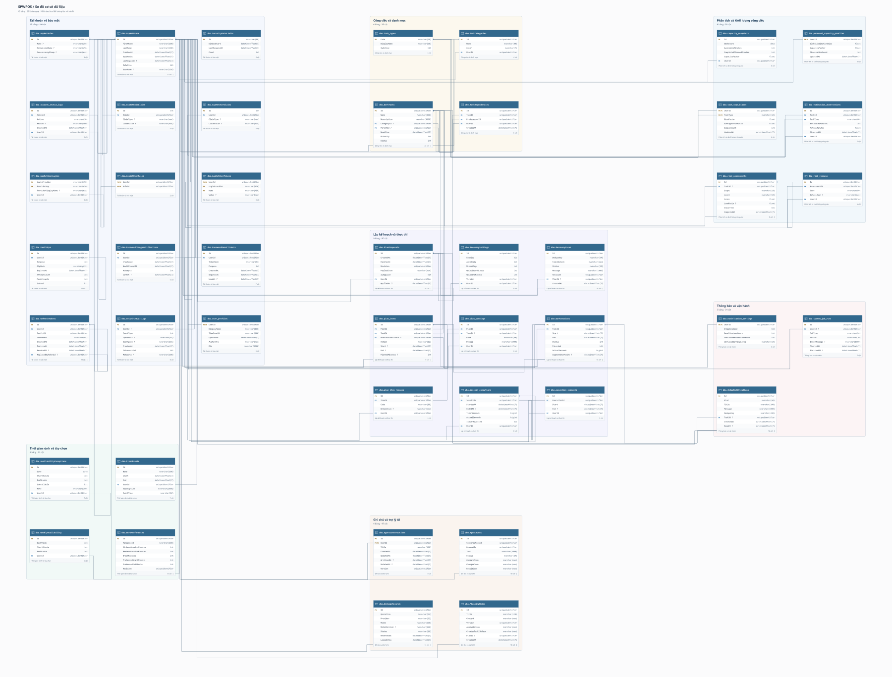

# Database images / Hình ảnh cơ sở dữ liệu

Snapshot / Chụp lúc: **2026-10-18T15:26:57.3648367Z** (UTC). **45 tables / bảng · 356 columns / cột · 69 foreign keys / khóa ngoại.**

| Export / Bản xuất | English | Tiếng Việt |
| --- | --- | --- |
| Grouped map / Sơ đồ nhóm chức năng | [PNG](map.png) | [PNG](map.vi.png) |
| All columns / Đầy đủ cột | [PNG](complete.png) | [PNG](complete.vi.png) |

The grouped map retains every table and relationship, with up to eight preview columns per card. Use the **all-column image** for every captured column or the [interactive explorer](../index.html) to inspect and scroll tables. PNGs are static: selection and connection highlighting are available in the explorer.

Sơ đồ nhóm giữ toàn bộ bảng và quan hệ, mỗi bảng xem trước tối đa tám cột. Dùng **ảnh đầy đủ cột** để xem mọi cột hoặc [sơ đồ tương tác](../index.html) để chọn, cuộn bảng và làm nổi bật kết nối. Ảnh PNG là ảnh tĩnh.

## Function details / Chi tiết theo chức năng

These print views show every column in the selected group and its outgoing FKs; referenced tables outside the group show primary keys for context. Cross-group incoming FKs remain available in the complete map. These are print layouts, not crops of the grouped overview.

Các ảnh chi tiết hiển thị mọi cột trong nhóm và khóa ngoại đi ra từ nhóm; bảng ngoài nhóm chỉ hiện khóa chính để tham chiếu. Quan hệ đi vào từ nhóm khác có trong sơ đồ toàn bộ. Đây là bố cục in chi tiết, không phải ảnh cắt từ sơ đồ tổng quan.

| Function / Chức năng | Tables / Bảng | English | Tiếng Việt |
| --- | ---: | --- | --- |
| Accounts & security / Tài khoản và bảo mật | 15 | [English](accounts.png) | [Tiếng Việt](accounts.vi.png) |
| Availability & preferences / Thời gian rảnh và tùy chọn | 4 | [English](time.png) | [Tiếng Việt](time.vi.png) |
| Tasks & categories / Công việc và danh mục | 4 | [English](tasks.png) | [Tiếng Việt](tasks.vi.png) |
| Planning & execution / Lập kế hoạch và thực thi | 9 | [English](planning.png) | [Tiếng Việt](planning.vi.png) |
| Intelligence & workload / Phân tích và khối lượng công việc | 6 | [English](intelligence.png) | [Tiếng Việt](intelligence.vi.png) |
| Notifications & operations / Thông báo và vận hành | 3 | [English](notifications.png) | [Tiếng Việt](notifications.vi.png) |
| Notes & AI assistant / Ghi chú và trợ lý AI | 4 | [English](assistant.png) | [Tiếng Việt](assistant.vi.png) |

[Image dimensions and coverage / Kích thước và phạm vi](manifest.json) · [Regeneration guide / Hướng dẫn tạo lại](../../../../scripts/database-diagram/README.md)
