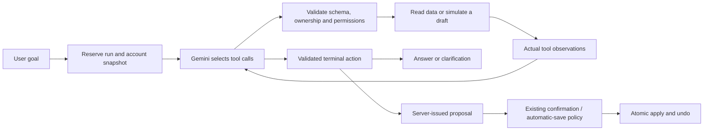

# NORA: bounded planning agent

NORA chat now uses a model-directed tool loop on Gemini/Vertex AI. The model chooses tools, receives actual observations and chooses the next step. `PlanningEngine` remains the deterministic scheduler and constraint checker. Notes/capture, image-to-note import and other older entry points retain their existing workflows; this change does not turn every feature into an autonomous agent.

## Execution



The eleven tools are `get_tasks`, `get_calendar`, `get_preferences`, `find_free_slots`, `analyze_workload`, `prepare_changes`, `simulate_plan`, `evaluate_candidate`, `finish_proposal`, `finish_answer`, and `ask_user`. There is no model-callable apply/undo, SQL or arbitrary URL tool. Tools are scoped to the authenticated account; draft/candidate IDs exist only inside the active execution.

`prepare_changes` normalizes the full intent using existing date, duration-evidence, category and scope guards. `simulate_plan` uses the real planner on copied state and creates no task, session, event or saved proposal. The terminal proposal must select a feasible server-issued candidate. Its exact IDs and schedule then go through existing preview/apply validation; the schedule is not regenerated from model prose.

Fixed events, locked/running work, dependencies, work windows and hard deadlines remain constraints. Moving flexible work through `replan_flexible` requires an explicit replan request. Optimization stays in the requested date range and requires confirmation. Existing automatic-save preferences continue to govern ordinary requests. A model saying “saved” is never evidence of a database write.

Native GenerateContent function declarations use `parametersJsonSchema`. Every returned model content block, including opaque thought signatures, remains in the in-memory transcript for the next round. Function responses echo provider IDs only when supplied. Private reasoning/signatures are never sent to the browser or retained in run records.

## Code map

| File | Responsibility |
| --- | --- |
| `src/SPWPOS.Application/Workspace/AgentRuntimeContracts.cs` | Model/tool protocol and limits |
| `src/SPWPOS.Infrastructure/Workspace/GeminiAgentModel.cs` | Native Gemini/Vertex function-calling HTTP adapter |
| `src/SPWPOS.Infrastructure/Workspace/NoraAgentRunner.cs` | Model → tools → observations loop, cache and stop conditions |
| `src/SPWPOS.Infrastructure/Workspace/NoraToolRegistry.cs` | Allowed tools and schemas |
| `src/SPWPOS.Infrastructure/Workspace/AgentRuntimeService.cs` | Account-scoped execution, leases, tool handlers and checkpoints |
| `src/SPWPOS.Infrastructure/Workspace/AgentRuntimeTools.cs` | Normalized drafts and deterministic simulations |
| `src/SPWPOS.Infrastructure/Workspace/AgentService.cs` | Integration with chat, preview, atomic apply and undo |
| `src/SPWPOS.Application/Workspace/PlanningEngine.cs` | Existing scheduling algorithm, capacity and feasibility |
| `src/SPWPOS.Domain/Entities/AgentRun.cs`, `AgentToolCall.cs` | Durable lifecycle and safe action metadata |
| `frontend/src/agent.jsx` | Live tool progress and persisted action trace |

## Configuration and migration

The API's `appsettings.json` enables Agent mode for supported configured Google providers:

```json
"NoraAgent": {
  "Mode": "Agent",
  "MaxModelTurns": 8,
  "MaxToolCalls": 12,
  "MaxSimulations": 3,
  "TimeoutSeconds": 120
}
```

Use `Mode: Workflow` to select the previous flow. Providers without the native adapter use the previous workflow; `/api/agent/capabilities` reports the actual `runtimeMode`. Existing AI credentials/model configuration are reused, with no additional key or public frontend credential.

Apply the additive migration `20261030191749_AddNoraAgentRuntime` before running the new API:

```powershell
dotnet tool restore
dotnet ef database update --project src/SPWPOS.Infrastructure --startup-project src/SPWPOS.Api
powershell.exe -NoProfile -ExecutionPolicy Bypass -File .\scripts\Restart-PlanoraApi.ps1
```

Run these commands in a terminal where the development database configuration is available, as described in the setup guide. The design-time context accepts `ConnectionStrings__DefaultConnection`; do not paste a connection password into source control. Deployments should back up their database first. Reverting the code to Workflow mode does not require dropping the new tables.

Limits are enforced on the server, with one provider usage reservation per model turn. Three consecutive tool errors stop the loop. Repeated identical tool arguments reuse an observation and still consume the tool budget. A run has a lease; a second active request in the same conversation is rejected. A clarification continues the same goal with cumulative counters, at most three continuations, for up to 30 minutes. A changed calendar revision invalidates an active execution; the user can retry against fresh state. This release does not silently restart an active run on a new snapshot.

`AgentRun` records goal, revision, counters and lifecycle. `AgentToolCall` stores tool name, status, duration, argument hash and safe error code, not raw tool transcripts or model reasoning. Non-running metadata is pruned after 30 days. Deleting a conversation removes its run goals and tool records. Chat's persisted public action trace remains available with its normal history/export lifecycle.

## Verification and demo

### Development log file

In Development, the API writes action metadata to
`src/SPWPOS.Api/logs/nora-agent/nora-agent-YYYY-MM-DD.jsonl` (date in UTC,
directory relative to the API content root). `LOG_READY` is written at startup.
Restart the updated API before expecting these records. No migration is needed
for file logging. Set `NoraAgent__FileLog__Enabled=false` to disable it;
file logging is always disabled outside Development.

Double-click `Check-NoraAgentLog.cmd` in the repository root for a live readable
view, or run:

```powershell
.\scripts\Watch-NoraAgentLog.ps1 -Follow
.\scripts\Watch-NoraAgentLog.ps1 -RunId '<run GUID>' -Tail 1000
.\scripts\Watch-NoraAgentLog.ps1 -Date '2026-10-31'
```

Each JSON line has a timestamp, run/turn IDs, event name and metadata.
`RUN_STARTED` links the request and conversation IDs without recording prompt
text. `MODEL_STARTED` / `MODEL_COMPLETED` show each model round, its duration
and selected tool names. `TOOL_COMPLETED` shows sequence, status, duration,
argument hash and safe error code. `RUN_COMPLETED` describes a completed agent
loop, not a database save. `TURN_COMPLETED` is written after a successful
service transaction returns, including SEND, APPLY and UNDO. A reused result
can produce another TURN_COMPLETED without another model call. RUN_ERROR
records failures/cancellation without exception messages. Workflow mode has
turn-result records but no tool loop.

The file does not contain raw prompts, task/calendar content, tool arguments
or observations, provider requests/responses, headers, keys, audio/images,
thought signatures or private model reasoning. Logs are excluded from Git,
outside wwwroot, and capped at 10 MiB per UTC day; an unavailable/full log
warns once without interrupting agent processing. Daily files remain on disk
until removed. The viewer displays local time; reopen it after UTC midnight.

```powershell
# Deterministic runner + real service + provider protocol tests
powershell.exe -NoProfile -ExecutionPolicy Bypass -File .\scripts\Test-NoraAgent.ps1

# Explicitly call the configured model with a fictional in-memory calendar
powershell.exe -NoProfile -ExecutionPolicy Bypass -File .\scripts\Test-NoraAgent.ps1 -Live
```

The live probe creates no real-account calendar data. It sets a fictional class tomorrow from 08:00–10:00 and requests a continuous 90-minute slide task before noon, preserving the class. It expects a verified preview ending by noon, at least one `simulate_plan` call and `finish_proposal`, with no saved task/session even when the model completes successfully.

For a UI demo, first configure tomorrow's available hours and save a class that occupies part of them. Turn automatic save off and enter:

> Xếp lịch làm slide 90 phút liên tục vào ngày mai, hạn chót 12 giờ trưa ngày mai, giữ nguyên lịch học.

Open “NORA Agent · … lần dùng công cụ” to show the actual actions. Confirm the preview, inspect the saved session, then use Undo. For an infeasible case, choose a duration greater than available time; NORA must ask about a permitted adjustment rather than claim success. Dynamic branching is also tested with paired observations: the same goal selects a proposal when feasible and a clarification when infeasible.

This is a bounded tool-using planning agent with controlled writes. It is not a continuously running background assistant or a guarantee of globally optimal scheduling. Provider delays/errors remain possible; the run stops without saving an unverified candidate.
