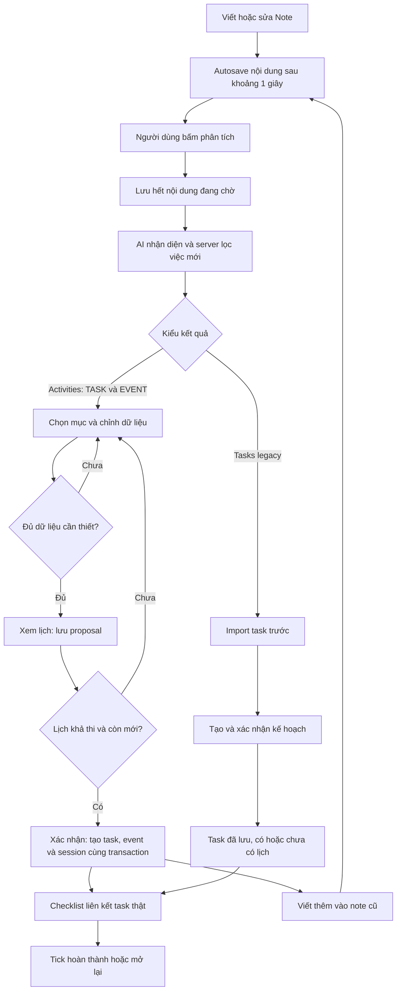
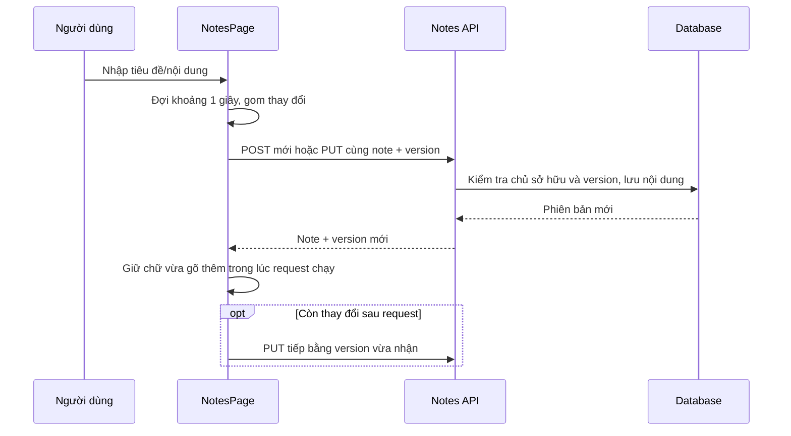
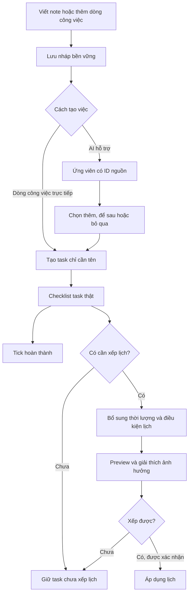

# Luồng Note chi tiết — hiện trạng và hướng cải thiện

Ngày đối chiếu mã và kiểm thử: **25/10/2026**. Tài liệu mô tả bản làm việc có thay đổi chưa commit; xem [manifest](../evidence/note-audit-2026-10-25/manifest.json). [Báo cáo kiểm thử](../reviews/NOTE_FLOW_AUDIT_2026-10-25.md) liệt kê các lỗi đã tái hiện. Phần cuối là thiết kế đề xuất, chưa phải chức năng đã triển khai.

## 1. Ba đối tượng cần hiểu riêng

| Đối tượng | Ý nghĩa | Khi nào tồn tại bền vững |
| --- | --- | --- |
| Note | Nội dung người dùng viết, tiêu đề, kết quả phân tích và liên kết việc đã tạo | Sau autosave/lưu nháp thành công |
| Ứng viên AI | TASK/EVENT được nhận diện, còn cần chọn và kiểm tra | Analysis gốc được lưu trên note; chỉnh sửa review hiện chủ yếu nằm trong state giao diện |
| Task/Event/Session | Công việc thật, sự kiện cố định và phiên làm việc thật trên lịch | Nhánh mới: sau apply; nhánh legacy: task sau import, phiên sau apply plan |

**Lưu note chưa tạo task. Phân tích chưa tạo task. Xem trước có lưu proposal nhưng chưa tạo task/event/session.** Nhánh mới chỉ ghi các đối tượng đó cùng nhau lúc xác nhận.

Checkbox cũng đang có ba biểu hiện: ký tự `☐` trong văn bản, ô chọn ứng viên để thêm, và checkbox hoàn thành task thật. Chỉ loại cuối cập nhật tiến độ công việc.

## 2. Sơ đồ luồng chính hiện tại

## 3. Mở trang, tạo mới và tìm note

1. UI lấy `GET /api/notes` và `GET /api/notes/agent`; workspace cung cấp task/session để hiển thị checklist.
2. Note mới mở trống. Có thể nhập tiêu đề hoặc lấy tiêu đề từ dòng nội dung đầu tiên khi lưu.
3. Thư viện lọc trạng thái và tìm tên tiếng Việt không dấu; server trả tối đa 200 note, sắp theo thời điểm cập nhật.
4. Chọn note khác khi có nội dung/review chưa lưu sẽ hỏi trước. Chọn lại cùng note không nên reset chỉnh sửa.
5. Font, giấy, màu và focus mode là thiết lập giao diện lưu cục bộ theo tài khoản/note; đổi chúng không phân tích lại hay tạo task.

Không nên diễn giải badge note là trạng thái hoàn thành của mọi task: nội dung đã phân tích, đã import, đã có plan và task đã hoàn thành là các trạng thái khác nhau.

## 4. Autosave nội dung

- Điều kiện hiện tại: nội dung phải có ký tự khác khoảng trắng. Title-only chưa được autosave.
- Request được tuần tự hóa trong UI, tránh một create chậm sinh thêm note thứ hai khi tiếp tục gõ.
- PUT bắt buộc version note hiện tại. Sai version → `NOTE_STALE`/409; chữ đang gõ vẫn giữ trong tab để đối chiếu, không tự ghi đè server.
- Đổi **nội dung** sẽ xóa analysis hiện tại, `PlanId`, pending/import của lần phân tích; liên kết task đã tạo và lịch sử xử lý nguồn vẫn giữ. Đổi **chỉ tiêu đề** giữ analysis; lưu y hệt không cần đổi version.
- Khi bấm AI, UI flush phần chưa lưu trước rồi mới gửi version mới nhất.
- Trước refresh/đóng trang có bảo vệ bản nháp nội dung chưa lưu. Review metadata không được bảo vệ bởi cơ chế này; title-only cũng lọt điều kiện. Offline draft chưa có khôi phục bền vững.

Nguồn: [notes.jsx](../../frontend/src/notes.jsx), [NoteService.cs](../../src/SPWPOS.Infrastructure/Workspace/NoteService.cs). Hạn chế tương ứng F05/F10/F11 trong báo cáo.

## 5. Phân tích lần đầu và phân tích phần thêm

1. Người dùng bấm “Xem trước công việc” hoặc “Nhận diện việc mới”, tùy lịch sử note.
2. `POST /api/notes/{id}/analyze` gửi version. Server đọc snapshot và kiểm tra quyền/version.
3. Gọi AI ngoài transaction của tài khoản để không giữ khóa trong lúc chờ mạng. Nếu đã xử lý nguyên nội dung này, server có nhánh trả danh sách rỗng mà không gọi provider.
4. Lần đầu: gửi nội dung để nhận TASK/EVENT. Lần sau: gửi nội dung mới cùng ngữ cảnh nội dung đã xử lý, tên/key đã lưu, yêu cầu chỉ tìm phần thêm.
5. AI thiếu thông tin phải giữ ứng viên chưa đầy đủ và hỏi thêm; không tự phát minh thời lượng/deadline. Không có AI hợp lệ thì trả lỗi, không fallback âm thầm sang rules để tạo việc.
6. Server chuẩn hóa loại task theo catalog đang hoạt động, lọc việc đã biết, rồi mở transaction ngắn kiểm tra version lần nữa trước khi lưu analysis và version mới.
7. Nếu note bị sửa trong lúc AI chạy, kết quả cũ không được lưu đè lên nội dung mới.

**Tác động:** lưu analysis vào note; chưa tạo task/event/session. Chỉnh thời lượng hoặc tên ở review chưa được lưu thành review draft riêng.

**Khoảng trống hiện tại:** TASK được dedupe theo tên, trạng thái xử lý theo toàn nội dung. Vì vậy có lỗi cùng tên/ngày khác, bỏ chọn, đổi tên một phần và reset pending đã nêu ở F01–F04.

## 6. Nhánh hiện đại: nhận diện lẫn TASK và EVENT

### 6.1. Chọn và kiểm tra

Mỗi mục có loại `TASK` hoặc `EVENT`. Checkbox tại đây có nghĩa **chọn mục để tạo**, chưa có nghĩa hoàn thành.

| TASK | EVENT |
| --- | --- |
| Tên và loại task hợp lệ | Tên, loại, giờ bắt đầu và kết thúc |
| Thời lượng 5–43.200 phút | Giờ kết thúc phải sau bắt đầu |
| Có deadline hoặc giờ bắt đầu để lập lịch | Không cần ép có estimatedMinutes của TASK |
| Nếu có khung thực hiện thì đủ dài và không vượt deadline | Có thể mở rộng các tuần lặp theo dữ liệu được chấp nhận |
| Priority hợp lệ, các điều kiện ngày giờ được server kiểm tra | Sự kiện trùng/ràng buộc được kiểm tra trong candidate |

Chọn 1–12 hoạt động, phạm vi 1–30 ngày. Thiếu trường → UI chỉ rõ cần bổ sung, server cũng kiểm tra lại. Những giới hạn này là hợp đồng code hiện tại, không phải đề xuất trải nghiệm checklist tối giản.

### 6.2. Preview

`POST /api/notes/{id}/proposals` nhận version note, activities đã chỉnh/chọn, phạm vi ngày, xác nhận điều kiện và tùy chọn dùng giờ yêu cầu ngoài availability.

Server:

1. Kiểm tra note, analysis, version và các điều kiện review.
2. Tạo task/event tạm trong bộ nhớ; chưa insert các dòng thực.
3. Tạo candidate gồm lịch hiện có, đối tượng mới và giờ bổ sung một lần nếu được phép.
4. Tìm phiên bị ảnh hưởng, chạy planner, giải thích thiếu giờ/ngoài availability; kiểm tra ảnh hưởng ngoài phạm vi preview.
5. Lưu `PlanProposal` với context note/version, IDs dự kiến, calendar revision, hết hạn sau 30 phút.
6. Trả lịch dự kiến, warnings và ảnh hưởng. UI giữ ngày người dùng đã chọn, ưu tiên cho thấy việc mới khi mở lần đầu.

Nếu có phiên sau deadline mềm hoặc chưa xếp đủ phút, chưa được xác nhận nhóm theo đường hiện tại. Không đồng nghĩa note đã mất: nội dung/analysis vẫn có.

### 6.3. Xác nhận

`POST /api/notes/{id}/proposals/{planId}/apply`:

1. Tìm proposal đúng user/note. Retry cùng plan đã áp dụng trả kết quả đã áp dụng.
2. Kiểm tra version note và version context, status proposal, hạn 30 phút và calendar revision.
3. Chặn nếu thiếu phút hoặc trễ deadline mềm; dựng lại đối tượng và kiểm tra ngày còn hợp lệ.
4. Trong một transaction, tạo task/event, giờ bổ sung đã xác nhận, quyết định lập lịch và session; nếu lỗi thì rollback cả nhóm.
5. Cộng dồn task IDs vào note, cập nhật ledger đã xử lý, analysis, PlanId và version note.
6. UI tải workspace mới; lúc này checklist thật mới có task để tick.

**Nếu áp dụng lỗi:** giữ nội dung review trong phiên để sửa/xem trước lại; không thông báo “đã lưu” khi chưa commit. Lịch thay đổi ở nơi khác → preview mới, không apply bản cũ.

Nguồn: [NoteActivitiesService.cs](../../src/SPWPOS.Infrastructure/Workspace/NoteActivitiesService.cs), [note-activities.jsx](../../frontend/src/note-activities.jsx), [note-plan-preview.jsx](../../frontend/src/note-plan-preview.jsx).

## 7. Nhánh legacy: task trước, lịch sau

Nhánh này dành cho analysis có `Tasks` và `Activities=null`, khác với kết quả mới có `Activities`.

1. `POST /api/notes/{id}/tasks` kiểm tra version, đã phân tích bằng AI hợp lệ, danh sách 1–12 task.
2. Tạo task độc lập; không tạo lại tên đã biết; kiểm tra catalog, task limit, quan hệ nguồn và version.
3. Lưu `CreatedTaskIds` cộng dồn, `PendingTaskIds` của batch hiện tại, `AnalysisImported=true`, snapshot nội dung và import version.
4. Tiếp tục bằng lập kế hoạch (`/api/plans/reschedule` ở luồng UI) và xác nhận plan.
5. Nếu bước lập lịch lỗi, **task đã tạo vẫn tồn tại**; UI có đường retry phần lịch, tránh import lại.

Đây là lý do cùng từ “lưu công việc” hiện có thể dẫn tới hai hành vi: legacy lưu task trước, modern chỉ lưu cùng lịch. Không thể chuyển analysis modern sang endpoint legacy một cách tùy ý: server trả `NOTE_NEEDS_REVIEW`.

**Lỗi cần sửa:** analyze lại nguyên note sau import legacy đang xóa pending và làm mất đường tiếp tục từ Note (F03).

## 8. Nút agent tự xếp lịch

`POST /api/notes/{id}/schedule` là cơ chế điều phối có nhiều nhánh:

- Kiểm tra phạm vi 1–30 ngày.
- Nếu note đang liên kết plan đã apply, retry có thể trả kết quả cũ dạng đọc; chỉnh nội dung sẽ xóa liên kết plan trước đó.
- Yêu cầu có giờ rảnh; thiếu thì trả `NO_AVAILABILITY`, UI cho mở/thiết lập giờ.
- Chưa analysis thì analyze trước.
- Có Activities hiện đại → cần review, không tự bỏ bước xác nhận nhóm.
- Tasks legacy đầy đủ → có thể import rồi generate plan cho batch pending.
- Plan cần xác nhận, ví dụ có dịch chuyển khẩn cấp → trả proposal; không tự nhận đã áp dụng.
- Plan không cần xác nhận → đi qua apply plan bình thường, vẫn kiểm tra revision/xung đột/ràng buộc.

Do đó không nên hiểu nút này là luôn “một click tạo hết và lên lịch hết”. Cần thống nhất tên và thông điệp theo trạng thái thực.

## 9. Checklist hoàn thành thực sự

1. UI lấy `note.createdTaskIds`, tra trong workspace để đọc **task thật**, không suy luận từ ký tự trong nội dung hoặc số phút đã làm.
2. Tick gửi `PATCH /api/notes/{noteId}/tasks/{taskId}/completion` với `completed` và **version task**.
3. Server kiểm tra note/task thuộc user, task thuộc note, chưa bị xóa/hủy và version đúng.
4. Dùng chung quy tắc đổi trạng thái task: không có phiên Running/Paused; các việc con và predecessor phải đáp ứng điều kiện.
5. Hoàn thành: status Completed, progress 100, CompletedAt hiện tại; các session Scheduled của task chuyển Cancelled, lịch sử thực tế giữ nguyên.
6. Bỏ tick: task về Todo, progress 0, CompletedAt=null. **Không tự khôi phục các session đã hủy**, cần xếp lịch lại nếu muốn.
7. Endpoint trả workspace đã commit để UI dùng version và lịch đúng; không tự đoán bằng checkbox.
8. Note content/version không bị chỉnh bởi tick, nên autosave nội dung và tick có thể chạy độc lập.

UI khóa click lặp trong lúc gửi; lỗi giữ checkbox theo dữ liệu đã xác nhận. Các task hoàn thành được nhóm riêng, task đã hủy không cho tick như task hoạt động. Đồng bộ khi có sự kiện workspace, focus/visibility hoặc tải lại; không có bằng chứng cơ chế WebSocket tức thời giữa mọi tab trong phạm vi này.

Nguồn: [NoteChecklistService.cs](../../src/SPWPOS.Infrastructure/Workspace/NoteChecklistService.cs), [TaskService.cs](../../src/SPWPOS.Infrastructure/Workspace/TaskService.cs), [note-checklist.jsx](../../frontend/src/note-checklist.jsx).

## 10. Sửa nhiều lần và mối quan hệ với task cũ

**Ý định hiện tại:** nội dung note là nguồn đầu vào; lần sửa sau chỉ thêm việc mới. Task đã tạo là đối tượng độc lập, không bị ghi đè từ note cũ.

| Thao tác | Hiện trạng |
| --- | --- |
| Đổi tiêu đề note | Giữ analysis và liên kết đã tạo |
| Đổi nội dung note | Lưu nháp; vô hiệu analysis/plan hiện tại; giữ task cũ |
| Thêm việc mới khác tên | Phân tích phần thêm và tạo batch mới; task/session cũ giữ nguyên trong các ca đã test |
| Sửa tên hoặc deadline trong câu nguồn sau khi task đã tạo | Không có hợp đồng cập nhật hai chiều chắc chắn; chỉnh task tại Công việc/Lịch |
| Đổi tên task thật ở màn khác | Checklist đọc tên/status mới; nội dung chữ trong note không tự viết lại |
| Viết lại cùng tên cho ngày khác | Có lỗi lọc mất lần mới (F01) |
| Đổi tên mục review rồi chỉ lưu một phần | Có nguy cơ nguồn cũ xuất hiện lại (F04) |
| Phân tích lại sau khi đã xử lý nguyên nội dung | Trả không có việc mới; hiện có thể reset pending không hợp lý (F03) |

## 11. Xóa note

UI hỏi xác nhận và gửi version note. Nếu hủy hoặc request lỗi, giữ note/nội dung đang viết. Xóa thành công chỉ xóa note; task/event/session đã tạo vẫn còn. Hiện không có luồng thùng rác/khôi phục note trong phần được kiểm tra.

API đang nhận `version` tùy chọn; bỏ version có thể bỏ kiểm tra xung đột (F08). Quyền sở hữu vẫn được kiểm tra.

## 12. Các trạng thái và thông báo cần tách

| Trạng thái thật | Câu nên dùng |
| --- | --- |
| Nội dung note đã lưu, chưa analyze | “Đã lưu ghi chú. Chưa tạo công việc.” |
| AI đã có ứng viên | “Đã tìm thấy 4 mục. Kiểm tra trước khi thêm.” |
| Review đang sửa chưa lưu bền vững | “Chỉnh sửa đề xuất chưa được lưu.” — hiện cần bổ sung cơ chế thực tương ứng |
| Proposal chưa apply | “Lịch dự kiến, chưa lưu công việc và sự kiện của nhóm này.” |
| Batch modern apply thành công | “Đã lưu 3 công việc, 1 sự kiện và áp dụng lịch.” |
| Task legacy đã import nhưng chưa có plan | “Đã lưu công việc. Chưa xếp lịch.” |
| Thiếu giờ | Nêu tên việc, số phút thiếu, deadline và lựa chọn chỉnh phù hợp |
| Có lịch trễ deadline | “Hạn chót …; dự kiến xong …; trễ … phút. Chưa lưu nhóm này.” |
| Chỉ có bản nháp offline | “Chưa lưu lên server. Nội dung đang giữ trong tab/thiết bị.” — chỉ nói thiết bị khi đã có lưu cục bộ thật |
| Bỏ tick task | “Đã mở lại công việc. Các phiên đã hủy chưa được khôi phục.” |

Đây là copy đề xuất; số lượng/tác động phải lấy từ kết quả server, không hardcode câu thành công trước commit.

## 13. Luồng đề xuất cho checklist trước, lịch sau

### Mô hình trạng thái đề xuất

- **Note draft:** nội dung/tiêu đề, version, trạng thái sync; local recovery là lớp riêng.
- **Candidate:** sourceItemId, occurrenceId, analysisRevision, dữ liệu AI gốc và dữ liệu review; trạng thái pending/accepted/dismissed.
- **Task link:** sourceItemId → taskId, giữ liên kết khi đổi tên. Có thể cùng tên nhưng khác occurrence.
- **Task:** tồn tại độc lập với lịch; metadata lập lịch có thể chưa đủ. Trạng thái hoàn thành dùng chung nguồn sự thật toàn hệ thống.
- **Schedule:** unscheduled/proposed/applied/needsAttention; độc lập với task completion và note saved.

### Hợp đồng hành vi cần chốt khi thực hiện

1. Task chỉ có tên phải lưu/tick được dù AI tắt hay không có availability.
2. Analyze và preview không được xóa liên kết hoặc trạng thái task đã tạo.
3. Bỏ chọn là “để sau” hay “bỏ qua” phải có quy tắc và UI minh bạch.
4. Retry dùng idempotency/source IDs; tên không làm khóa duy nhất của việc.
5. Autosave bao phủ nội dung và review draft; version conflict luôn giữ bản người dùng đang sửa để đối chiếu.
6. Xếp lịch thất bại không xóa task đã ghi nhận. Không tự thay đổi semantics của endpoint atomic cũ mà thiếu contract mới.
7. Sửa nguồn không tự sửa task đã commit; nếu cung cấp “cập nhật liên kết” thì hiển thị diff và xác nhận tác động lịch.
8. Xóa note giữ task hay xóa kèm phải thành lựa chọn rõ; mặc định hiện tại là giữ task/lịch.

Các thay đổi trên cần thiết kế API/model/migration và regression test mới; tài liệu này không khẳng định đã triển khai chúng.
