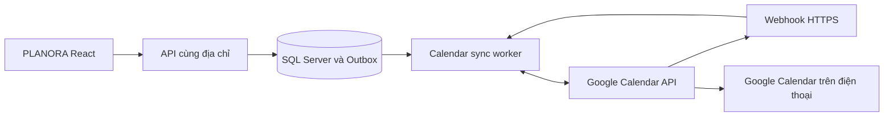

# Kế hoạch Google Calendar: đồng bộ hai chiều và nhắc lịch trên điện thoại

Ngày lập: 30/10/2026. Bản đầu đã được triển khai và cập nhật local; xem [hướng dẫn cấu hình và phạm vi hỗ trợ](../integrations/GOOGLE_CALENDAR_SETUP.md). OAuth và nhắc lịch trên điện thoại thật còn chờ cấu hình/kết nối tài khoản Google. Các mục dưới đây giữ nội dung kế hoạch thiết kế ban đầu.

## 1. Kết quả hướng tới

- PLANORA tạo lịch học, cuộc hẹn hoặc phiên làm việc: sự kiện xuất hiện trên Google Calendar.
- Người dùng thêm, sửa giờ hoặc xóa sự kiện trong lịch PLANORA trên Google Calendar: thay đổi quay về PLANORA.
- Google Calendar trên điện thoại nhắc trước giờ bắt đầu, kể cả khi người dùng đã đóng website PLANORA.
- NORA dùng các khoảng bận đã đồng bộ khi xếp lịch; không tạo thêm một phiên làm việc trùng với chính sự kiện đã liên kết.
- Giữ frontend/backend chung địa chỉ như lựa chọn hiện tại của người dùng.

## 2. Phạm vi đề xuất

MVP tạo một lịch phụ tên **PLANORA** trong tài khoản Google của người dùng. Đồng bộ hai chiều áp dụng trong lịch này. Sự kiện thêm bằng ứng dụng Google phải được đặt vào lịch PLANORA để xuất hiện trong ứng dụng.

Ưu tiên scope `https://www.googleapis.com/auth/calendar.app.created`: tạo lịch phụ và quản lý sự kiện trong các lịch do ứng dụng tạo. Không mặc định xin quyền toàn bộ lịch cá nhân. [Phạm vi quyền Google Calendar](https://developers.google.com/workspace/calendar/api/auth).

Giai đoạn mở rộng cho phép chọn các lịch khác để đọc khoảng bận bằng quyền bổ sung phù hợp; chỉ đọc khoảng bận không đồng nghĩa đọc được tên/nội dung sự kiện. Việc chỉnh sửa lịch chính là một lựa chọn riêng, cần quyền và quy tắc đồng bộ tương ứng.

MVP giới hạn một kết nối Google cho mỗi người dùng PLANORA. Kết nối lại cùng tài khoản phải dùng lại lịch đã lưu, tránh tạo nhiều lịch cùng tên. Tài khoản Google được kết nối Calendar có thể khác tài khoản dùng đăng nhập PLANORA, nhưng giao diện phải hiển thị rõ tài khoản đang kết nối.

## 3. Trải nghiệm người dùng

1. Vào **Cài đặt → Kết nối → Google Calendar**.
2. Bấm **Kết nối Google Calendar**, chọn tài khoản và cấp quyền trên Google.
3. PLANORA hiển thị tài khoản, lịch đích, nội dung sẽ đồng bộ và tùy chọn nhắc trước 15 phút; có thể thêm nhắc đúng giờ bắt đầu.
4. Bấm **Bật đồng bộ hai chiều**. Lần đầu chỉ đẩy các lịch địa phương chưa kết thúc; không xuất toàn bộ lịch sử mặc định. Phiên đang diễn ra vẫn giữ giờ bắt đầu thật.
5. Các lần tạo/sửa/xóa sau đó tự đồng bộ. Hiển thị trạng thái **Đã đồng bộ**, **Chờ gửi**, **Đang đồng bộ**, **Cần kết nối lại** hoặc **Có xung đột**, kèm lần thành công gần nhất.
6. Có **Đồng bộ ngay**, liên kết mở Google Calendar và **Ngắt kết nối**.

Thông báo xác nhận phải dựa vào kết quả thực: “Đã lưu ở PLANORA, đang gửi sang Google” khi còn trong hàng đợi; chỉ báo “Đã đồng bộ” sau khi Google xác nhận và lưu được liên kết.

## 4. Nhắc lịch qua Google Calendar app

Khi tạo sự kiện, đặt `reminders.useDefault = false` và `reminders.overrides` theo lựa chọn người dùng, ví dụ `popup` trước 15 phút. Google tính mốc nhắc theo giờ bắt đầu sự kiện. [Reminders and notifications](https://developers.google.com/workspace/calendar/api/concepts/reminders).

Sau khi sự kiện đã đến Google, việc hiển thị lời nhắc do Google Calendar và điện thoại xử lý. Cần đăng nhập đúng tài khoản, bật đồng bộ lịch PLANORA và bật quyền thông báo. Chế độ không làm phiền hoặc cài đặt thiết bị có thể ngăn hiển thị. [Cài đặt thông báo Google Calendar trên Android](https://support.google.com/calendar/answer/37242?co=GENIE.Platform%3DAndroid&hl=vi).

Webhook là tín hiệu gửi từ Google tới backend để biết dữ liệu đã đổi; không phải thông báo đẩy tới điện thoại. Không thiết kế API này như một kênh gửi tùy ý mọi thông điệp của NORA vào Google Calendar app. Những thông báo như lỗi xếp lịch/xung đột vẫn ở PLANORA. [Google Calendar push notifications](https://developers.google.com/workspace/calendar/api/guides/push).

Thay đổi lời nhắc trực tiếp trên Google cũng cần được lưu về mô hình đồng bộ, tránh bị ghi đè mỗi lần PLANORA sửa tiêu đề. Chính sách mặc định mới chỉ áp dụng khi tạo sự kiện, trừ khi người dùng chọn áp dụng lại cho các lịch hiện có.

## 5. Ánh xạ dữ liệu và hành vi

| Dữ liệu/thao tác | Cách xử lý đề xuất |
| --- | --- |
| `FixedEvent` | Một Google event, giữ tên, bắt đầu/kết thúc, mô tả phù hợp và múi giờ. |
| `WorkSession` có khung giờ | Một Google event liên kết phiên và task gốc. Không xuất phiên đã hủy. |
| `WorkTask` chưa được xếp giờ | Không tạo sự kiện. Deadline không tự biến thành một phiên làm việc. |
| Thêm sự kiện có giờ trên lịch PLANORA trong Google | Tạo `FixedEvent`, dùng làm khoảng bận khi NORA xếp lịch. |
| Google đổi giờ một phiên liên kết | Cập nhật khung giờ, giữ task gốc và đánh dấu đã chỉnh tay để bộ tự xếp lịch không kéo về giờ cũ. |
| Google xóa phiên liên kết | Hủy phiên, giữ task và lịch sử thực hiện; không tự đánh dấu hoàn thành, cộng XP hoặc lập lại phiên vừa bị xóa. |
| Google xóa sự kiện cố định | Xóa/hủy sự kiện tương ứng theo cơ chế hiện có, giữ dấu xóa để tránh tạo lại. |
| Hai bên cùng sửa cùng trường | Giữ bản nền và hai phiên bản, hiển thị lựa chọn giữ PLANORA/giữ Google. Không âm thầm ghi đè. |
| Hai bên sửa các trường độc lập | Hợp nhất nếu không phá ràng buộc nghiệp vụ, lưu bản nền mới. |
| Sự kiện Google trùng deadline/lịch khác | Ghi nhận sự kiện thực tế là khoảng bận và cảnh báo; NORA đề xuất xử lý phần việc linh hoạt. Không âm thầm xóa lịch Google. |

Giữ ưu tiên khẩn cấp hiện tại trong bộ lập lịch. Quyền Calendar không mặc nhiên cho NORA quyền dời các cuộc hẹn cố định trên Google để lấy chỗ.

Sự kiện cả ngày dùng ngày bắt đầu/kết thúc riêng, ngày kết thúc không bao gồm trong sự kiện. Lịch lặp cần lưu danh tính chuỗi và các ngoại lệ, không chuyển mọi buổi thành các bản độc lập rồi làm mất quan hệ. MVP thao tác hai chiều đầy đủ cho sự kiện đơn có giờ; loại chưa hỗ trợ phải hiển thị rõ và mở Google để chỉnh, đồng thời vẫn được tính là khoảng bận. Chỉ công bố hỗ trợ lịch lặp/cả ngày sau giai đoạn mở rộng. [Event resource](https://developers.google.com/workspace/calendar/api/v3/reference/events).

## 6. Kiến trúc trong repo hiện tại

Đăng nhập Google hiện tại xác minh Firebase ID token; chưa thay thế bước cấp quyền Calendar. Bổ sung luồng OAuth riêng, không sửa chức năng đăng nhập đang có.

- Application: hợp đồng `IGoogleCalendarGateway`, dịch vụ điều phối sync và quy tắc xung đột.
- Infrastructure: adapter Google Calendar, OAuth/token store, worker gửi Outbox, worker đồng bộ vào và gia hạn watch.
- API: controller kết nối/callback/webhook riêng; không dồn vào `WorkspaceService`.
- Frontend: phần Kết nối trong Settings, trạng thái đồng bộ trên lịch và màn hình giải quyết xung đột.
- Database: migration bổ sung; không dùng Google API bên trong transaction đang giữ khóa dữ liệu lịch.

| Bảng đề xuất | Nội dung chính |
| --- | --- |
| `CalendarConnection` | UserId, Google account identity, scopes, refresh token mã hóa, trạng thái kết nối. |
| `SyncedCalendar` | CalendarId, hướng đồng bộ, syncToken, tham số truy vấn cố định, lần thành công/lỗi gần nhất. |
| `CalendarEventLink` | LocalKind/LocalId, GoogleEventId, etag, phiên bản địa phương đã sync, snapshot nền, tombstone, cờ chỉnh tay. |
| `CalendarSyncOutbox` | Thao tác chờ gửi, idempotency key, số lần thử, thời điểm thử lại, lease của worker. |
| `CalendarWatchChannel` | ChannelId, ResourceId, token hash, expiration, trạng thái Pending/Active/Stopped. |
| `CalendarSyncConflict` | Bản nền, thay đổi địa phương/Google và quyết định xử lý. |
| `ExternalCalendarEvent` nếu cần | Mirror cho sự kiện cả ngày/chuỗi lặp chưa biểu diễn đủ bằng `FixedEvent`. |

Ràng buộc duy nhất trên liên kết theo `(UserId, CalendarId, GoogleEventId)` và `(UserId, LocalKind, LocalId)` trong phạm vi MVP. Mirror không được tạo thêm một khoảng bận trùng với chính bản ghi địa phương đã liên kết.

API dự kiến: `POST /api/integrations/google-calendar/connect`, `GET .../status`, `POST .../sync`, `POST .../disconnect`, `GET .../conflicts`, `POST .../conflicts/{id}/resolve`. OAuth callback và webhook có route riêng. Các API người dùng đều cần xác thực và chống CSRF theo cơ chế hiện tại.

## 7. Luồng đồng bộ và độ tin cậy

**PLANORA → Google:** transaction ghi thay đổi lịch và Outbox cùng nhau → worker lấy việc → gọi Google → lưu eventId/etag/snapshot. Sinh Google event ID hợp lệ, ổn định cho mỗi thao tác tạo để retry sau timeout không tạo bản sao. Chỉ patch trường ứng dụng cần sửa, giữ trường Google chưa hỗ trợ.

**Google → PLANORA:** webhook kiểm tra channel/token/resource → trả phản hồi nhanh và xếp việc → worker lấy delta → áp dụng các trang kết quả → lưu cursor mới. Webhook không chứa đầy đủ sự kiện. Ban đầu tải đầy đủ lịch đích; các lần sau dùng `syncToken`. Chỉ lưu `nextSyncToken` sau khi mọi trang đã xử lý bền vững. Token hết hiệu lực HTTP 410 thì tạo lại mirror/cursor và đối soát, giữ toàn bộ task, dữ liệu địa phương và Outbox chưa gửi. [Incremental synchronization](https://developers.google.com/workspace/calendar/api/guides/sync).

Chống lặp bằng bản nền/hash và nguồn thay đổi nội bộ: thay đổi áp dụng từ Google không tự tạo Outbox echo. Không bỏ qua mọi sự kiện có metadata PLANORA vì người dùng vẫn có thể sửa chính các sự kiện đó trên Google. Không dùng metadata nhận từ Google để xác định quyền sở hữu.

Dùng `etag`/`If-Match` khi cập nhật/xóa; HTTP 412 kích hoạt tải lại và đối chiếu ba phiên bản. Không chọn bên thắng chỉ theo timestamp. [Versioned resources](https://developers.google.com/workspace/calendar/api/guides/version-resources).

Watch phải được gia hạn trước `expiration` do Google trả về. Lưu channel Pending trước khi gọi đăng ký để xử lý callback ban đầu đến sớm. Có thể cần chồng lấn kênh cũ/mới và gộp nhiều callback vào một lượt sync. Bổ sung đối soát định kỳ cấu hình được, ví dụ 5 phút có jitter, để phục hồi thông báo bỏ lỡ. Mục tiêu kiểm thử khi hệ thống khỏe: thay đổi xuất hiện ở bên còn lại trong khoảng 60 giây; đây là mục tiêu sản phẩm, không phải cam kết của Google.

Retry backoff kèm jitter cho 429, lỗi 5xx và 403 có lý do rate limit; không retry vô hạn mọi 403. 401 thử refresh phù hợp; token bị thu hồi chuyển sang **Cần kết nối lại**. Chia hàng đợi theo người dùng/lịch để một tài khoản lỗi không chặn người khác. [Calendar API error handling](https://developers.google.com/workspace/calendar/api/guides/errors).

## 8. OAuth, bảo mật và điều kiện vận hành

- Bật Calendar API trong Google Cloud, tạo OAuth client loại web, khai báo consent screen và redirect URI đúng môi trường.
- Dùng authorization code flow trên backend, `access_type=offline`, state ngẫu nhiên dùng một lần gắn với UserId và có hạn ngắn. Không xin lại consent mỗi lần đăng nhập; giữ refresh token cũ nếu lần đổi code mới không trả token mới. [OAuth web-server flow](https://developers.google.com/identity/protocols/oauth2/web-server).
- Cookie đăng nhập hiện dùng Strict: callback từ Google không được phụ thuộc vào việc trình duyệt gửi cookie đó. State đã lưu phía server xác định kết nối người dùng; callback kiểm tra state, code và redirect đích được phép. Không đổi CORS/cookie toàn ứng dụng chỉ để thêm OAuth.
- Mã hóa refresh token; khóa mã hóa được lưu bền vững trong secret/key store của môi trường triển khai. Token không vào frontend, localStorage, log hoặc màn hình admin. Chỉ user sở hữu mới đọc được trạng thái kết nối/xung đột.
- OAuth app External còn ở trạng thái Testing có refresh token thường hết hạn sau 7 ngày khi dùng scope Calendar. Kế hoạch production phải xử lý publishing/verification theo scope áp dụng. [OAuth token expiration](https://developers.google.com/identity/protocols/oauth2#expiration).
- Production cần backend hoạt động và webhook HTTPS công khai hợp lệ. `localhost:7043` không phải endpoint Google gọi được; phát triển dùng tunnel có kiểm soát hoặc polling. Nhắc điện thoại cho các sự kiện đã sync không phụ thuộc tab PLANORA đang mở; thay đổi mới vẫn cần backend đồng bộ.
- Webhook kiểm tra token bí mật ngẫu nhiên và ràng buộc channel/resource đã lưu; không tin UserId trong request. Không ghi code/token vào log.
- Ngắt kết nối: dừng watch/job, thu hồi quyền/token phù hợp, xóa bí mật; giữ sự kiện đã có trên Google mặc định. Xóa lịch/sự kiện Google là thao tác riêng, không gộp âm thầm vào ngắt kết nối.
- Không tự thêm khách mời/gửi email hàng loạt. Chỉ gửi những trường lịch cần thiết; ghi chú riêng không mặc định xuất hết sang description.

## 9. Các giai đoạn triển khai

| Giai đoạn | Công việc | Điều kiện hoàn thành |
| --- | --- | --- |
| 1. Kết nối | OAuth riêng, lưu token an toàn, tạo/dùng lại lịch PLANORA, giao diện trạng thái và ngắt kết nối. | Kết nối lại không nhân đôi lịch; tách biệt dữ liệu người dùng. |
| 2. Gửi lịch và nhắc giờ | Mapping FixedEvent/WorkSession, Outbox, tạo/sửa/xóa phía Google, cấu hình reminders. | Tạo lịch tại PLANORA và nhận lời nhắc trên điện thoại thật khi đóng website. |
| 3. Nhận thay đổi từ Google | Full/incremental sync, webhook, gia hạn watch, chống echo/trùng, etag và giải quyết xung đột. | Thêm/sửa/xóa từ Google phản ánh về PLANORA; task gốc và lịch sử được giữ. Đây mới là MVP hai chiều hoàn chỉnh. |
| 4. Mở rộng và vận hành | Lịch lặp/cả ngày, ngoại lệ từng buổi, tùy chọn đọc khoảng bận lịch khác, phục hồi token/cursor, giám sát lỗi. | Chạy qua trường hợp biên và kiểm thử thiết bị; mô tả đúng phạm vi được hỗ trợ. |

Không ghép tính năng này với thay đổi triển khai frontend/backend khác địa chỉ. Không cần khôi phục nút xuất ICS.

## 10. Kiểm thử nghiệm thu

1. Tạo/sửa/xóa từng chiều; thêm mới từ Google; đổi giờ và múi giờ `Asia/Ho_Chi_Minh`.
2. Xóa WorkSession từ Google giữ WorkTask; không tự cộng tiến độ/XP và không tự tái tạo sự kiện.
3. Callback lặp, timeout sau khi Google đã tạo thành công, worker khởi động lại: không nhân đôi lịch hoặc mất thao tác.
4. Hai bên sửa cùng giờ: hiện xung đột; sửa hai trường độc lập: hợp nhất đúng.
5. HTTP 410, token bị thu hồi, OAuth từ chối, watch hết hạn, thiếu một callback, quota và Google lỗi tạm thời: phục hồi đúng trạng thái.
6. Hàng đợi còn thay đổi địa phương khi full re-sync: không xóa dữ liệu hoặc gửi ngược bản cũ đè bản mới.
7. Lịch lặp, ngoại lệ một buổi, sự kiện cả ngày và sự kiện bị hủy: bảo toàn danh tính, không tạo lịch trùng.
8. Google thay đổi nhắc giờ: PLANORA không ghi đè lại chỉ vì sửa tên sự kiện.
9. Sự kiện hiện tại/tương lai tiếp tục cấp dữ liệu cho countdown, màu lịch, phân tích khả năng và tránh trùng lịch.
10. Android/iOS: tạo buổi sau 10 phút với reminder trước 5 phút, bật đồng bộ/thông báo, đóng PLANORA rồi xác nhận lời nhắc bằng ứng dụng Google Calendar thực tế.
11. User A không đọc/sửa kết nối, sự kiện, conflict hoặc token của User B; admin không xem nội dung lịch cá nhân/token.
12. Ngắt kết nối không xóa lịch Google; kết nối lại đối soát được mà không nhân đôi.

Kết quả triển khai và kiểm chứng được cập nhật trong hướng dẫn cấu hình liên kết ở đầu tài liệu. Không lưu OAuth credentials trong repository.
