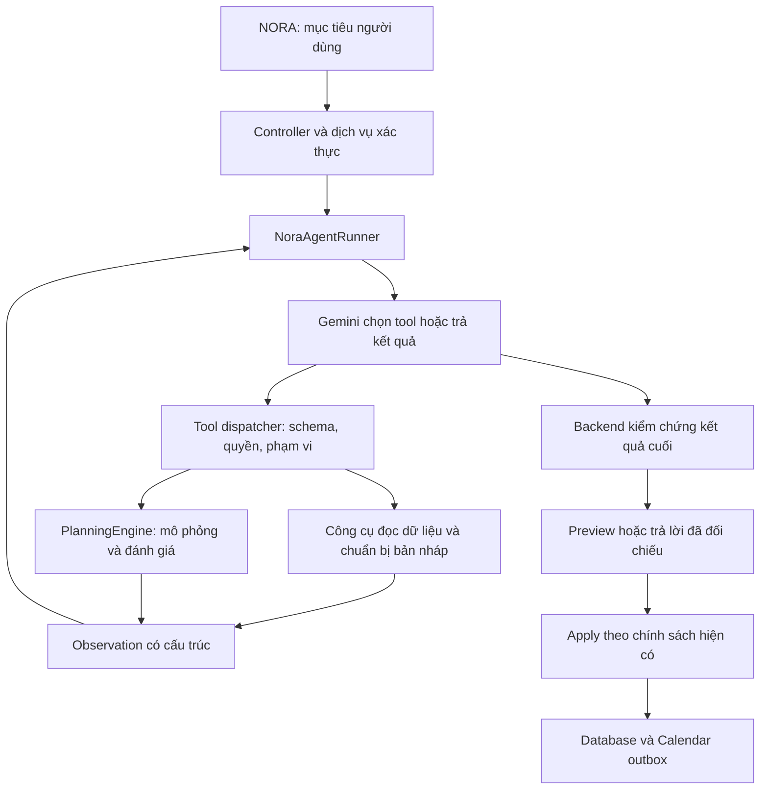

# Kế hoạch chuyển NORA từ workflow AI sang agent hoạch định

Ngày lập: 31/10/2026 — Asia/Ho_Chi_Minh.

Trạng thái: **kế hoạch triển khai, chưa thực hiện nâng cấp**. Căn cứ: [rà soát kiến trúc theo source](../reviews/NORA_AGENT_ARCHITECTURE_AUDIT_2026-10-31.md). Kế hoạch này thay thế đề xuất agent loop ngày 07/10/2026 về thứ tự thực hiện, nhưng không thay đổi các bằng chứng kiểm thử lịch sử.

## 1. Kết quả cần đạt

NORA nhận một mục tiêu, chọn công cụ, nhận kết quả thực thi và quyết định hành động tiếp theo cho đến khi có phương án đã kiểm chứng, cần hỏi người dùng hoặc phải dừng.

Điều kiện để gọi bản nâng cấp là agent không phải số lần gọi model. Phải có bằng chứng model tự thay đổi chuỗi hành động theo observation. Backend thực thi quyền và ràng buộc, nhưng không định sẵn mọi chuỗi đọc lịch → tìm chỗ → mô phỏng → kết thúc.

Mục tiêu ưu tiên cho cuộc thi: **một agent hoạch định có kiểm soát**, không triển khai nhiều agent trao đổi với nhau trong MVP.

Phạm vi MVP:

- Chat xem và phân tích lịch, tạo/xếp công việc, tối ưu lịch hiện có.
- Đọc lịch học, họp, phiên làm việc và giờ rảnh để tìm phương án.
- Mô phỏng lại trong phạm vi cho phép khi phương án đầu chưa phù hợp.
- Hỏi thêm khi thiếu dữ kiện hoặc phương án đòi hỏi quyền thay đổi chưa được cấp.
- Xem trước, áp dụng và hoàn tác qua cơ chế backend hiện có.
- Giữ trải nghiệm ảnh trong chat, hội thoại và giọng nói; chuyển ảnh/voice sang loop theo giai đoạn sau.

Không đưa vào MVP: agent gửi email/tin nhắn, Google Tasks, tự sửa tùy chọn tài khoản, công cụ SQL/shell/URL tùy ý, multi-agent, chuyển frontend/backend sang hai domain hoặc thay provider.

## 2. Những phần giữ lại

| Thành phần | Cách tái sử dụng |
| --- | --- |
| .NET 8, frontend React, same-origin deployment | Giữ cách đăng nhập, triển khai và cấu trúc UI. |
| Gemini 3.8 Flash qua Vertex AI | Giữ model và xác thực hiện tại; thêm adapter cho tương tác công cụ nhiều lượt. |
| `PlanningEngine` và scoring/repair/urgency/protection | Giữ làm bộ tính toán và kiểm tra nghiệp vụ. Không chuyển phép tính thời gian sang LLM. |
| `AgentTurn`, `AgentConversation` | Giữ lịch sử chat, request idempotency và trạng thái hiển thị. |
| `AgentService` apply/undo, revision và transaction | Tách phần dùng chung thành dịch vụ áp dụng draft/proposal, không viết một đường lưu lịch bỏ qua kiểm tra cũ. |
| SSE, preview card và so sánh giờ cũ/mới | Mở rộng bằng tool events; kết quả cuối vẫn tương thích `AgentTurnView`. |
| Hạn mức, token ledger và quyền sở hữu dữ liệu | Tính chi phí từng lượt model, thêm giới hạn cho toàn run. |
| Google Calendar outbox | Chỉ phát sinh đồng bộ từ thay đổi lịch đã commit, không đồng bộ ứng viên thử. |

Đặc biệt: không gọi `GeneratePlanAsync` để thử mọi ứng viên vì hàm hiện tại ghi `PlanProposal`. Tool mô phỏng phải gọi pure engine trên draft/snapshot; chỉ materialize proposal được chọn sau khi kiểm tra.

## 3. Kiến trúc đích



Backend luôn có quyền từ chối hoặc dừng. Agent không tự mở rộng quyền khi gặp bế tắc.

## 4. Danh sách công cụ

Các tên và contract dưới đây là thiết kế mới, chưa tồn tại trong source hiện tại.

| Tool | Input chính | Observation trả về | Tác động |
| --- | --- | --- | --- |
| `get_tasks` | ID hoặc tên cần tìm, trạng thái, phạm vi deadline | Task ID, thời lượng còn lại, priority, deadline, dependency; báo rõ khi trùng tên | Chỉ đọc. |
| `get_calendar` | Bắt đầu/kết thúc trong phạm vi cho phép | Sự kiện, phiên, khóa/đang chạy, giờ bận và revision | Chỉ đọc. |
| `get_preferences` | Không nhận user ID | Múi giờ, giờ rảnh, giới hạn phiên/ngày, thời gian nghỉ và giờ ưu tiên | Chỉ đọc. |
| `find_free_slots` | Phạm vi và điều kiện thời lượng | Khoảng trống và giới hạn thực tế; không khẳng định task chắc chắn vừa nếu chưa kiểm tra đầy đủ | Chỉ tính toán. |
| `prepare_task` | Tạo mới hoặc sửa task được chỉ định, thông tin có căn cứ từ yêu cầu | Draft ID, trường còn thiếu, task gốc nếu có | Chỉ sửa bản nháp của run. |
| `prepare_event` | Tạo/sửa sự kiện được yêu cầu rõ, giờ và recurrence | Draft event ID, xung đột/điều kiện cần xác nhận | Chỉ sửa bản nháp của run. |
| `simulate_plan` | Draft IDs, phạm vi, affected task IDs và chiến lược được phép | Candidate ID, lịch đề xuất, phần thiếu, cảnh báo, diff và revision | Chưa lưu lịch/proposal. |
| `evaluate_candidate` | Candidate ID do server cấp | Ràng buộc đạt/chưa đạt, thời lượng chưa xếp, việc trễ hạn và diff | Chỉ kiểm tra. |
| `analyze_workload` | Phạm vi và draft IDs tùy chọn | Khả năng thực hiện, nhu cầu, rủi ro từ engine | Chỉ tính toán. |

Quy định contract:

- `UserId` lấy từ phiên đăng nhập, không do model cung cấp. ID trong tool phải thuộc tài khoản và đúng run.
- Tool trả `status`, `data`, `warnings`, `errorCode`, `snapshotRevision`, thông tin phân trang/truncated khi có; dùng lỗi có cấu trúc cho các tình huống có thể khắc phục.
- Mô phỏng lại được phép thay thứ tự/chiến lược hoặc phạm vi affected trong phần người dùng đã cho phép. Không được tự tăng thời lượng khả dụng, đổi deadline, hạ độ khẩn hoặc chuyển việc sang ngoài ngày yêu cầu.
- Đổi cách chia phiên chỉ khi người dùng đã cho phép. Trường hợp chưa rõ phải hỏi, không tự hiểu “90 phút” là chắc chắn liên tục hoặc chắc chắn được chia.
- Phiên khóa, đang chạy, lịch học/họp được bảo vệ. Tool trả rõ phạm vi dịch chuyển thực tế và yêu cầu xác nhận khi engine đề xuất dời lịch linh hoạt.
- `evaluate_candidate` có thể do model lựa chọn để lấy observation. Ngoài ra backend **luôn kiểm tra cuối** dù model bỏ qua tool này.
- Không dùng một lời trả lời từ model làm bằng chứng đã tạo task hoặc lưu lịch.

MVP không cho model gọi trực tiếp `apply_proposal` hoặc `undo_change`. Model vẫn là agent nhờ tự điều phối các công cụ đọc/draft/mô phỏng. Lưu và hoàn tác đi qua các nút/API hiện có cùng quyền người dùng. Có thể mở thêm tool ghi về sau khi đã có kiểm thử quyền và idempotency tương ứng.

## 5. Giao thức model và vòng lặp

Ưu tiên native function calling của Gemini, triển khai bằng HTTP adapter .NET hiện có, không thêm framework agent chỉ để có tên framework. Giữ GenerateContent/Vertex endpoint đang dùng trong MVP; không chuyển đồng thời sang Interactions API. Google có tài liệu riêng về [function calling trên Cloud](https://docs.cloud.google.com/gemini-enterprise-agent-platform/models/tools/function-calling), [reference GenerateContent function calling](https://docs.cloud.google.com/gemini-enterprise-agent-platform/reference/models/function-calling) và [Gemini API function calling](https://ai.google.dev/gemini-api/docs/function-calling).

Điểm kỹ thuật phải làm:

- Request tool round có function declarations phù hợp; không tái sử dụng nguyên schema `AgentIntent` bắt model phải trả mọi collection trong mỗi lượt.
- Parse các phần model content/function call, kiểm tra tên và arguments rồi đưa observation tương ứng trở lại model; khớp call ID khi provider trả ID.
- Giữ model content và các signature/metadata cần thiết cho lượt tiếp theo; không chỉ ghép các phần `text` như interpreter hiện tại. Xác minh theo [tài liệu thinking và signature của Google](https://ai.google.dev/gemini-api/docs/thinking). Không hiển thị reasoning nội bộ hoặc opaque signatures lên UI.
- Function calling với Vertex v1/Express + model đang cấu hình là một cổng kiểm chứng thực tế trước rollout. Không mặc định mọi mẫu Developer API áp dụng nguyên xi cho Cloud.
- Kết quả kết thúc được chuẩn hóa thành `ANSWER`, `QUESTION`, `PROPOSAL` hoặc `BLOCKED`. Proposal phải trỏ Candidate ID hợp lệ; backend lấy lịch từ candidate, không lấy một lịch model tự viết trong prose.
- Dùng schema terminal riêng hoặc terminal control message đã kiểm tra; không parse lời tự do như “đã lưu” thành lệnh ghi dữ liệu.
- Thời gian hiện tại/ngày mai do server cung cấp theo múi giờ tài khoản. Cải thiện guard 12 giờ: “12 giờ trưa” phải đi thẳng, cách hỏi giờ mơ hồ không được sinh nhãn 12 giờ khó hiểu.

Pseudocode:

```text
reserve run + idempotency key
load minimal trusted context, clock, scope, permissions and tool definitions
repeat while budget remains:
    decision = model.next(messages, availableTools)
    if decision contains tool calls:
        validate name, parameters, ownership and permitted scope
        execute bounded tool on account snapshot/draft
        record result; send matching observation back to model
        continue
    validate terminal decision against facts and selected candidate
    return verified answer/question/proposal/blocked
stop with bounded result; never report success without verified evidence
```

Không hardcode bắt buộc mọi run phải gọi đủ tất cả tool theo một thứ tự. Backend có thể yêu cầu dữ kiện bắt buộc và kiểm tra cuối mà không định sẵn chiến lược tìm phương án.

## 6. Trạng thái, bộ nhớ và tiếp tục hội thoại

Đề xuất thêm hai entity, không thay thế dữ liệu hội thoại đang có:

- `AgentRun`: user, conversation, turn/request IDs, mục tiêu, phạm vi/đồng ý hiện có, expected revision, trạng thái, candidate được chọn, counters và timestamps.
- `AgentToolCall`: run, sequence, provider call ID, tên tool, arguments/result đã chuẩn hóa có giới hạn, trạng thái và thời gian. Unique key chống thực hiện lại.

Các trạng thái: `RUNNING`, `WAITING_FOR_INPUT`, `AWAITING_CONFIRMATION`, `COMPLETED`, `BLOCKED`, `FAILED`, `CANCELLED`, `EXPIRED`.

`COMPLETED` cho tác vụ chỉ đọc không có nghĩa lịch đã lưu. Tác vụ ghi cần `AWAITING_CONFIRMATION`/proposal rồi trạng thái apply đã xác nhận. UI cuối vẫn phân biệt `ANSWERED`, `NEEDS_INPUT`, `PREVIEW`, `APPLIED`, `BLOCKED` như hiện tại.

Khi trả lời câu hỏi làm rõ:

- Liên kết đúng run đang chờ và câu hỏi; không lặp lại hành động của turn đã áp dụng.
- Nạp trạng thái lịch mới, kiểm tra revision và lập lại candidate nếu dữ liệu đã đổi.
- Giữ counters và quyền của mục tiêu; không tạo run mới để lách giới hạn.
- Không giữ transaction hoặc lease concurrency trong lúc chờ người dùng. Proposal vẫn có hạn dùng và được kiểm tra lại lúc apply.

Model chỉ được nhận ngữ cảnh liên quan. Không gửi toàn bộ tool transcript hoặc lịch nhiều năm trong mọi request. Metadata công cụ có thể giữ để audit; nội dung cá nhân phải có giới hạn lưu trữ và tuân theo cơ chế xóa/export hội thoại.

Migration entity, retention và index là công việc triển khai sau khi plan được thực hiện; lần lập plan này không chạy migration.

## 7. Ngân sách và hành động ghi

Giá trị khởi đầu để đo, không phải cam kết hiệu năng:

| Giới hạn | Giá trị đề xuất |
| --- | --- |
| Lượt model cho một mục tiêu | Tối đa 8, tính cả lượt kết thúc |
| Lần gọi tool | Tối đa 12 |
| Mô phỏng lịch | Tối đa 3 ứng viên |
| Thời gian xử lý chủ động | Tối đa 120 giây; không tính thời gian chờ người dùng |
| Thời gian một lượt model | Tối đa 45 giây và không vượt ngân sách còn lại |
| Tool call lỗi trùng arguments | Không thực thi lặp vô hạn; dùng kết quả cache hoặc trả lỗi và dừng sau ngưỡng |
| Tiếp tục sau câu hỏi | Tối đa 3 lượt bổ sung trong cùng mục tiêu, có thông báo khi hết giới hạn |

Counters được kiểm tra phía server trước mỗi thao tác. Hết budget trả kết quả có căn cứ hoặc thông báo chưa hoàn tất, không tự lưu candidate chưa kiểm chứng.

Tích hợp `AiUsageService`: mỗi lượt provider vẫn có reservation và ledger token/latency riêng. Run có lease riêng để tránh hai request tiếp tục cùng run. Không bọc toàn bộ run trong `RunAsync` rồi lại reserve từng lượt bên trong, gây tính quota hoặc concurrency sai. Hủy stream vẫn phải settle các lượt provider đã chạy.

Tự động lưu:

- Giữ tùy chọn người dùng; không âm thầm đổi mặc định của toàn ứng dụng.
- Trong giai đoạn đầu kiểm chứng tool loop, chức năng mới chỉ tạo preview.
- Trước rollout đầy đủ, ghép lại policy hiện có: trường hợp được phép auto-save có thể áp dụng sau kiểm tra; tối ưu và dịch chuyển cần xác nhận vẫn chờ xác nhận.
- Model không quyết định bỏ yêu cầu xác nhận; backend quyết định từ loại thay đổi và policy.
- Một transaction áp dụng draft đã chọn; reuse revision/idempotency/undo. Các tool đọc và thử lịch không tạo task/event/session thật.

## 8. Các giai đoạn triển khai

| Giai đoạn | Việc cần làm | Tiêu chí hoàn thành |
| --- | --- | --- |
| P0 — Chốt contract và baseline | Chuẩn hóa mục tiêu/phạm vi/quyền; định nghĩa tools, terminal outputs, state và fixture dữ liệu; giữ kết quả workflow làm baseline | Có contract và test matrix, chứng minh bộ test phân biệt được workflow cũ với agent loop. |
| P1 — Adapter function calling và runner | Thêm adapter cho Gemini; parse call/result/signatures; runner, budgets, cancellation, duplicate protection; mock provider nhiều lượt | Model giả chọn được tool khác nhau theo observation; tool lạ hoặc final không có căn cứ bị từ chối. |
| P2 — Tools và draft planning | Bọc read services; tách builder draft/candidate khỏi `AgentChangeSet` private; dùng pure engine; scope, selected tasks, urgency và dependency validation | Thử nhiều ứng viên không tạo dữ liệu thật; ID/phạm vi đúng; không đổi lịch học, deadline hoặc phiên được bảo vệ. |
| P3 — Lifecycle và apply/undo | Thêm run/tool storage, migration trong test DB, resume clarification, stale revision, reuse apply/undo và Calendar outbox | Hủy/retry/resume không tạo trùng; chờ xác nhận hoạt động; undo đúng; dữ liệu cũ vẫn đọc được. |
| P4 — UI NORA và khả năng quan sát | Phát tool events thật qua SSE; hiển thị “Đã đọc lịch”, “Đang thử phương án”; preview, hỏi lại và budget message | Timeline khớp tool thực thi, không giả lập suy nghĩ; giữ nguyên ảnh, bản nháp và hội thoại; đủ dùng trên mobile. |
| P5 — Eval, tích hợp thực và rollout | Chạy regression, paired scenarios, live Google có kiểm soát; so sánh workflow/agent về task success, đúng policy, latency, token và lượt tool | Có trace và báo cáo theo kịch bản; test bắt buộc đạt; feature flag và rollback đã kiểm chứng. |

Phụ thuộc: P0 → P1 → P2 → P3 → P4 → P5. Không chuyển traffic chat thật sang runner khi chỉ có adapter function calling nhưng chưa có validator và đường apply an toàn.

Mốc đầu tiên có giá trị để demo: hết P2 có agent mô phỏng với trace trên dữ liệu fixture. Mốc dùng với tài khoản demo thật: qua P3–P5. Đây là trình tự công việc, chưa cam kết ngày hoàn thành khi chưa có hạn thi và nhân lực.

## 9. Danh sách file/module dự kiến

| Vị trí | Thay đổi |
| --- | --- |
| `Application/Workspace/AgentRuntimeContracts.cs` | Mới: decision, tool definition/call/result, scope, budget, final outcome. |
| `Application/Workspace/INoraAgentModel.cs` | Mới: giao thức model nhiều lượt, độc lập EF/HTTP. |
| `Infrastructure/Workspace/NoraAgentRunner.cs` | Mới: vòng điều phối, checkpoints, kết thúc và giới hạn. |
| `Infrastructure/Workspace/NoraToolRegistry.cs` | Mới: catalog và dispatch tường minh theo allowlist. |
| `Infrastructure/Workspace/AgentTools/` | Mới: công cụ đọc, draft, simulate/evaluate và workload. |
| `Infrastructure/Workspace/GeminiAgentModel.cs` | Mới: function calls, observations, signature retention, model config hiện có. |
| `Infrastructure/Workspace/AgentDraftPlanning.cs` | Mới/tách từ service: draft changes và candidate validator dùng lại. |
| `Infrastructure/Workspace/AgentService.cs` | Làm cầu nối turn/conversation → runner → `AgentTurnView`; tách apply/undo dùng chung khi cần. |
| `Infrastructure/Workspace/AgentInterpreter.cs`, `TaskInterpreter.cs` | Giữ adapter workflow cho rollback, ghi chú, vision/voice; không xóa ngay. |
| `Domain/Entities/AgentRun.cs`, `AgentToolCall.cs` | Mới: lifecycle/trace có ownership và index. |
| `Persistence/Configurations`, migration | Model/index, retention và migration nâng cấp, kiểm thử SQL Server. |
| `Infrastructure/DependencyInjection.cs` | Đăng ký runner, adapter, registry, options và repositories cần thiết. |
| `frontend/src/agent-stream.js`, `agent.jsx` | Nhận tool event, nối run đang chờ; tương thích event/result cũ. |
| `frontend/src/nora-progress.jsx`, result/schedule cards | Timeline hành động và proposal từ candidate; không lộ metadata provider nội bộ. |
| `tests/SPWPOS.UnitTests`, `IntegrationTests`, `frontend/tests` | Contract, nhiều lượt model, tools, DB concurrency, UX và regression. |

Không để class mới gọi hàm private bằng reflection hoặc gọi ngược controller HTTP nội bộ. Tách phần cần dùng thành interface/service có trách nhiệm rõ ràng.

## 10. Bộ kiểm thử và bằng chứng agent

### Các cặp tình huống bắt buộc

1. Cùng yêu cầu làm slide 90 phút: một lịch có slot liên tục → model hoàn tất sớm; lịch khác thiếu chỗ → model đọc thêm/mô phỏng lại hoặc hỏi điều kiện cần thiết.
2. Cùng mục tiêu tối ưu: một lịch đã hợp lý → trả không có thay đổi; lịch khác có việc khẩn chưa được xếp → model chọn mô phỏng và kiểm tra phương án.
3. Công cụ trả `INSUFFICIENT_CAPACITY`: model chọn hành động tiếp theo dựa trên dữ liệu thật; không chỉ nhắc lại câu lỗi, không tự nới điều kiện.
4. Công cụ trả `AMBIGUOUS_TASK`: hỏi chọn đúng việc; không sửa nhầm task trùng tên.
5. Công cụ trả `STALE_REVISION`: đọc lại snapshot và mô phỏng lại trong budget, hoặc báo cần thử lại; không áp dụng candidate cũ.

### Ràng buộc và lifecycle

- Không trùng giờ, đúng nghỉ, deadline cứng, giới hạn phiên/ngày, ngày/múi giờ và phụ thuộc.
- Giữ lịch học, phiên khóa/đang chạy, scope ngoài ngày yêu cầu. Không tự tạo giờ rảnh hoặc tự cho phép chia nhỏ.
- Tool arguments giả mạo user/task/candidate ID bị chặn. Chỉ dẫn trong tên việc, ảnh hoặc tool data không đổi tool catalog/quyền.
- Retry cùng request/call ID, gửi đồng thời, refresh/resume, hủy stream, quá timeout, hết quota và hết budget.
- Không tạo dữ liệu thật khi simulate; confirm chỉ áp dụng đúng candidate; một Calendar outbox tương ứng thay đổi đã commit; undo đúng phiên bản.
- Không tuyên bố “đã lưu” khi chỉ có proposal hoặc tool lỗi.
- Giữ regression workflow cũ, ghi chú, ảnh giữ trong chat, giọng nói và admin privacy.

### Cách đo

- Pass/fail các kiểm tra bắt buộc phía backend; lỗi vi phạm ràng buộc là blocker rollout.
- Task success theo từng kịch bản, số hỏi lại không cần thiết, số tool/model calls, số candidate, latency và token/chi phí nếu có dữ liệu provider.
- Phân biệt test mock với live model; công bố tập dữ liệu, model/config, số lần chạy và kết quả thất bại. Chưa có đo thì không đưa tỷ lệ thành công hoặc cải thiện.
- Trace phải chỉ ra các nhánh khác nhau do model chọn từ observation. Không hardcode chuỗi tool trong test live rồi gọi đó là bằng chứng tự chủ.

## 11. Rollout và hoàn tác

Đề xuất option `NoraAgent:Mode = Workflow | Shadow | Agent`, mặc định `Workflow` cho đến khi kiểm chứng:

- `Workflow`: giữ luồng hiện tại.
- `Shadow`: agent chỉ mô phỏng trên snapshot/draft và ghi kết quả đánh giá; không ghi lịch hoặc nhân đôi actions. Chỉ bật cho tài khoản demo/test đã chọn, không âm thầm tăng gấp đôi số lượt AI toàn bộ người dùng.
- `Agent`: dùng runner cho phạm vi chat đã được chuyển đổi; tính năng chưa chuyển vẫn đi theo luồng đã ghi rõ.

Giai đoạn chuyển tiếp không được âm thầm fallback sang workflow có ghi dữ liệu sau khi agent đã tác động. Khi lỗi sau proposal/apply, trả trạng thái và hướng phục hồi theo run; feature flag rollback phải bảo toàn dữ liệu đã lưu.

Migration là additive. Kiểm tra schema trước restart, smoke test localhost, giữ bản API trước khi triển khai. Không cần sửa thông tin đăng nhập, cấp lại Google credential hay đổi domain để thực hiện kế hoạch này.

## 12. Kịch bản demo cho cuộc thi

Prompt đầy đủ để tránh tranh luận về dữ kiện thiếu:

> “Ngày mai tôi cần làm slide liên tục 90 phút, bắt buộc hoàn thành trước 12 giờ trưa. Giữ nguyên lịch học. Nếu cần, hãy đề xuất dời các phiên làm việc linh hoạt khác trong ngày, nhưng chờ tôi xác nhận trước khi lưu.”

Dùng hai bộ fixture cùng giờ rảnh và prompt nhưng khác lịch đã lưu:

- A: có slot đủ 90 phút → agent tìm và đề xuất trực tiếp.
- B: slot bị phiên linh hoạt chiếm → tool báo thiếu chỗ; agent kiểm tra task liên quan và mô phỏng có dời phiên trong phạm vi được phép, rồi đánh giá và trình bày diff.
- C bổ sung: không còn phương án hợp lệ hoặc phiên chiếm chỗ đã khóa → agent nói rõ và hỏi lựa chọn, không cố phá điều kiện.

Màn hình demo hiển thị tool thật, kết quả rút gọn, proposal và xác nhận/undo. Hội đồng có thể đổi dữ liệu để kiểm tra agent không chạy một kịch bản cố định.

Tiêu chí nghiệm thu cuối: **model điều phối được chuỗi công cụ theo observation; backend bảo đảm phương án và hành động được phép; kết quả và trace đối chiếu được với dữ liệu thực tế.**
