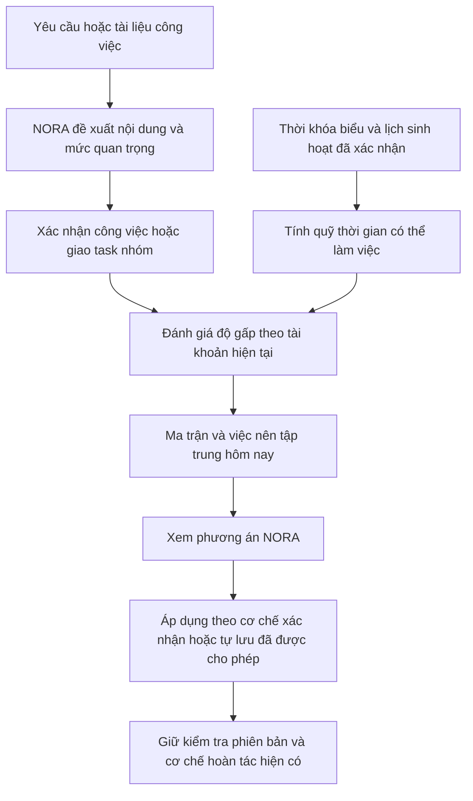

# PLANORA — Kế hoạch thực thi Eisenhower cho NORA và lập lịch cá nhân

Ngày lập: **02/11/2026**, múi giờ `Asia/Ho_Chi_Minh`.

Trạng thái: **đã triển khai và kiểm chứng EIS-01 đến EIS-08 trên local**. Thiết kế dưới đây được giữ làm hồ sơ quyết định; những điều chỉnh thực tế được ghi tại cuối tài liệu. Hướng dẫn chức năng hiện hành: [EISENHOWER.md](../features/EISENHOWER.md).

## 1. Kết quả sản phẩm cần đạt

Người dùng gửi thời khóa biểu và xác nhận lịch sinh hoạt như hiện tại. Khi có công việc mới, NORA hiểu yêu cầu, đề xuất mức quan trọng và giải thích. Hệ thống tính độ gấp theo lịch thực tế, hiển thị bốn nhóm Eisenhower và dùng kết quả để cải thiện phương án làm việc. Không thêm bước bắt người dùng tự điền ma trận hoặc nhập giờ rảnh.

Luồng đích:

Riêng task nhóm: leader tạo/giao task không đồng nghĩa đã nhận task hoặc đã lưu lịch của member. Người được phép nhận vẫn đi qua bước nhận việc và xác nhận phương án cá nhân hiện tại.

| Ô | Nhãn trong sản phẩm | Hành vi |
| --- | --- | --- |
| Q1 | Làm trước | Ưu tiên xem xét lịch sớm; cảnh báo thiếu quỹ thời gian. |
| Q2 | Chủ động lên lịch | Đề xuất phiên làm sớm, tránh dồn sát hạn. |
| Q3 | Xử lý / phân công phù hợp | Giữ deadline đã cam kết; leader có thể dùng chức năng chỉ định người nhận. |
| Q4 | Có thể để sau | Giữ task để người dùng cân nhắc; không tự xóa hoặc hủy. |
| Chưa xác định | Cần làm rõ | Thiếu căn cứ quan trọng hoặc thiếu dữ liệu đánh giá độ gấp; không ép vào một trong bốn ô. |

## 2. Ràng buộc phải giữ

- Giữ **Gemini 3.8 Flash**; không đổi model hoặc gọi model trên mỗi lần tải bảng task.
- Giữ nguyên Notes, file leader, file báo cáo member, link nhóm, chat, avatar và luồng duyệt hai bước.
- Giữ lịch cố định, giờ sinh hoạt đã xác nhận, phiên khóa, phiên đang chạy/tạm dừng và ràng buộc deadline/phụ thuộc.
- Chỉ leader được tạo/giao/chuyển người nhận task nhóm. Chỉ người được chỉ định được nhận task đó.
- Không chia sẻ lịch, khoảng rảnh, điểm độ gấp hoặc lý do liên quan lịch riêng của member cho leader/thành viên khác.
- Xem ma trận, phân loại hoặc nhận thông báo không tự tạo task, nhận task, đổi deadline hoặc thay lịch.
- Hỗ trợ cơ chế tự lưu đã được người dùng cho phép; riêng xác nhận nhận task nhóm vẫn giữ quy trình hiện hành. Khi áp dụng cần kiểm tra lại tính khả thi và phiên bản.
- Không gán việc học, ăn uống, nghỉ ngơi, ngủ vào Q4 để lấy chỗ làm việc. Ma trận chỉ áp dụng cho công việc cần quản lý.

## 3. Hiện trạng và điểm tích hợp đã đối chiếu

| Thành phần hiện tại | Hướng mở rộng |
| --- | --- |
| `WorkTask`, `TaskInput`, `TaskView` | Bổ sung mức quan trọng và nguồn đánh giá; giữ các field cũ tương thích. |
| `TeamTask`, `SharedTaskView` | Bổ sung mức quan trọng chung do leader xác nhận; không lưu một độ gấp cá nhân dùng chung cho cả nhóm. |
| `PlanningEngine.Remaining` | Tái sử dụng cách tính thời lượng còn lại hiện hành; không đổi ngầm sang lấy thời gian đã ngồi làm để suy ra hoàn thành. |
| `PlanningEngine.Analyze`, `CapacityDays`, `FocusSlots`, `Generate` | Tái sử dụng quỹ thời gian, khả năng xếp và lý do không khả thi; tránh viết bộ tính lịch song song. |
| `PlanningUrgency`, `PlanningProtection`, `PlanningScoring` | Tích hợp ưu tiên mới sau khi có kiểm thử bảo toàn ràng buộc. |
| `AgentTaskCommand`, `AgentService`, `TeamBriefInterpreter`, `TeamBriefService` | Bổ sung kết quả phân loại vào cùng lần phân tích task/file hiện tại. |
| `page-tasks.jsx`, `dashboard.jsx`, `team-task-board.jsx`, `team-task-detail.jsx` | Bổ sung chế độ ma trận, khối tập trung hôm nay và giải thích trong popup hiện có. |
| `TeamTaskRecipients`, `PrivateTeamClaims` | Tái sử dụng quyền giao đích danh, preview, confirm, stale, trả việc và hoàn tác. |
| `NotificationAdminService` và hàng đợi Telegram hiện tại | Thêm thông báo chuyển sang khẩn cấp có chống gửi trùng. |

**Lưu ý bắt buộc:** hiện `Priority == 4` ảnh hưởng đến thứ tự lập lịch và bảo vệ deadline. Không ánh xạ Q1/Q2/Q3/Q4 thành Priority 4/3/2/1. Giữ `Priority` và `IsHardDeadline` hiện tại trong đợt đầu, đánh giá Eisenhower là dữ liệu riêng.

## 4. Quy tắc nghiệp vụ được chốt cho bản đầu

### 4.1. Mức quan trọng

Ba giá trị: `Important`, `Lower`, `Unknown`. `Lower` nghĩa là mức ảnh hưởng thấp hơn, không có nghĩa được phép bỏ nghĩa vụ.

NORA xem xét mục tiêu, đầu ra bắt buộc, hậu quả khi không hoàn thành, vai trò đối với dự án và quan hệ chặn công việc khác. Không kết luận quan trọng chỉ vì có chữ “gấp”, deadline gần hoặc task đang được leader giao đích danh.

Kết quả AI gồm mức đề xuất, lý do ngắn, bằng chứng từ yêu cầu/tài liệu và độ tin cậy. Ngưỡng ban đầu đề xuất: dưới `0.8` hoặc thiếu căn cứ thì `Unknown`; chỉ hỏi làm rõ qua chat khi cần. Không chặn tạo một task hợp lệ chỉ vì chưa phân loại được mức quan trọng. Không biến mọi task cũ thành quan trọng từ Priority hiện có.

Trong bản nháp mới, người dùng/leader nhìn thấy phân loại đề xuất cùng nội dung và thời lượng trước khi xác nhận. Có thể điều chỉnh bằng lời: “Việc này là đầu ra bắt buộc để nộp môn học”. Không yêu cầu nhập thêm một bộ form điểm số.

### 4.2. Độ khẩn cấp

Giá trị: `Urgent`, `NotUrgent`, `Unknown`. Tính bằng quy tắc hệ thống, không giao cho LLM tự đoán quỹ thời gian.

Dùng cùng một thời điểm `now`, múi giờ, horizon và snapshot cho toàn bộ một lần đánh giá. Dùng thời lượng còn lại theo engine hiện tại. Chỉ tính task lá chưa hoàn thành/chưa hủy/chưa xóa, tránh đếm cả công việc cha và các việc con.

Tín hiệu khởi điểm:

1. Task đã quá hạn nhưng còn việc: khẩn cấp và kèm `OVERDUE`; không tự dời deadline hoặc hứa có thể hoàn thành đúng hạn.
2. Phương án kiểm tra không xếp đủ trước hạn: khẩn cấp kèm lý do thiếu quỹ thời gian/phiên liên tục/phụ thuộc. Phân biệt thiếu dữ liệu với thực sự thiếu thời gian.
3. Quỹ dự phòng trước hạn thấp: khẩn cấp. Bộ tính phải xét tổng nhu cầu cạnh tranh trước cùng hạn, không so từng task độc lập với toàn bộ quỹ rảnh.
4. Deadline trong 24 giờ: tín hiệu khẩn cấp ban đầu, độc lập với mức quan trọng. Đặt ngưỡng trong chính sách có phiên bản và kiểm thử, không thêm cấu hình bắt buộc cho người dùng.
5. Task ngoài horizon hỗ trợ, chưa có thời khóa biểu/giờ sinh hoạt phù hợp, thiếu deadline hoặc thiếu thời lượng: `Unknown`, kèm lý do cần làm rõ. Không tự gán `NotUrgent`.

Ngưỡng dự phòng khởi điểm đề xuất: thấp hơn hoặc bằng `max(độ dài phiên tối thiểu hợp lệ, 25% nhu cầu còn lại của tập việc xét)`. Khi hiện thực phải chuẩn hóa cách đếm nhu cầu/quỹ thời gian với engine: các phiên đã xếp hợp lệ được tính đúng một lần, phiên được bảo vệ của việc khác chiếm chỗ, không đếm trùng khoảng rảnh. Kiểm chứng bằng các ca cạnh tranh nhiều task trước khi bật quy tắc này.

V1 đánh giá chính xác trong horizon hiện được bộ lập lịch hỗ trợ, tối đa 30 ngày cho luồng nhận task nhóm. Các hạn xa hơn hiển thị giới hạn đánh giá; không mở rộng horizon lên một năm chỉ để phân loại.

### 4.3. Ghép thành ma trận

| Quan trọng | Khẩn cấp | Kết quả |
| --- | --- | --- |
| Important | Urgent | Q1 |
| Important | NotUrgent | Q2 |
| Lower | Urgent | Q3 |
| Lower | NotUrgent | Q4 |
| Unknown hoặc urgency Unknown | Bất kỳ | Chưa xác định; vẫn hiển thị tín hiệu đã biết. |

Ngoài ô ma trận, trả riêng `AtRisk`, `Overdue`, `Blocked`, `NeedsClarification`. Ví dụ task Q3 vẫn có thể đang có nguy cơ trễ và phải được xử lý.

### 4.4. Task nhóm và tính cá nhân

- Mức quan trọng chung thuộc leader. Sau khi nhận task, đánh giá quan trọng riêng của member, nếu có, chỉ ảnh hưởng thứ tự cá nhân; không sửa hợp đồng task chung.
- Task đã nhận dùng `WorkTask` liên kết assignment; không đếm thêm bản `TeamTask` tương ứng.
- Task được chỉ định nhưng chưa nhận hiển thị mục **Cần nhận task**, tách với công việc đã nhận. Đánh giá trước khi nhận là phương án dự kiến, không được trình bày như lịch đã cam kết.
- Khi xây đánh giá quỹ thời gian cho các task được chỉ định, xét cả tập nghĩa vụ đang chờ nhận của chính tài khoản để không kết luận nhiều task cùng khả thi từ một khoảng trống. Dùng dữ liệu ứng viên trong bộ nhớ, không tạo `WorkTask`/`WorkSession` thật. Không tính task mở cho cả nhóm chưa có ai nhận vào nghĩa vụ của mọi member.
- Task `PendingReview`: việc cần hành động là leader duyệt. Không lấy toàn bộ thời lượng thực hiện ban đầu để lập lịch member lần nữa. Bản đầu hiển thị trong mục **Chờ bạn duyệt**, chưa tự ước lượng thời lượng duyệt.
- Q3 không tự ủy quyền: leader dùng chọn người nhận hiện có; member chỉ có gợi ý trao đổi/yêu cầu đổi người. Không suy đoán “ai đang rảnh” từ lịch riêng của người khác.

## 5. Thiết kế dữ liệu và API đề xuất

### 5.1. Dữ liệu lưu và dữ liệu tính

Migration đầu chỉ thêm dữ liệu quan trọng, nullable/default Unknown, không sửa Priority hoặc lịch cũ:

| Đối tượng | Dữ liệu đề xuất |
| --- | --- |
| `WorkTask` | `ImportanceLevel`, `ImportanceSource`, `ImportanceReason`, `ImportanceConfidence`, `ImportanceConfirmedAt`. Với việc nhóm, giá trị cá nhân chưa đặt sẽ kế thừa mức chung qua assignment đang hoạt động. |
| `TeamTask` | Các trường quan trọng chung tương ứng, do leader xác nhận. |
| DTO đánh giá, không phải field chung của task | `Quadrant`, `Urgency`, `ReasonCodes`, `Explanation`, `RemainingMinutes`, `CapacityMinutes`, `AtRisk`, `EvaluatedAt`, `NextEvaluationAt`, `AssessmentRevision`, `PolicyVersion`. |
| Giai đoạn thông báo | `PriorityAlertState` thuộc tài khoản: khóa công việc, trạng thái trước, lần chuyển trạng thái và episode chống trùng. |

`ImportanceReason`/bằng chứng giới hạn độ dài; confidence nullable, trong khoảng 0–1. `User`/`Leader` xác nhận được ưu tiên hơn đề xuất AI. Thay mô tả tạo đề xuất phân loại mới, không âm thầm ghi đè đánh giá đã xác nhận. Task cũ được đưa vào “Chưa xác định”; phân loại dần qua các lần tương tác hoặc thao tác phân tích rõ ràng.

Không lưu một trường `TeamTask.Quadrant` dùng chung cho nhóm. Không trả `CapacityMinutes` hay lý do lịch riêng trong DTO dùng chung.

### 5.2. API mới hoặc mở rộng

| API đề xuất | Hành vi và quyền |
| --- | --- |
| `GET /api/eisenhower` | Ma trận của tài khoản đăng nhập, phân trang/lọc horizon; chỉ đọc dữ liệu. Không nhận `userId` để xem hộ tài khoản khác. |
| `GET /api/tasks/{id}/eisenhower` | Giải thích cá nhân cho task thuộc tài khoản. |
| `GET /api/teams/tasks/{id}/eisenhower` | Đánh giá riêng của người đang nhận/được chỉ định, hoặc ứng viên tự nhận hợp lệ; không cho leader đọc đánh giá của member khác. |
| Bản nháp task cá nhân, task nhóm, file brief | Mở rộng kết quả phân tích bằng các field quan trọng optional. Giữ client và draft cũ hoạt động. |
| Lệnh chat điều chỉnh mức quan trọng | Đi qua validation/version hiện có; không tự sửa deadline/thời lượng. Có endpoint metadata hẹp nếu cần để UI gọi cùng service. |
| Cập nhật mức quan trọng chung của task nhóm | Chỉ leader. Tách với override cá nhân của member. |

Mọi payload phải có giới hạn, kiểm tra quyền sở hữu/membership và phiên bản. Lệnh sửa đánh giá không được sửa người nhận, nội dung hợp đồng hoặc lịch qua đường tắt.

## 6. Backlog thực thi theo thứ tự

### EIS-01 — Nền dữ liệu, contract và cờ tính năng

- [x] Thêm enum/field quan trọng vào domain và mapping EF, migration additive.
- [x] Mở rộng `TaskView`, `SharedTaskView`, contract bản nháp bằng optional fields; thêm `EisenhowerContracts.cs`.
- [x] Xây resolver ưu tiên xác nhận cá nhân → mức chung kế thừa → Unknown, kiểm tra assignment/membership còn hiệu lực.
- [x] Thêm cờ riêng cho hiển thị ma trận, thay đổi chính sách xếp lịch và thông báo; mặc định tắt tác động lịch/thông báo.
- [x] Kiểm thử migration trên SQL tạm, dữ liệu cũ, JSON draft cũ và đọc/ghi metadata đúng quyền.

**Hoàn tất khi:** dữ liệu hiện tại đọc được, task cũ không bị đổi ưu tiên, không có lịch hoặc notification tự sinh từ migration.

### EIS-02 — Bộ đánh giá xác định và API chỉ đọc

- [x] Thêm `EisenhowerEngine.cs` trong Application; tái sử dụng Remaining/capacity/feasibility hiện có.
- [x] Chuẩn hóa tổng demand, các phiên được bảo vệ và horizon. Chỉ chạy feasibility một lần cho snapshot, không Generate riêng cho từng task.
- [x] Thực hiện quy tắc mục 4; trả lý do và revision có thể kiểm tra lại.
- [x] Thêm service và controller theo quyền ở mục 5.
- [x] Kiểm thử múi giờ, deadline qua nửa đêm, thiếu lịch, zero capacity, task cha/con và nhiều task tranh cùng khoảng trống.

**Hoàn tất khi:** cùng dữ liệu/thời điểm/chính sách cho cùng kết quả; GET không gọi AI, không lưu lịch và không rò dữ liệu tài khoản khác.

### EIS-03 — NORA đề xuất quan trọng trong cùng lần phân tích

- [x] Mở rộng `AgentTaskCommand`, schema và prompt tạo task; mở rộng `TeamBriefTask`/interpreter tương ứng.
- [x] Model trả mức đề xuất/lý do/bằng chứng/confidence; server kiểm tra độ dài và giá trị, không tin AI tự tính khoảng rảnh.
- [x] Hiển thị trong bản nháp và lưu cùng transaction xác nhận công việc/giao batch.
- [x] Thêm hiểu lệnh sửa bằng chat; đánh giá thiếu căn cứ vẫn cho tạo task hợp lệ với Unknown.
- [x] Giữ Gemini 3.8 Flash và khả năng xử lý output cũ thiếu field; không thêm một vòng gọi model chỉ để phân loại.

**Hoàn tất khi:** tạo một task hoặc phân tích một file không tăng số lượt gọi model chỉ vì Eisenhower; AI chậm/lỗi phân loại không làm mất task hoặc cản xem lịch hiện có.

### EIS-04 — Giao diện cá nhân và Hôm nay

- [x] Thêm chuyển đổi **Danh sách / Eisenhower** ở Công việc; desktop bốn ô, mobile dùng tab.
- [x] Mỗi ô chỉ render số task giới hạn, có tổng số, tìm kiếm và phân trang; không render toàn bộ backlog dài.
- [x] Dùng lại popup task: nhãn, lý do, độ tin cậy khi cần làm rõ; giữ nguyên ghi chú, file leader và báo cáo member đúng quyền.
- [x] Có mục “Chưa xác định”, không đẩy chúng vào Q4. Bấm điều chỉnh mở hội thoại với task đã chọn.
- [x] Thêm khối **Nên tập trung hôm nay**, tối đa ba gợi ý có lý do; tách rõ việc quá hạn, việc bị chặn và yêu cầu duyệt.
- [x] Kiểm tra bàn phím, màu/ký hiệu ngoài màu, focus popup, desktop 1440px, mobile 390px/320px và dữ liệu 100–500 task.

**Hoàn tất khi:** người dùng nhìn thấy và hiểu phân loại, không phải nhập form mới và thao tác xem không thay lịch. Đây là mốc MVP đầu tiên.

### EIS-05 — Tích hợp với bộ lập lịch, stale và hoàn tác

- [x] Thêm chính sách ưu tiên Eisenhower dưới cờ riêng; giữ thứ tự phụ thuộc, bảo vệ phiên, kiểm tra mọi deadline/ràng buộc trước điểm ưu tiên mềm.
- [x] Q1 thúc đẩy tìm lịch sớm; Q2 có phiên chủ động; Q3 vẫn được xếp để đáp ứng cam kết. Không sắp cứng Q1 → Q2 → Q3 khiến task Q3 trễ hạn dù tồn tại phương án hợp lệ.
- [x] Phụ thuộc của việc quan trọng được ưu tiên theo nhu cầu của chuỗi công việc, không đổi nhãn quan trọng gốc của task tiền nhiệm.
- [x] Đánh giá lại toàn bộ candidate khi sửa ưu tiên; nếu phương án mới phá lịch đang khả thi thì giữ phương án cũ và giải thích.
- [x] Gắn fingerprint đánh giá vào plan/agent preview/team claim cần thiết: revision lịch, version task, version mức quan trọng nhóm kế thừa, policy version và các thay đổi thời gian liên quan.
- [x] Đổi mức quan trọng, tiến độ, membership, người nhận hoặc giờ sinh hoạt làm proposal cũ stale đúng phạm vi. Khi confirm, tính lại theo thời gian hiện tại; không chỉ dựa vào cache.
- [x] Metadata và GET không tự ApplyPlan; áp dụng/tự lưu/hoàn tác dùng transaction và điều kiện hiện có.

**Hoàn tất khi:** các ca lập lịch vốn khả thi vẫn giữ được ràng buộc; chỉ xác nhận hợp lệ mới thay lịch và stale không ghi dở dữ liệu.

### EIS-06 — Tích hợp nghiệp vụ nhóm

- [x] Hiển thị mức quan trọng chung trong bản nháp từng task từ file và popup nhóm; leader xác nhận trước khi giao.
- [x] Ma trận cá nhân gom task đã nhận và phần “Cần nhận task” có nhãn dự kiến, chống đếm hai lần cùng assignment.
- [x] Bổ sung đánh giá tập task được giao đích danh đang chờ nhận theo mục 4.4; không tự tạo lịch hay tự nhận nhiều task.
- [x] Leader nhìn mức quan trọng chung/trạng thái/deadline và hàng chờ duyệt; không trả độ gấp cá nhân/khả năng còn trống của member.
- [x] Gợi ý phân công dùng chức năng chọn người nhận hiện tại; member không được tự chuyển trách nhiệm cho tài khoản khác.
- [x] Giữ PendingReview → leader approve → Completed → chat hệ thống/notification như hiện tại.

**Hoàn tất khi:** hai tài khoản cùng deadline có thể nhận đánh giá khác nhau mà lịch vẫn riêng tư, nhận việc và duyệt hoàn thành vẫn đúng quyền.

### EIS-07 — Đánh giá lại, thông báo và hiệu năng

- [x] Tính lại khi task, tiến độ, lịch, chính sách, dependency, assignment hoặc mức quan trọng thay đổi; cập nhật theo thời gian khi gần ngưỡng.
- [x] Cache theo tài khoản + revision + các version liên quan + policy version; hết hạn ở mốc chuyển tiếp gần nhất. Không dùng cache chung giữa các user.
- [x] Cache là tối ưu, không phải nguồn sự thật. Không cache file binary, không gọi LLM từ polling hoặc worker nhắc việc.
- [x] Thông báo khi Q2 → Q1 hoặc xuất hiện rủi ro mới đáng chú ý; có episode và dedupe, không gửi lại chỉ vì cùng task được tính vào phút mới.
- [x] Chống dao động bằng hysteresis/ổn định trạng thái; không trì hoãn cảnh báo quá hạn hoặc phát hiện không còn phương án khả thi.
- [x] Dùng `AddNotification`/hàng đợi Telegram hiện tại, giữ opt-in, binding, retry và idempotency. Mức gấp cá nhân chỉ gửi cho chính tài khoản đó.
- [x] Đo baseline và bản mới trên cùng bộ dữ liệu. Mục tiêu thử nghiệm local cho snapshot 100 task/7 ngày: GET cache ấm p95 ≤ 300ms, cache lạnh p95 ≤ 1s, không tăng số lượt gọi AI; ghi cả cấu hình máy và kết quả thực đo. Đây là mục tiêu kiểm chứng, chưa phải cam kết tốc độ.

**Hoàn tất khi:** dữ liệu đổi/thời gian trôi làm đánh giá cập nhật đúng, notification không lặp và giao diện không phải chờ AI để mở ma trận.

### EIS-08 — Phát hành và hồ sơ kiểm chứng

- [x] Chạy unit/integration/frontend liên quan; SQL concurrency dùng database kiểm thử tạm, không dùng task thật để gọi AI thử.
- [x] Sao lưu và verify database local; chỉ áp dụng migration additive đã đọc kiểm tra. So sánh số lượng task, lịch, Notes, nhóm, chat, file trước/sau.
- [x] Build cấu hình không đè tiến trình API đang chạy, kiểm tra schema rồi khởi động bản mới.
- [x] Bật UI trước, chính sách xếp lịch sau khi qua hồi quy; notification bật sau khi kiểm chứng dedupe/không lộ dữ liệu.
- [x] Kiểm tra HTTP asset/version thực tế để người dùng thấy giao diện mới sau reload; xác minh AI vẫn là Gemini 3.8 Flash.
- [x] Ghi kết quả, ảnh desktop/mobile, giới hạn còn lại và cập nhật tài liệu tính năng.
- [x] Khi rollback: tắt cờ hành vi mới, giữ dữ liệu bổ sung; không xóa task hoặc rollback migration bằng cách xóa dữ liệu người dùng.

## 7. Ma trận kiểm thử bắt buộc

| Ca | Kết quả cần chứng minh |
| --- | --- |
| Important + đủ quỹ thời gian | Q2; đề xuất làm sớm, không báo khẩn vô căn cứ. |
| Important + không còn đủ quỹ trước hạn | Q1 + AtRisk; nêu thiếu bao nhiêu thời gian khi tính được. |
| Lower + hạn bắt buộc gần | Q3; vẫn giữ deadline, không tự bỏ qua hoặc giao cho người khác. |
| Lower + còn đủ thời gian | Q4; task và dữ liệu vẫn nguyên vẹn. |
| Thiếu thời khóa biểu/giờ sinh hoạt hoặc importance | Chưa xác định với lý do, không Q4 mặc định, không sinh giờ giả. |
| A/B cùng deadline, mỗi người có quỹ khác nhau | Đánh giá cá nhân khác nhau; leader không đọc được quỹ của A/B. |
| Nhiều task cùng dùng một khoảng rảnh | Không kết luận tất cả đều an toàn từ việc tái sử dụng cùng quỹ thời gian. |
| Task đã nhận + TeamTask liên kết + task cha/con | Không đếm trùng thời lượng hoặc số công việc. |
| Task được chỉ định chưa nhận | Không tự claim/tạo WorkTask; người khác bị chặn preview và confirm. |
| PendingReview | Nhắc leader duyệt, không xếp lại toàn bộ việc đã nộp cho member. |
| Q2 → Q1 do thời gian trôi, không có thao tác sửa | Đánh giá cập nhật và một thông báo/episode; retry worker không gửi trùng. |
| Phiên đang chạy/khóa, giờ ăn/ngủ, dependency | Không bị ưu tiên Eisenhower ghi đè. |
| Importance hoặc lịch đổi giữa preview và confirm | Stale/recompute; không áp lịch cũ và không ghi một phần. |
| AI thiếu field/timeout/suy đoán sai | Task hợp lệ và lịch cũ vẫn dùng được; hỏi làm rõ/Unknown, không bịa dữ liệu. |
| Task quá hạn hoặc ngoài horizon | Nêu đúng quá hạn/giới hạn đánh giá; không tự đổi deadline. |
| Dữ liệu cũ và notification đã tắt | Không ép phân loại, không tự gửi thông báo trái thiết lập. |

## 8. Phạm vi bàn giao và điểm dừng

Mỗi EIS là một phần công việc có thể review riêng, kèm kiểm thử phù hợp và cập nhật trạng thái thực tế trong checklist. Thứ tự phụ thuộc: `EIS-01 → EIS-02 → EIS-03 → EIS-04 → EIS-05 → EIS-06 → EIS-07 → EIS-08`. Có thể nghiên cứu UI sớm nhưng chỉ bật khi API và quyền đã được kiểm thử.

**Mốc MVP 1:** hết EIS-04 — phân loại có căn cứ, ma trận gọn và gợi ý Hôm nay; chưa thay chính sách xếp lịch.

**Mốc MVP 2:** hết EIS-06 — ưu tiên vào phương án đã kiểm chứng và tích hợp phân công nhóm, giữ quy trình nhận/duyệt.

**Mốc hoàn chỉnh:** hết EIS-08 — cập nhật theo thời gian, notification/Telegram chống trùng, bản local chạy đúng và có hồ sơ kiểm chứng.

Chưa thuộc đợt này: tự đổi deadline, tự nhận/chuyển task giữa member, tự xóa Q4, công khai lịch riêng để tìm người rảnh, thay model AI, hoặc tái thiết kế toàn bộ Notes/chat.

Nguồn nguyên tắc bốn ô: [Eisenhower Matrix](https://www.eisenhower.me/eisenhower-matrix/). Các quy tắc quỹ thời gian, quyền nhóm, dữ liệu, API và giai đoạn ở trên là thiết kế đề xuất cho PLANORA dựa trên repository tại ngày lập kế hoạch.

## 9. Điều chỉnh khi triển khai và bằng chứng

- API đánh giá trả snapshot metadata đầy đủ trong giới hạn tải task hiện hành để tổng demand và top 3 nhất quán. Phân trang thực hiện ở UI, bốn task/ô; chưa thêm pagination server khiến phép tính riêng từng trang sai tổng nhu cầu.
- Bộ lập lịch chạy phương án cũ và thử ưu tiên Importance cùng tiền nhiệm, so sánh thiếu phút và trễ hạn theo từng task rồi fallback nếu xấu đi. Không ánh xạ ô ma trận vào Priority. Lịch khẩn cố định giữ thuật toán dịch chuyển hiện hành.
- Không thêm bảng cache: dùng MemoryCache theo hash snapshot/user, TTL tối đa 30 giây. Các thông tin lịch cá nhân không trả trong DTO chung.
- Importance cũ là Unknown. UI có điều chỉnh tự chọn kèm lý do và trao đổi NORA; không thêm form cấu hình bắt buộc. Model giữ Gemini 3.8 Flash, cùng số vòng gọi để phân tích task/file; đọc ma trận không dùng AI.
- Đã kiểm tra browser 100 task ở 1440/1024/390/320px: ma trận giới hạn bốn task/ô, popup cá nhân, mở task nhóm đúng người, top 3 Hôm nay, không tràn ngang hoặc tự thay dữ liệu.
- Bộ frontend đầy đủ: 486 kiểm thử đạt; backend đầy đủ ở mốc tích hợp: 984 đạt, 6 live/opt-in bỏ qua; sau đó bổ sung kiểm thử chat chỉnh importance không replan và chạy lại phần liên quan.
- Kiểm thử API/SQL: đánh giá riêng tư, version metadata, tương thích draft, lưu file và xác nhận batch đồng thời đều đạt. Một kiểm tra PDF giả lập với Gemini 3.8 Flash thật đã đạt; không sử dụng thời khóa biểu hoặc tài liệu của người dùng để thử.
- Benchmark API trong SQLite kiểm thử, 100 task/7 ngày: lần đo đầu cold 60,5ms, cache ấm p95 11,5ms. Đây là số đo local, không suy ra cam kết độ trễ môi trường khác.
