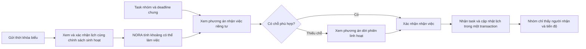

# PLANORA — Kế hoạch lập lịch cá nhân trong nhóm đồ án

Ngày lập: 01/11/2026. Trạng thái: đã triển khai MVP nghiệp vụ nhóm và bổ sung chat chung theo yêu cầu. Luồng nhận task mở popup NORA để phân tích và xếp lịch riêng trước khi xác nhận.

## 1. Mục tiêu và phạm vi

Một task nhóm có một người chịu trách nhiệm và một deadline chung. Mỗi thành viên nhận được phương án làm việc riêng, tính từ thời khóa biểu và các ràng buộc cá nhân. Nhóm chỉ xem người nhận, trạng thái và tiến độ được người nhận xác nhận.

Luồng chính:

Giữ nguyên Notes: soạn ghi chú, lưu bản nháp, phân tích AI, chỉnh kết quả và xem trước/tự lưu lịch. Không thay Notes bằng một màn hình chỉ đọc hoặc bắt chuyển sang chat.

Các thao tác mới về nhóm, nhận việc và thay đổi lịch có thể bắt đầu bằng hội thoại hoặc nút hành động; không yêu cầu người dùng tính hoặc nhập từng khoảng rảnh.

## 2. Những quyết định cần điều chỉnh từ bản mô tả

| Nội dung | Cách triển khai đề xuất |
|---|---|
| Tự tạo giờ sinh hoạt, ăn uống và di chuyển | Hiển thị một preset gồm 07:00–22:30, nghỉ trưa 11:45–12:45, nghỉ tối 18:00–19:00, đệm di chuyển 30 phút. Chỉ sử dụng sau một lần xác nhận. Đây là chính sách đề xuất, không phải thói quen đã được AI xác minh. Có nút “Điều chỉnh với NORA”. |
| Tự đọc tiết 1–12 | Dùng bảng quy đổi tiết của trường đã xác minh hoặc giờ thể hiện trong ảnh. Nếu thiếu bảng quy đổi, hỏi một lần; không tự đoán độ dài tiết. |
| Lấy phần bù rồi lưu thành giờ rảnh tuần | Lưu lịch cố định theo ngày/chuỗi lặp được xác nhận, lưu chính sách sinh hoạt, rồi tính khoảng rảnh từ dữ liệu nguồn. Không áp lịch của một tuần cho mọi tuần sau. |
| Bỏ khoảng nhỏ hơn 45 phút | Giữ chúng trong thông tin khoảng trống, nhưng không đưa vào tập phiên tập trung nếu chính sách yêu cầu tối thiểu 45 phút. Không gộp qua giờ học, ăn uống hoặc khoảng bận. |
| Thêm 30 phút sau mỗi ô môn học | Sinh khoảng đệm theo chính sách đã xác nhận; hợp nhất các khoảng chồng nhau. Phân biệt một cụm ca học liên tiếp với một chuyến về nhà; không để khoảng đệm gây lỗi xung đột giả với ca học kế tiếp. |
| Chia task thành phiên 2–3 tiếng | Tôn trọng giới hạn phiên thực tế của tài khoản. Mặc định hiện tại là 90 phút, nên ví dụ hai phiên 120 phút không tự động hợp lệ. |
| “Cày đêm” 23:00–01:00 cho deadline 23:00 | Không cung cấp như một phương án đúng hạn. Chỉ đề xuất làm đêm nếu vẫn hoàn thành trước deadline. Thay deadline nhóm phải là một quy trình riêng do người có quyền xác nhận. |
| Hoàn thành phiên đồng nghĩa hoàn thành task | Giữ hai sự kiện riêng. Hoàn thành phiên ghi nhận thời gian; hoàn thành task cần xác nhận kết quả. Không suy ra phần trăm hoàn thành từ thời gian đã tiêu. |
| “Bảo mật 100%”, “phương án tối ưu nhất”, “đọc trong 3 giây” | Chuyển thành tiêu chí kiểm thử quyền truy cập, chất lượng phương án và số đo độ trễ thực tế. Không dùng lời hứa tuyệt đối hoặc một con số chưa đo. |

Với người dùng đã có lịch rảnh hoặc chính sách riêng, giữ dữ liệu đó; không ghi đè bằng preset mới. Đổi preset, lịch học hay ngày áp dụng phải tạo một bản xem trước có thể đối chiếu.

## 3. Phần có thể tái sử dụng và phần cần xây

| Thành phần hiện tại | Tái sử dụng / mở rộng |
|---|---|
| `AgentService`, `GeminiAgentModel`, `AgentTimetableImport` | Đọc ảnh, hội thoại làm rõ, giải quyết tuần áp dụng, bản xem trước, áp dụng và hoàn tác. |
| `PlanningEngine.FreeSlots` | Hợp nhất và trừ khoảng thời gian; bổ sung chính sách ăn/ngủ/di chuyển và nguồn gốc khoảng đệm. |
| `PlanningUrgency`, `PlanningProtection`, `PlanningUrgentEvents` | Bảo vệ lịch cố định và phiên khóa, ưu tiên việc khẩn và thử dời công việc; cần mở rộng tìm phương án theo deadline thật. |
| `PlanProposal`, revision, `WorkTask.Version` | Phương án có phiên bản, hết hạn, kiểm tra lại trước khi lưu và chống ghi đè. |
| `WorkTask`, `WorkSession` | Giữ nguyên mô hình sở hữu cá nhân; không chuyển chúng thành tài nguyên dùng chung của nhóm. |
| Notes | Giữ nguyên tính năng và giao diện. Có thể bổ sung thao tác tạo bản nháp task nhóm từ nội dung Notes ở giai đoạn sau. |
| Nhóm, thành viên, mã mời, task nhóm, nhận task | Xây mới. Qua kiểm tra mã nguồn hiện tại, chưa có mô hình nghiệp vụ tương ứng. |

Không viết lại bộ lập lịch hoặc tách microservice cho MVP. Tiếp tục dùng .NET, SQL Server và React trong kiến trúc hiện tại.

## 4. Thiết kế nghiệp vụ và dữ liệu

### 4.1. Thời khóa biểu và giờ có thể làm việc

1. Người dùng gửi ảnh; NORA trích ngày, giờ, môn học, vị trí và phạm vi lặp.
2. Kiểm tra đủ dữ kiện, đúng múi giờ và các ngày trong tuần. Không bỏ qua môn để vừa giới hạn batch.
3. Hiển thị lịch cố định và preset sinh hoạt, phân biệt dữ liệu đọc từ ảnh với giá trị đang đề xuất.
4. Một lần bấm xác nhận lưu lịch và chấp nhận chính sách. Nếu người dùng chỉ chấp nhận lịch học, vẫn lưu được lịch học; phần giờ có thể làm việc ở trạng thái chờ xác nhận.
5. Tính lại khi lịch hoặc chính sách thay đổi:

   `Khoảng có thể làm việc = khung sinh hoạt đã xác nhận − hợp các lịch cố định, bận cá nhân, ăn/ngủ/di chuyển và phiên đã chiếm chỗ.`

6. Bộ lập lịch tiếp tục kiểm tra giới hạn phút/ngày, độ dài phiên, nghỉ giữa phiên, deadline, phụ thuộc và phần việc còn lại.

Đề xuất thêm `AvailabilityPolicy` theo tài khoản, có phiên bản và trạng thái xác nhận. Khoảng rảnh là kết quả tính hoặc cache theo revision; không dùng một bản sao `WeeklyAvailability` đã trừ lịch học làm nguồn dữ liệu gốc. Các khoảng rảnh cũ vẫn có đường tương thích riêng.

Phân biệt `calendarGaps` và `schedulableFocusSlots`: một khoảng không có lịch chưa chứng minh rằng một công việc cụ thể có thể xếp vào đó.

### 4.2. Nhóm và task chung

Mô hình tối thiểu:

| Entity đề xuất | Trách nhiệm |
|---|---|
| `TeamProject` | Tên nhóm, trạng thái, người tạo. |
| `TeamMembership` | Thành viên, vai trò Leader/Member, trạng thái tham gia, phiên bản. |
| `TeamInvite` | Mã ngẫu nhiên, bản hash, hết hạn, thu hồi, giới hạn lượt dùng. |
| `TeamTask` | Nội dung chung, thời lượng được xác nhận, deadline chung, ưu tiên, khả năng chia phiên, người nhận, tiến độ và phiên bản. |
| `TeamTaskAssignment` | Liên kết task nhóm với người nhận và `WorkTask` cá nhân; không xuất liên kết nội bộ này trong DTO nhóm. |
| `TeamClaimProposal` | Phương án riêng của người đang cân nhắc nhận việc; chụp phiên bản task nhóm, lịch cá nhân, thành viên và thời hạn hiệu lực. |
| `TeamActivity` | Hoạt động được phép công khai: tạo task, nhận task, cập nhật tiến độ, hoàn thành. |

MVP chỉ có một người nhận trên mỗi task. Thành viên tạo được task; leader quản lý thành viên và deadline. Thành viên khác không được sửa task đã có người nhận tùy ý. Mã mời cần chống dò và có thể thu hồi, không dùng mã ngắn dễ đoán làm ranh giới bảo mật.

NORA có thể đề xuất tên, mô tả và thời lượng. Giá trị chưa được người dùng xác nhận chưa được dùng để phát hành task chung hoặc chiếm lịch cá nhân. Deadline nhóm không được tự đặt hoặc tự nới.

### 4.3. Nhận task và chống tranh chấp

**Xem phương án:** đọc một snapshot của task chung và lịch riêng, chạy thử ngoài transaction. Task vẫn mở; không giữ chỗ dài hạn trong lúc AI xử lý.

**Xác nhận:** trong một transaction ngắn:

1. Kiểm tra người dùng còn là thành viên hợp lệ và có quyền nhận task.
2. Kiểm tra deadline/thời lượng/phiên bản task chung chưa đổi, task chưa có người nhận và phương án còn hiệu lực.
3. Kiểm tra revision lịch cá nhân, phiên khóa/đang chạy và các ràng buộc thời gian.
4. Nhận task bằng cập nhật có điều kiện theo phiên bản và `Assignee IS NULL`.
5. Tạo `WorkTask` cá nhân, áp dụng phiên mới và các phiên được phép dời, lưu liên kết nhận việc và hoạt động nhóm.
6. Commit toàn bộ. Bất kỳ bước nào thất bại đều rollback cả phần nhóm lẫn lịch cá nhân.

Dùng khóa chống trùng theo người dùng + request ID; thêm ràng buộc chỉ một assignment đang hoạt động cho một task. Quy định thứ tự khóa thống nhất để tránh deadlock. Khi tái sử dụng service áp dụng kế hoạch, tách phần core dùng chung transaction thay vì gọi lồng các API/service đang tự mở transaction.

Người xác nhận sau nhận thông báo task đã có người nhận; lịch của người đó không được thêm, dời hay hủy phiên nào. Retry cùng request không tạo thêm task hoặc phiên.

Các thay đổi sau khi đã nhận cần có quy tắc ngay từ MVP:

- **Đổi deadline/thời lượng:** với task đã nhận, leader tạo yêu cầu thay đổi; người nhận xem phương án riêng và xác nhận trước khi thay đổi có hiệu lực. Giữ giá trị hiện hành trong lúc chờ, không để deadline task nhóm và việc cá nhân âm thầm khác nhau.
- **Trả task:** người nhận xác nhận tác động tới các phiên chưa thực hiện. Giải phóng assignment và cập nhật lịch trong cùng transaction; giữ lịch sử công việc đã làm.
- **Rời nhóm hoặc bị xóa khỏi nhóm:** xử lý trách nhiệm của task đang nhận trước khi kết thúc membership. Leader không được thao tác trực tiếp lịch cá nhân của thành viên.
- **Hoàn tác nhận việc:** kiểm tra đồng thời phiên bản assignment và revision lịch; từ chối nếu đã có thay đổi mới hoặc phiên đã bắt đầu. Không dùng riêng cơ chế hoàn tác lịch cá nhân để làm lệch trạng thái nhóm.

### 4.4. Đàm phán khi thiếu thời gian

Thứ tự tìm phương án:

1. Xếp vào khoảng rảnh hiện có trước deadline.
2. Chia thành phiên trong giới hạn đã cho phép; không tự chia công việc yêu cầu liên tục.
3. Tìm phiên linh hoạt ưu tiên thấp hơn có thể dời và vẫn đáp ứng deadline, phụ thuộc, nghỉ giữa phiên và năng lực ngày của cả hai việc.
4. Trả tối đa 2–3 phương án, ưu tiên ít phút bị dời, ít phiên bị ảnh hưởng và ít phân mảnh hơn.
5. Nếu không có phương án hợp lệ, giải thích ràng buộc thật; giữ task nhóm mở và cho phép hủy hoặc trao đổi tiếp.

Lịch học, thi, hẹn cố định, giờ bận đã xác nhận, phiên khóa và phiên đang thực hiện không phải ứng viên dời. AI chỉ giải thích các phương án mà backend đã kiểm tra; không tự bịa giờ cũ/giờ mới hay tỷ lệ cải thiện.

Cần mở rộng chính sách dịch chuyển hiện tại: mã nguồn đang có giới hạn dịch chuyển việc khẩn `MaximumUrgentDisplacementDays = 2`. Ví dụ dời sang cuối tuần chỉ được đưa ra khi nằm trong phạm vi người dùng cho phép và còn trước deadline của việc bị dời; không âm thầm bỏ giới hạn này.

Mọi phương án nhận task và dời lịch cá nhân đều cần một lần xác nhận cụ thể, kể cả khi tự lưu trong chat đang bật. Nút xác nhận thể hiện rõ task nào được nhận và phiên nào sẽ đổi. Hủy phương án không thay đổi nghiệp vụ.

### 4.5. Ranh giới riêng tư

**Nhóm được nhận:** tên/nội dung task chung, estimate chung, deadline chung, người nhận, trạng thái, phần trăm tiến độ đã xác nhận và thời điểm cập nhật task.

**Chỉ chủ tài khoản được nhận:** ảnh TKB, lịch học, lịch cá nhân, giờ rảnh, phiên dự kiến/thực tế, lý do bận, phương án nhận task, tên việc bị dời và lịch sử đàm phán.

Không trả entity cá nhân rồi ẩn bằng CSS. Dùng DTO, truy vấn và endpoint riêng. Leader không có quyền xem lịch thành viên. `TeamClaimProposal` luôn kiểm tra chủ sở hữu, không chỉ kiểm tra cùng nhóm. Luồng AI tạo task chung chỉ nhận ngữ cảnh nhóm; nội dung giải thích riêng không được sao chép vào bảng hoạt động hoặc thông báo nhóm.

MVP có thể cập nhật bảng nhóm bằng tải lại/polling có giới hạn. Nếu bổ sung realtime, payload cũng chỉ dùng DTO nhóm, không broadcast private proposal.

## 5. Kế hoạch triển khai theo sáu chặng

Ước lượng để lập kế hoạch: nhóm 3 người, mỗi người khoảng 12–15 giờ/tuần, khoảng 5–6 tuần. Đây là ước lượng sơ bộ theo phạm vi dưới đây; cần chốt lại sau chặng 1. Với một người làm, giữ thứ tự nhưng lập lại thời lượng theo năng lực thực tế.

| Chặng | Kết quả bàn giao | Điều kiện hoàn thành |
|---|---|---|
| 1 — Ổn định nền cá nhân | Chốt quy tắc xác nhận, phạm vi ngày, bảo vệ lịch cố định, hành vi lỗi/tiếp tục; baseline Notes và lịch cá nhân. | Ảnh → làm rõ tuần → lưu đủ buổi → phân tích; retry không trùng; lỗi xử lý không bị báo thành thiếu giờ rảnh. |
| 2 — TKB thành giờ có thể làm việc | `AvailabilityPolicy`, preview preset và khoảng đệm, tính khoảng rảnh theo ngày, điều chỉnh qua NORA. | Xác nhận một lần tạo được lịch hợp lệ; không tự ghi đè giờ đã có, không nhầm tuần hoặc đoán giờ theo tiết. |
| 3 — Nhóm tối thiểu | Nhóm, thành viên, mã mời, task pool, phân quyền và DTO nhóm. | Người ngoài không truy cập được; thành viên/leader chỉ nhìn thấy đúng dữ liệu chung. |
| 4 — Nhận task riêng tư | Private proposal, liên kết task nhóm/cá nhân, xác nhận nguyên tử, chống trùng và race condition. | Hai người cùng xác nhận chỉ một người thành công; người còn lại không bị đổi lịch. |
| 5 — Đàm phán và tiến độ | Phương án dời việc ưu tiên thấp, giải thích trước/sau, cập nhật trạng thái/tiến độ đã xác nhận. | Việc gấp và việc bị dời đều giữ deadline; mọi thay đổi cần phê duyệt; nhóm không biết chi tiết đàm phán. |
| 6 — Kiểm thử tích hợp và demo | Kiểm thử SQL Server thật cho giao dịch đồng thời, kiểm thử quyền truy cập, trải nghiệm mobile, lỗi provider và kịch bản 3 thành viên. | Qua toàn bộ tiêu chí ở phần 6; không làm hỏng Notes/lịch cá nhân hiện có. |

Phân công gợi ý: một người phụ trách policy và planner; một người phụ trách nhóm, quyền và transaction; một người phụ trách UI và luồng kiểm thử. Cả ba cùng chốt contract trước khi triển khai chặng 3–4.

## 6. Tiêu chí nghiệm thu bắt buộc

- Import giữ đủ môn, đúng giờ, tuần áp dụng, múi giờ và ngày kết thúc. Ảnh mờ hoặc thiếu bảng tiết phải hỏi đúng phần thiếu.
- Preset chưa được chấp nhận không trở thành giờ làm việc thật. Các khoảng đệm chồng nhau được hợp nhất, không trừ hai lần hoặc làm mất lịch học.
- Không dùng phần giờ rảnh của tuần này như lịch chắc chắn của tuần khác có TKB khác.
- Preview, đóng popup và hủy không nhận task hoặc đổi lịch.
- Task nhóm 240 phút được xếp đủ phần việc theo giới hạn phiên/ngày thực tế, không nhất thiết hai phiên 120 phút.
- Xác nhận task + tạo việc cá nhân + dời phiên cũ là một giao dịch. Kiểm thử lỗi giữa chừng phải chứng minh rollback đầy đủ.
- Hai thành viên xác nhận đồng thời: đúng một assignment; lịch người thua không đổi. Retry cũng không nhân đôi assignment/task/session.
- Nếu deadline/thời lượng nhóm, revision lịch hoặc quyền thành viên đổi sau preview, yêu cầu xác nhận cũ bị từ chối và có đường tính lại.
- Dời việc khẩn không làm việc cũ trễ hạn hoặc vi phạm phụ thuộc, phiên khóa, giới hạn ngày hay giờ nghỉ.
- Không đưa phương án sau 23:00 cho task có deadline cứng 23:00. Không tự mở giờ đêm.
- Leader và thành viên khác không đọc được private proposal/lịch/ảnh dù đoán đúng ID hoặc sửa request trực tiếp.
- Response, hoạt động nhóm và thông báo không chứa tên việc riêng, lý do bận hoặc thời gian phiên cá nhân.
- Tiến độ nhóm lấy từ cập nhật được xác nhận, không lấy thời gian sử dụng/estimate làm bằng chứng đã hoàn thành sản phẩm.
- Lỗi AI, hết thời gian, quota, mất kết nối và stale preview không để lại trạng thái nhận task hoặc đổi lịch một phần.
- Notes giữ nguyên khả năng tạo/sửa/lưu/phân tích/xem trước; người dùng cũ vẫn dùng lịch cá nhân bình thường.

## 7. Demo MVP và những gì chưa làm

Demo bằng ba tài khoản test: leader tạo nhóm và hai task; thành viên A nhận một task vào lịch riêng; thành viên B nhận task gấp bằng phương án dời một phiên linh hoạt sau khi xác nhận. Mở màn hình nhóm để chứng minh chỉ thấy người nhận/tiến độ; thử gọi private API của B bằng tài khoản A và leader để chứng minh đều bị chặn. Chạy thêm ca hai người nhận cùng task và ca task đổi deadline trong lúc đang xem preview.

Không đưa vào MVP: chat nhóm realtime đầy đủ, mạng xã hội, thanh toán/điểm thưởng mới, nhiều người cùng nhận một task, quản lý vi mô lịch thành viên, tối ưu lịch chung của cả nhóm, đồng bộ hai chiều toàn bộ mô hình nhóm với Google Calendar, tự đổi deadline hoặc tự mở giờ ngủ. Tích hợp Calendar cá nhân hiện có tiếp tục giữ riêng.

Cập nhật phạm vi theo yêu cầu tiếp theo: đã bổ sung khung chat chung, lịch sử có phân trang và tự cập nhật 7 giây khi trang đang hiển thị. Nội dung chat do thành viên chủ động gửi; không tự đưa hội thoại NORA hoặc lịch riêng vào nhóm. Chưa dùng SignalR/realtime đầy đủ.

Ưu tiên bản đầu là một luồng hoàn chỉnh, kiểm chứng được: **gửi TKB → xác nhận chính sách → tạo nhóm/task → xem lịch riêng → xác nhận nhận việc → nhóm chỉ thấy tiến độ**. Sau khi luồng này ổn định mới mở rộng mức tự động hóa và trải nghiệm cộng tác.
