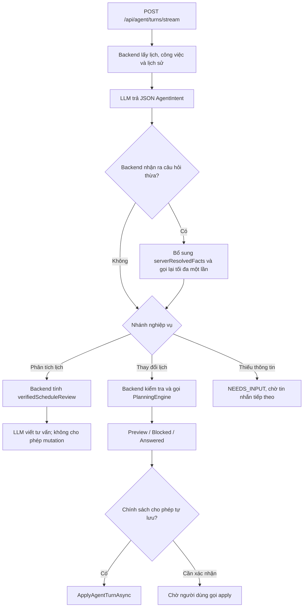

# Kiểm tra kiến trúc Agent của NORA / PLANORA

Ngày đánh giá: 31/10/2026, Asia/Ho_Chi_Minh.

Đối tượng: mã nguồn hiện tại trong workspace, bao gồm các thay đổi chưa commit. Đây là đánh giá kiến trúc điều phối AI; không phải kiểm toán toàn bộ bảo mật, chất lượng model hay kết quả vận hành Google Calendar. Không sửa luồng sản phẩm hoặc dữ liệu người dùng trong lần đánh giá này.

## Kết luận

**NORA hiện là workflow có tích hợp LLM, có bộ nhớ hội thoại, khả năng hành động và một số bước phản hồi có giới hạn. Chưa tìm thấy bộ điều phối cho phép LLM tự chọn chuỗi công cụ và quyết định bước tiếp theo sau mỗi kết quả thực thi để hoàn thành một mục tiêu.**

Vì vậy, khi phân biệt nghiêm ngặt giữa workflow và agent do LLM điều khiển, kiến trúc hiện tại thuộc nhóm **AI-powered workflow / workflow-based assistant**. Có thể mô tả là một hệ thống có đặc tính agentic nếu giải thích rõ phạm vi; chưa có đủ bằng chứng để quảng bá là agent tự chủ nhiều bước.

Các cách diễn đạt trước đây cần hiệu chỉnh:

- “NORA chỉ gọi AI một lần” không đúng với tất cả nhánh: có nhánh gọi lại để khôi phục câu hỏi thừa và nhánh lấy lời tư vấn từ dữ liệu backend đã kiểm chứng.
- “Có tạo, lưu và hoàn tác nên chắc chắn là agent” không đủ để kết luận: workflow cũng thực hiện được những hành động đó.
- “Không có native function calling / framework nên không phải agent” cũng không phải tiêu chí đúng. Agent có thể sử dụng JSON tùy biến và công cụ tự xây; yếu tố quyết định là quyền điều phối bước tiếp theo.
- Có yêu cầu xác nhận không làm mất tính agent. Một agent có kiểm soát vẫn có thể dừng để người dùng phê duyệt.

## Tiêu chí đánh giá

Áp dụng sự phân biệt kiến trúc của [Anthropic — Building effective agents](https://www.anthropic.com/research/building-effective-agents): workflow tổ chức LLM và công cụ qua các đường đi định trước; agent cho LLM điều phối động quá trình và việc sử dụng công cụ. Thuật ngữ “agent” có nhiều cách dùng; kết luận này dựa trên tiêu chí cụ thể đó, không dựa vào tên lớp hay framework.

Không có quy chế cuộc thi trong dữ liệu đánh giá, nên không thể khẳng định hệ thống đạt hoặc bị loại theo tiêu chí riêng của ban tổ chức.

## Phạm vi đã kiểm tra

- Frontend gửi yêu cầu và nhận SSE: `frontend/src/agent.jsx`, `frontend/src/agent-stream.js`.
- Controller chat, ảnh, giọng nói, ghi chú và thao tác công việc.
- Các điểm gọi model trong Infrastructure: chat/vision, phân tích lịch, chuyển giọng nói, đọc ảnh riêng, phân tích ghi chú, capture và breakdown.
- `AgentIntent`, ngữ cảnh, lịch sử, xác thực đầu ra, chuẩn hóa, câu hỏi bổ sung, preview/apply/undo.
- Hoạch định, chấm điểm, sửa phương án, ưu tiên khẩn và bảo vệ công việc.
- Tự phục hồi lịch, ghi nhận bù, học hệ số ước lượng, thông báo và đồng bộ Calendar.
- Kiểm thử hiện có mô phỏng provider để đối chiếu số lượt gọi, bước kiểm tra lại, kết quả tư vấn, áp dụng và hoàn tác.

## Luồng chat thực tế

Sau khi `PlanningEngine` trả thiếu thời gian hoặc xung đột, luồng chat hiện trả trạng thái và gợi ý theo code. Không có bước tổng quát đưa kết quả planner trở lại LLM để model tự chọn hành động tiếp theo trong cùng một lần thực hiện mục tiêu.

## Bằng chứng trong source

| Phần | Bằng chứng | Nhận định |
| --- | --- | --- |
| Điều phối chính | [AgentService.cs:43](../../src/SPWPOS.Infrastructure/Workspace/AgentService.cs#L43), `SendAgentTurnCoreAsync` | Thứ tự lấy trạng thái → diễn giải → kiểm tra → hoạch định → trả/lưu được quy định trong code. |
| Ngữ cảnh và lịch sử | [AgentService.cs:101](../../src/SPWPOS.Infrastructure/Workspace/AgentService.cs#L101), [AgentContext.cs](../../src/SPWPOS.Infrastructure/Workspace/AgentContext.cs) | Có dữ liệu thực tế theo tài khoản; lấy tối đa 8 lượt gần đây. Đây là ngữ cảnh được backend chuẩn bị sẵn, không phải model tự chọn truy vấn công cụ. |
| Model chọn ý định | [AgentContracts.cs:21](../../src/SPWPOS.Application/Workspace/AgentContracts.cs#L21), [AgentInterpreter.cs:28](../../src/SPWPOS.Infrastructure/Workspace/AgentInterpreter.cs#L28) | Model trả các mảng `tasks`, `events`, `exceptions`, cờ `reschedule` và các query. Có định tuyến và lựa chọn hành động có cấu trúc. |
| Giao tiếp provider | [GoogleCloudAi.cs:76](../../src/SPWPOS.Infrastructure/Workspace/GoogleCloudAi.cs#L76), [AgentInterpreter.cs:144](../../src/SPWPOS.Infrastructure/Workspace/AgentInterpreter.cs#L144) | Gửi prompt/ngữ cảnh và JSON Schema. Không thấy khai báo công cụ native hay dispatcher công cụ tùy biến có vòng lặp observation → next action. |
| Kiểm tra lại diễn giải | [AgentService.cs:122](../../src/SPWPOS.Infrastructure/Workspace/AgentService.cs#L122), [AgentRequestPolicy.cs:94](../../src/SPWPOS.Infrastructure/Workspace/AgentRequestPolicy.cs#L94) | Có một lần recheck do điều kiện backend kích hoạt, không phải model tự quyết định số bước và công cụ. |
| Phân tích lịch hai lượt | [AgentScheduleReview.cs:32](../../src/SPWPOS.Infrastructure/Workspace/AgentScheduleReview.cs#L32) | Backend tính dữ kiện rồi gọi AI viết tư vấn. Đầu ra bước này bị kiểm tra không có hành động thay đổi. Đây là prompt chaining có kiểm chứng. |
| Lập/tối ưu lịch | [AgentService.cs:183](../../src/SPWPOS.Infrastructure/Workspace/AgentService.cs#L183), [PlanningEngine.cs:119](../../src/SPWPOS.Application/Workspace/PlanningEngine.cs#L119) | Backend chọn gọi bộ hoạch định. LLM không tự chọn một vòng thử phương án mới theo kết quả planner. |
| Sửa phương án | [PlanningRepair.cs:8](../../src/SPWPOS.Application/Workspace/PlanningRepair.cs#L8) | Tối đa 8 lần sửa theo thuật toán C#, không gọi model trong vòng lặp. Không phải vòng lặp agent. |
| Ghi lịch và hoàn tác | [AgentService.cs:480](../../src/SPWPOS.Infrastructure/Workspace/AgentService.cs#L480), [AgentService.cs:570](../../src/SPWPOS.Infrastructure/Workspace/AgentService.cs#L570) | Có hành động thật, kiểm tra phiên bản, preview và undo. Đây là nền tảng tốt để xây tool thực thi. |
| Bộ nhớ bền vững | [AgentTurn.cs](../../src/SPWPOS.Domain/Entities/AgentTurn.cs), [AgentConversation.cs](../../src/SPWPOS.Domain/Entities/AgentConversation.cs) | Lưu request, command, kết quả và dữ liệu undo; chưa có trạng thái mục tiêu/chuỗi tool observations cho một agent run. |

Tìm kiếm các dấu hiệu function/tool call và các điểm gọi model trên source production được kết hợp với đọc luồng thực thi; việc không thấy một từ khóa đơn lẻ không được dùng làm bằng chứng duy nhất.

## Đối chiếu với kế hoạch Agent cũ

[AI_AGENT_IMPLEMENTATION_PLAN.md](../plans/AI_AGENT_IMPLEMENTATION_PLAN.md), ngày 07/10/2026, đã đề xuất đúng một kiến trúc agent: model chọn công cụ, orchestrator quản lý vòng lặp, mô phỏng và đánh giá ứng viên nhiều lần. Công cụ dự kiến là `get_planning_context`, `simulate_plan`, `evaluate_candidate`, `analyze_workload`.

Nhưng tài liệu ghi rõ đây là **đề xuất**, một số tên chưa tồn tại trong code. Trong source hiện tại, các chức năng tương tự được gọi bởi pipeline backend, chưa được mở thành giao thức công cụ cho model và vòng lặp điều phối như đề xuất. Vì vậy không lấy sơ đồ hoặc tên trong kế hoạch làm bằng chứng rằng agent loop đã được triển khai.

Mốc repository khi đối chiếu: commit `74d759f` (cộng các thay đổi đang có trong workspace). Tên commit/file chứa “NORA” hoặc “Agent” không thay thế bằng chứng luồng thực thi.

## Phân loại các chức năng còn lại

| Chức năng | Cách thực hiện hiện tại | Phân loại |
| --- | --- | --- |
| Đọc ảnh ngay trong chat | `InterpretImageAsync` gửi ảnh và yêu cầu đến model rồi đi qua cùng pipeline `AgentIntent`. | Đầu vào đa phương thức của workflow. |
| Đọc thời khóa biểu bằng endpoint riêng | `ReadTimetableAsync` nhận ảnh, trả dữ liệu có cấu trúc. | Tác vụ trích xuất bằng LLM. |
| Giọng nói | `TranscribeAsync` chuyển audio thành văn bản; controller không giao cho model quyền chọn công cụ lịch. | Pipeline chuyển giọng nói thành chữ. |
| Ghi chú → công việc/lịch | `AnalyzeNoteAsync` → người dùng kiểm tra → tạo proposal → apply. | Workflow phân tích và duyệt theo các bước cố định. |
| Chia công việc | `BreakdownAsync` nhờ model gợi ý các việc con; không tự phân công và thực thi worker. | Sinh nội dung có cấu trúc; chưa phải multi-agent. |
| Tự phục hồi lịch | `ScanRecoveryAsync` kiểm tra quy tắc bỏ lỡ rồi gọi `engine.Generate`. | Automation theo quy tắc. |
| Ghi nhận bù/Auto-heal | `CatchUpAsync` xử lý kết quả và `AutoHealScheduleAsync` tìm khoảng hợp lệ trong 48 giờ. | Automation/thuật toán C#, không có quyết định LLM. |
| Học ước lượng/năng lực | `UpdateLearningAsync`, `AdaptiveLearning.Ema` cập nhật hệ số từ lịch sử thực hiện. | Thích nghi thống kê; không phải model tự học trọng số hoặc tự quyết định tool. |
| Thông báo | Worker định kỳ gọi các nghiệp vụ quét và gửi. | Background automation. |
| Đồng bộ Google Calendar | `GoogleCalendarWorker` chạy `SyncNextAsync` theo lịch, OAuth và outbox. | Tích hợp/sync service; không phải tool được LLM chọn trong agent loop. |
| SSE và trạng thái tiến trình | `READING`, `UNDERSTANDING`, `PLANNING`, `SAVING` phát từ backend; đọc stream để ghép câu trả lời. | Truyền trạng thái và nội dung, không phải chứng cứ về bước suy luận tự chủ. |

## Đối chiếu năng lực agent

| Năng lực | Trạng thái |
| --- | --- |
| Hiểu mục tiêu ngôn ngữ tự nhiên | Có. |
| Ngữ cảnh người dùng và lịch sử hội thoại | Có, có giới hạn. |
| Chọn loại hành động và các tham số | Có, qua `AgentIntent`. |
| Thực hiện thay đổi vào hệ thống thật | Có, qua backend. |
| Phản hồi từ dữ kiện đã kiểm chứng | Có, đặc biệt nhánh phân tích lịch. |
| Kiểm tra quyền, ràng buộc, preview, xác nhận và undo | Có. |
| Model tự chọn một chuỗi công cụ theo từng observation | Chưa thấy trong luồng production. |
| Model tự sửa chiến lược sau kết quả tool thất bại/không đủ chỗ | Chưa thấy vòng lặp tổng quát; hiện code trả blocked hoặc chờ người dùng. |
| Trạng thái agent run gồm mục tiêu, tool calls, observations và điều kiện hoàn thành | Chưa thấy; hiện chủ yếu lưu theo turn/intent/result. |
| Model tự phân công nhiều agent và tổng hợp kết quả | Chưa thấy. |

## Điều còn thiếu để trình diễn agent nhiều bước

Không cần viết lại bộ hoạch định hoặc đổi model. Phần thiếu tập trung ở điều phối:

1. Định nghĩa tool contract cho các nghiệp vụ đọc lịch, đọc việc, tìm giờ trống và tạo proposal.
2. Cho model chọn tool và tham số; backend thực thi dưới quyền tài khoản đã xác thực.
3. Đưa kết quả tool có cấu trúc trở lại model; model chọn bước tiếp theo, hỏi lại hoặc kết thúc.
4. Giới hạn số bước/thời gian/chi phí và có điều kiện dừng rõ ràng. Không tự nới deadline, giờ rảnh hay quyền hạn để đạt mục tiêu.
5. Giữ apply/undo và xác nhận cho các hành động cần phê duyệt; lưu trace hành động, không hiển thị suy luận nội bộ.
6. Bổ sung bài kiểm thử chứng minh model chọn chuỗi hành động khác nhau khi cùng mục tiêu nhưng kết quả công cụ khác nhau.

Ví dụ bằng chứng cần có: model đọc lịch → nhận các khoảng trống → gọi planner → nhận cảnh báo giới hạn phiên → chọn lại phương án trong phạm vi được phép → kiểm tra → trả proposal hoặc hỏi người dùng. Nếu chuỗi này được cố định hoàn toàn trong code thì vẫn là workflow nhiều bước.

## Cách trả lời hội đồng phù hợp với bản hiện tại

> “NORA hiện được triển khai dưới dạng workflow có tích hợp LLM cho bài toán hoạch định. Hệ thống có ngữ cảnh, hội thoại, lựa chọn hành động có cấu trúc, thực thi và kiểm chứng. Thứ tự điều phối vẫn do backend quản lý; nhóm chưa triển khai vòng lặp tổng quát để LLM tự chọn công cụ và điều chỉnh sau từng kết quả thực thi.”

Không dùng số phần trăm tự chủ hoặc khẳng định đạt tiêu chí cuộc thi khi chưa có rubric và benchmark tương ứng.

## Kiểm chứng của lần rà soát

- Đọc source production và đối chiếu các call site thay vì dựa vào tên “Agent” trong file/class.
- Build Release thành công, 0 warning và 0 error, output riêng trong `artifacts/agent-architecture-audit-bin` để không ảnh hưởng API đang chạy.
- Chạy lại 212 kiểm thử thuộc `AgentInterpreterTests`, `AgentFreeTimeTests` và `NoraQualityTests`: 212 passed, 0 failed, 0 skipped. Bao gồm các ca phân tích lịch hai lượt, recheck có giới hạn, câu hỏi cần làm rõ, preview/apply/undo và tối ưu trong NORA. Báo cáo runner ở `artifacts/agent-architecture-audit-tests.xml`.
- Các kiểm thử dùng provider giả và database fixture, giúp đối chiếu hành vi điều phối; không phải bằng chứng tỷ lệ hiểu đúng của model thật hoặc chứng nhận đạt tiêu chí cuộc thi.
- Không gọi Google AI thật, không thay đổi model, không sửa lịch hoặc thao tác tài khoản người dùng trong lần đánh giá này.
