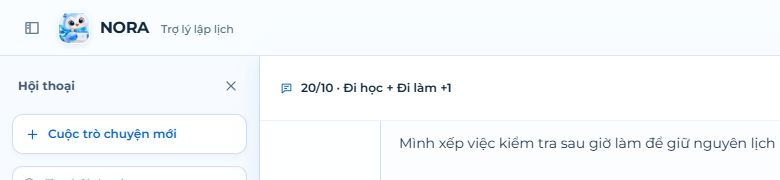
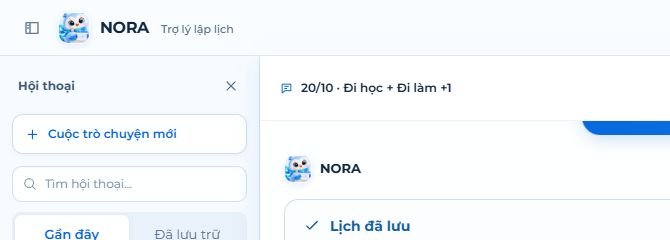
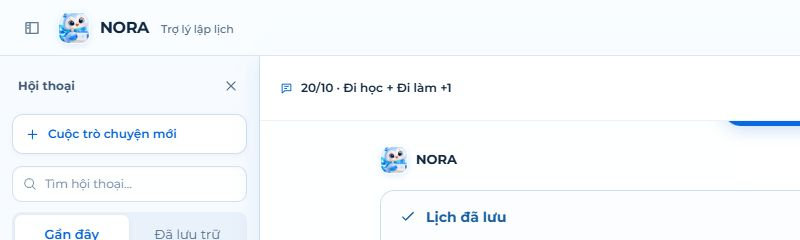
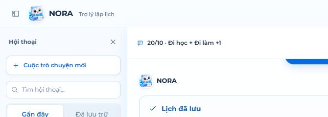
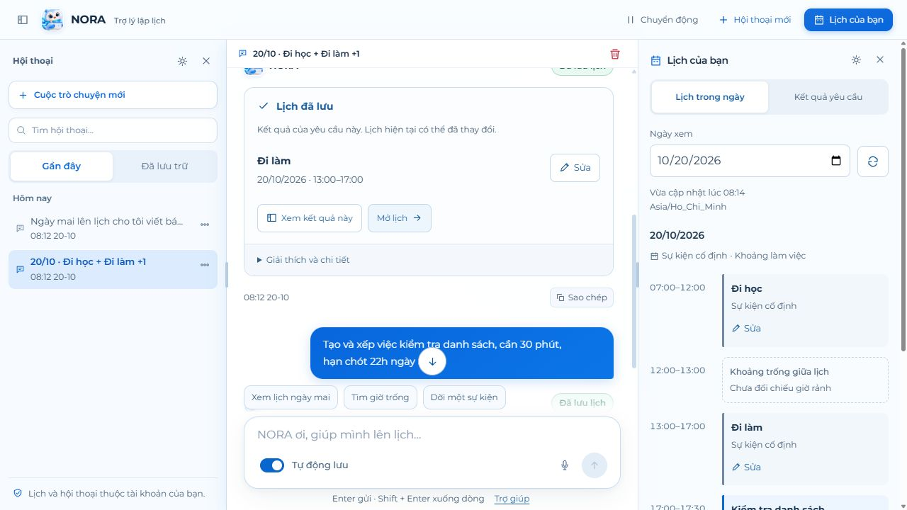
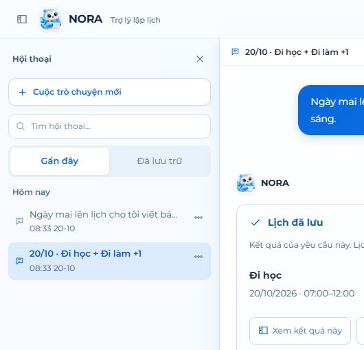

# Nora UI/UX first-pass refinement — implementation

Implemented in the main workspace on 19 October 2026, following [the consolidated first-pass findings](NORA_UI_UX_FIRST_PASS_FINDINGS_2026-10-19.md).

## Result

The right panel now separates **Lịch trong ngày** (saved calendar data) from **Kết quả yêu cầu** (the selected request's result). Fixed classes/work events and scheduled work sessions appear together in the day view. A previous request's plan is no longer presented as the user's entire current calendar.

Each structured response has one primary result card with compact dates, relevant edit/undo actions and a calendar link. Useful public explanation remains visible; duplicate confirmation prose and verified audit text are available under **Giải thích và chi tiết**. The underlying agent response and scheduling rules remain unchanged.

## Findings addressed

| Finding | Implemented refinement |
| --- | --- |
| NUX-01: chat/panel mismatch | The day view reads `/api/workspace`, includes both fixed events and work sessions, displays the selected date/timezone and update state, and offers refresh. Request results have their own explicitly historical/request-scoped view. Comparing an older request switches to that request's date. Failed refreshes disclose cached data rather than claiming a new verification. |
| NUX-02: triple confirmation | One structured result card is the primary confirmation. Exact work-session times are visible. Meaningful rationale is retained; duplicate prose and audit output are collapsed. Warnings, conflicts, failed outcomes and clarification remain separate and visible. |
| NUX-03: internal codes | Known `[CLASS]`, `[WORK]` and other built-in category tags are rendered as Vietnamese labels in displayed/copied response text. Raw saved result data is not rewritten. |
| NUX-04: repetitive dates | Same-day ranges display the date once, followed by `07:00–12:00`. Cross-day ranges retain both dates. |
| NUX-05: undo/edit discoverability | Eligible results show **Hoàn tác** inside the card. Matched saved fixed events open a pre-filled editor for title/start/end. It preserves description/category, submits account-timezone values to the existing event endpoint, and retains edits after rejection. Task results open the existing task-edit form. Calendar links open the relevant date. |
| NUX-06: deletion control | The requested red bin and floating menu remain. Both use the existing centered confirmation. Its description now explicitly states that saved calendar items remain when chat messages are deleted. |
| NUX-07: terminology | **Sự kiện cố định** identifies a fixed calendar reservation; **Khoảng làm việc** identifies a task session. **Lịch trong ngày** and **Kết quả yêu cầu** name different scopes. Preview and undone results are labeled as unsaved/history. |
| NUX-08: day context | A chronological day timeline shows fixed events, work sessions, intervening gaps and overlap warnings. Overnight entries are clipped to the selected account day. Gaps say **Chưa đối chiếu giờ rảnh**; they are not represented as guaranteed availability. |
| NUX-09: proactive suggestions | Eligible loaded gaps can offer optional lunch/travel drafts. Clicking only fills and focuses the composer. The user reviews and sends; no calendar entry is created by selecting a suggestion. Past days and elapsed intervals today do not offer these suggestions; the check uses the loaded account timezone. |
| NUX-10: capability discovery | Populated chats offer **Xem lịch ngày mai**, **Tìm giờ trống** and **Dời một sự kiện**. Examples populate drafts without sending. Read-only examples explicitly ask the agent not to change the calendar. |
| NUX-11: similar conversation titles | Loaded automatically titled conversations display date/topic summaries, aggregating distinct change names. Manually renamed titles are preserved. Creation timestamps help distinguish rows; full original titles remain available. This is a presentation refinement, not a background rewrite of all historical titles. |
| NUX-12: unclear icons | Send options use a sliders symbol. Desktop motion/new-chat controls include labels; icon-only compact controls retain accessible names/tooltips. Editing a submitted prompt remains clearly distinguished from editing a saved event. |
| NUX-13: idle status clutter | The normal ready indicator is omitted. Connection, processing and voice states remain visible. |
| NUX-14: request-count ambiguity | The unlabeled request-count badge is removed from the conversation toolbar. |
| NUX-15: composer clearance | The message history and composer remain separate flex regions. Resize observation preserves the bottom position when following the latest reply, recalculates the jump button position, and preserves older-message reading position. Short landscape windows cap a long draft at 72 px and fold secondary content so send controls remain visible. |
| NUX-16: idle counter clutter | The visual counter appears from 1800/2000 characters. The limit remains available in input guidance/accessibility descriptions. |
| NUX-17: auto-save understanding | A labeled switch distinguishes **Tự động lưu** from **Xem trước khi lưu**, with explanatory text and a clear **Lưu thay đổi** preview action. Existing default/persistence behavior is preserved. |
| NUX-18: readability/accessibility | Timestamp/copy/status and relevant secondary text use at least 12 px. Foreground colors are darker; focus indicators and accessible names are retained. Mobile edit/close controls have larger targets; native modal focus/cancellation works within the calendar drawer. |

## Implementation boundaries

- The live timeline is populated from loaded workspace/calendar records, never inferred from model prose or request history. Request results are separately identified and can legitimately differ from the current calendar after later edits.
- Result-card event editing is offered only when name and exact times uniquely match a saved event. Otherwise the day view/full calendar provides the current edit path. Task editing reuses the application's existing form; changing a work session's exact slot remains available through the full calendar.
- Lunch/travel gaps do not prove configured availability, travel necessity or user preference. Suggestions remain optional drafts subject to existing backend validation.
- No schema migration, agent-policy modification, live AI request or real calendar write was needed for this frontend pass. Browser verification used synthetic HTTP responses and in-memory records.

## Verification

- **261 frontend tests passed** across 32 files; **4 session tests passed**.
- Production frontend build passed. Assets were generated into the existing API web root.
- Thirteen new regression cases cover saved-vs-preview separation, refresh failure/retry, draft-only suggestions and suppression of elapsed intervals, consolidated result actions, overnight overlap handling, compact/localized text, automatic/manual title distinction, two account-timezone cases, older-request comparison date, and editor cancellation/rejection/retry.
- The real application dialog was included in the synthetic browser fixture. Task editing opened the existing form. A fixed event was moved from **13:00 to 13:30**, then the saved day view refreshed to **13:30–17:00**. Editing a native date field exposed an old-value submission edge case; the editor now reads submitted `FormData` values, matching the application's form pattern.
- Checked **1440 × 960**, **900 × 800**, **375 × 812**, and **667 × 375** viewports. Document width matched viewport width. The phone calendar drawer began at y=52 and retained focus after cancelling the event editor.
- A **1911-character multiline draft** in 667 × 375 landscape retained a 72 px text area, visible send/options/auto-save controls, and a composer bottom at **y=367**, within the 375 px viewport.
- The phone history stayed at distance **0** from its bottom when following the latest result after resizing. History and composer bounds did not overlap.
- Computed browser styles confirmed **12 px** copy/timestamp/status text. Sample color-pair ratios are listed below; these checks are not a full accessibility certification.
- `git diff --check` passed. All **261 protected user files** from the workspace-transfer manifest remained unchanged.

| Sample pair | Contrast ratio |
| --- | --- |
| Secondary text `#486078` on `#EAF1F8` | 5.73:1 |
| Saved badge `#116548` on `#E9F9F1` | 6.47:1 |
| Preview badge `#805013` on `#FFF6E4` | 6.36:1 |
| Action text `#195D9D` on `#EDF5FD` | 6.17:1 |

## Evidence

- [Desktop result card and saved day](../evidence/nora-ui-refinement-2026-10-19/desktop.jpg)
- [Selected request scope](../evidence/nora-ui-refinement-2026-10-19/request-scope.jpg)
- [Phone day view](../evidence/nora-ui-refinement-2026-10-19/mobile-day.jpg)
- [Phone event editor](../evidence/nora-ui-refinement-2026-10-19/mobile-editor.jpg)
- [Long draft in short landscape](../evidence/nora-ui-refinement-2026-10-19/landscape-long-draft.jpg)
- [Frontend test output](../evidence/nora-ui-refinement-2026-10-19/frontend-tests.log)

## Remaining evaluation

The proposed 3–5 participant usability study is still needed to measure comprehension, task completion and trust. Live AI quality, screen-reader operation, native mobile keyboard behavior and broad accessibility conformance have not been certified by the synthetic browser checks. The earlier 6.5/10 screenshot impression is not replaced with an invented new score.

Refresh the local application to load the rebuilt frontend. A separately hosted application requires its normal frontend deployment. The prior review ZIP remains a dated snapshot of the earlier implementation; the current source and this report describe this refinement.

## Follow-up: composer layout requested by the user

The configuration panel has been removed. **Tự động lưu** remains directly available inside the chat box. The remaining-character counter appears only below **500** characters remaining (hidden at exactly 500) and hides again when text is shortened. Below the box, **Enter gửi · Shift + Enter xuống dòng** sits beside **Trợ giúp**. Help holds the save/undo, sending, data and voice instructions. The removed personalization control used the same disabled-by-default planning flags that outgoing requests retain.

Suggestions now share the composer's centered width and left edge. On phones, three equally sized buttons fit without clipping. The footer is 28 px high on desktop and 32 px on phones; this brings the chat box 24 px lower on desktop and 20 px lower on phones. Supporting text remains 12 px. Microphone warnings have an accessible X button that clears the warning, preserves the draft and returns focus to the input. Dismissing a warning does not grant microphone permission; another denied attempt shows a new warning.

The affected Nora test group passed **47 tests**, including the 500/499 boundary, shortening the draft, warning dismissal/reappearance and preview/apply behavior. The frontend production build passed. Synthetic browser checks confirmed matching suggestion/composer bounds, a 30 px desktop bottom gap and a 34 px phone gap. The 375 px phone view had no document overflow. Microphone denial used a synthetic browser fixture, without real permission prompts or recording. Earlier screenshots describe the initial refinement.

[Phone layout](../evidence/nora-ui-refinement-2026-10-19/composer-spacing-mobile.png) · [Dismissible microphone warning](../evidence/nora-ui-refinement-2026-10-19/microphone-warning-dismissible.png)

## Follow-up: consistent popup dismissal across the app

Floating Help, note formatting and task deadline filters now use the shared `PopupDetails` component. `useOutsideDismiss` also handles conversation actions, introductory navigation, the shared application dialog, Nora event editing and conversation deletion confirmation. Existing mobile navigation/history/calendar backdrops remain in place. Persistent desktop sidebars and inline explanations/forms are not treated as floating popups.

Outside clicks are handled during capture, including when the clicked control stops propagation. Clicks inside a popup remain usable. A drag that begins inside a dialog does not cancel it on release outside. Dialog padding is inside the panel; the backdrop is outside. Foreground dialogs dismiss without also dismissing a dialog beneath them. Outside dismissal cancels a confirmation without executing its destructive action; busy Nora confirmations/editors keep their existing save/delete protection. Escape and existing focus restoration remain available.

All **271 frontend tests across 33 files** passed, and the production frontend build passed. Regression coverage includes Help, note formatting, deadline input preservation, stopped-propagation clicks, backdrop vs padding/drag gestures, foreground dialogs, busy deletion and introductory navigation. Synthetic desktop/phone browser checks confirmed Help closes outside, voice instructions remain usable inside, and backdrop cancellation of event editing leaves the saved event unchanged. [Phone evidence after dismissal](../evidence/nora-ui-refinement-2026-10-19/popup-outside-dismissed.png).

## 20 October follow-up: remove the white strip above the composer

Removing the suggestion backgrounds and fade did not address the reported strip. Browser measurement showed the transcript scroll viewport stopped at y=542, exactly where suggestions started, while the conversation panel continued to y=720. The apparent white overlay was the exposed parent area after the transcript's clipping boundary.

The composer, suggestions and notices now occupy a transparent floating dock. The transcript extends to the panel bottom; a resize observer measures the dock's height and reserves corresponding bottom scroll space. Latest messages remain above the controls at the end of the conversation, and messages stay visible through uncovered parts of the dock while scrolling. Only the individual buttons and input box have fills; gaps in the suggestion row pass pointer events through to the transcript. Existing scroll-to-latest animation and user reading position are preserved.

**41 relevant tests and the production build passed**, including a new regression for growing dock height. Browser checks confirmed a blue message spanning y=537–610 remained visible across the suggestions at y=542. At 375 px width, the latest message ended above the dock and growing the draft updated the reserved space. At 667 × 375 with a multiline draft, the textarea remained 72 px high and the composer bottom stayed at y=341. No real AI requests were sent.

Resize-driven layout writes are deferred to the next animation frame to avoid ResizeObserver delivery loops. A fresh browser check across desktop, phone, growing draft and landscape reported no warnings or errors.

[Long draft in landscape](../evidence/nora-ui-refinement-2026-10-19/transparent-dock-landscape.png)

## 20 October follow-up: restore the strip below suggestions

The requested white background now covers the input and footer only. An 8 px gradient sits in the gap below the suggestions, reaching solid white halfway through that gap. The suggestions remain over the full-height transcript, preserving the previous clipping fix. The surface follows the input naturally as drafts grow or the layout changes.

The production build and **41 relevant tests passed**. Browser checks at 1280 × 720 and 375 × 812 confirmed the 8 px chip/input gap, full-height transcript and no phone overflow; no browser warnings or errors were reported. Verification used synthetic calendar data.

[Phone layout](../evidence/nora-ui-refinement-2026-10-19/composer-strip-fade-mobile.png)

The fade was subsequently extended to start at the top of the suggestion row, as requested. Its height follows the row naturally, including wrapped phone labels, and it still reaches solid white halfway through the gap above the input. Desktop and phone browser checks confirmed matching fade/chip top edges (542 px and 618.4 px respectively), no phone overflow and no browser warnings or errors. The production build and 22 agent tests passed.

## 20 October follow-up: compact header and adjustable side panels

The conversation title row is now 40 px high on desktop, down from approximately 65 px. At drawer widths it remains 44 px to retain a usable delete target. Both desktop side panels have draggable boundary grips and keyboard resizing (arrows, Shift + arrows, Home/End). Header size menus offer narrower/wider buttons and reset as a single-pointer alternative; double-clicking a grip also resets its width. These menus use the shared outside-dismissal behavior.

Widths are remembered in browser storage, including after collapsing and reopening a panel. Conversation history supports 220–400 px; the calendar supports 280–480 px. The layout reduces the effective widths when needed to retain 440 px for the conversation where space permits, while preserving preferred widths for a larger window. Closing either panel releases its column, and the existing header controls reopen it. A user-collapsed calendar stays collapsed when a new response arrives. Phones and tablets retain the existing dismissible drawers without desktop resize grips.

**All 275 frontend tests across 33 files and the production build passed.** New interaction tests cover both panel widths, click/keyboard controls, reload persistence, bounds and keeping the calendar collapsed after a saved response. Synthetic browser checks covered dragging both edges, keyboard and menu adjustments, outside dismissal, collapse/reopen, reload, a 1081 px desktop with a 440 px conversation, and 375 px mobile drawers without overflow. Both collapsed columns measured zero and the conversation filled the 1280 px panel. No browser warnings or errors were recorded.

[Both panels collapsed](../evidence/nora-ui-refinement-2026-10-19/panels-collapsed.png) · [Narrow desktop](../evidence/nora-ui-refinement-2026-10-19/panels-narrow-desktop.png) · [Mobile calendar drawer](../evidence/nora-ui-refinement-2026-10-19/panels-mobile.png)

The visible resize grips and pointer hover/drag edge highlights were subsequently removed as requested. The transparent hit areas retain the resize cursor and drag behavior; keyboard focus remains visible when using the separator by keyboard. Browser checks verified no generated grip or pointer outline, successful dragging and keyboard resizing. The production build and 25 agent tests passed. [Clean panel edge](../evidence/nora-ui-refinement-2026-10-19/panels-invisible-resize.png).

The sizing popups and their header buttons were then removed from both panels at the user's request, along with unused component/styles. Drag and keyboard resizing, double-click reset, remembered widths and collapse/reopen remain. The production build and 25 agent tests passed; the browser showed zero sizing menus and both resize targets. [Simplified panel header](../evidence/nora-ui-refinement-2026-10-19/panels-without-sizing-menu.png).

## 20 October follow-up: prompt and response action footers

Prompts now show their timestamp, copy icon and edit icon in a right-aligned row below the bubble. The same prompt component is used during processing, with editing disabled while busy. Copying preserves the original prompt text; editing only populates the draft. The response copy icon now sits immediately after its timestamp on the left. All copy/edit controls have transparent backgrounds, no borders or visible labels, accessible names and tooltips. Copy success briefly changes the icon to a check; clipboard failures show readable feedback. Mobile targets remain 44 × 44 px.

Timestamps use the account time zone and the existing recorded turn creation time; no separate response completion time is invented. Browser checks confirmed the prompt footer begins below the bubble, response time/copy are adjacent, all three controls have transparent backgrounds and zero borders, and the 375 px layout has no document overflow. No browser warnings or errors were recorded.

The production build and **all 277 tests across 33 files passed with `--maxWorkers=2`**. The initial unrestricted full run experienced resource-related timeouts across several pages; the complete rerun passed without production changes for those failures. New tests cover separate prompt/response clipboard contents, editing without sending, both timestamps, and clipboard failures for each source.

[Mobile action rows](../evidence/nora-ui-refinement-2026-10-19/message-actions-mobile.png)

The copy/edit icons are now hidden on desktop until their own prompt or response is hovered or contains keyboard focus. Their reserved space prevents layout shifts, and invisible icons do not accept pointer clicks. The prompt timestamp now follows the same hover/focus behavior; response timestamps remain visible. Touch devices retain directly accessible controls. The production build passed. Browser checks confirmed idle opacity 0, the hovered message's icons at opacity 1 while the other message stays hidden, and keyboard focus revealing the edit control. [Idle state](../evidence/nora-ui-refinement-2026-10-19/message-actions-hidden.png) · [Prompt hovered](../evidence/nora-ui-refinement-2026-10-19/message-actions-hovered.png).

The prompt timestamp hover follow-up passed the production build and browser checks (opacity 0 at rest, 1 on prompt hover). [Hidden prompt timestamp](../evidence/nora-ui-refinement-2026-10-19/prompt-time-hidden.png) · [Prompt hovered](../evidence/nora-ui-refinement-2026-10-19/prompt-time-hovered.png).

The response copy icon is now always visible beside its timestamp, as requested. Hover rules apply only to the prompt timestamp and its copy/edit icons. The production build passed; browser checks confirmed response opacity 1 and pointer access at rest, while prompt timestamp/copy remained at opacity 0. [Always-visible response copy](../evidence/nora-ui-refinement-2026-10-19/response-copy-always-visible.png).

## 20 October follow-up: plain status indicators

Turn statuses now use colored text with a small contextual icon instead of pills. Backgrounds, borders, rounded corners and pill padding were removed for every turn status. Saved items use a check; failed/blocked items use an alert icon; clarification, preview and undo retain distinct icons and their existing text/colors. The production build and 27 agent tests passed. Synthetic browser checks confirmed both saved and failed statuses have transparent backgrounds, zero borders/radius/padding and an icon. [Plain status example](../evidence/nora-ui-refinement-2026-10-19/plain-status-failed.png).
