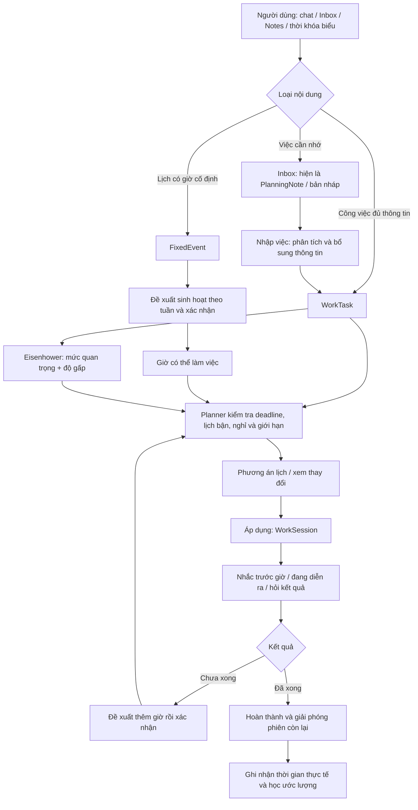

# Đánh giá luồng và tính năng PLANORA — 04/11/2026

## Phạm vi và kết luận

Đối chiếu mã nguồn backend/frontend, hợp đồng dữ liệu, tài liệu hiện tại và kiểm thử tự động tại workspace ngày 04/11/2026. Đánh giá bao gồm các thay đổi local chưa commit, không chỉ bản main trên Git. Không sửa nghiệp vụ, không reset dữ liệu, không gửi Telegram, không thanh toán và không gọi model thật trong lượt đánh giá này. Đây không phải kiểm toán bảo mật đầy đủ, kiểm thử tải hay xác nhận mọi tích hợp production.

PLANORA đã có các phần chính của một hệ thống quản lý thời gian cá nhân và nhóm: tiếp nhận nội dung, phân tích, kiểm tra quỹ thời gian, lập lịch, thực hiện, phản hồi và duyệt kết quả. Điểm mạnh nhất là planner có ràng buộc thực tế và luồng task nhóm tôn trọng lịch riêng. Điểm yếu chính là một việc chưa có vòng đời thống nhất: ghi chú, bản nháp Inbox, task có deadline và task nhóm có các đường xử lý khác nhau. NORA đã tối ưu số vòng gọi model, nhưng chưa có thao tác lưu một việc không ngày/thời lượng trực tiếp trong bộ công cụ Agent.

Ưu tiên phát triển nên chuyển từ mở rộng số màn hình sang thống nhất vòng đời công việc và giải thích rõ hệ thống vừa lưu điều gì.

## 1. Bản đồ nghiệp vụ

Sơ đồ thể hiện luồng chủ đạo. Có ngoại lệ: sự kiện đầy đủ thông tin không cần cấu hình giờ rảnh; phân loại ma trận không tự đổi lịch; yêu cầu cứu deadline/dời phiên cần xác nhận riêng dù bật tự lưu. Bản nháp Inbox hiện chưa đi thẳng tới hoàn thành như task thông thường.

Luồng nhóm:

`Tạo nhóm / mời / leader duyệt tham gia → leader mô tả hoặc tải file → NORA soạn gói việc → leader sửa và phát hành → chỉ định hoặc tự nhận → member xem lịch riêng và xác nhận → thực hiện → gửi báo cáo/file → leader duyệt hoặc yêu cầu bổ sung → tin hệ thống, notification và thưởng theo điều kiện`.

## 2. Đánh giá từng phần

| Phần | Đã có trong source | Giới hạn / nhận xét |
| --- | --- | --- |
| Tài khoản và quyền | Đăng nhập, đăng ký/OTP, quên/đổi mật khẩu, Google/Firebase, quản lý phiên; API kiểm tra tài khoản hoạt động và quyền Admin | Nền tảng đã có. Không kết luận bảo mật tuyệt đối từ việc unit test qua. |
| Inbox và Notes | Ghi nhanh không ngày/thời lượng, sửa/xóa, mở đúng note trong Nhập việc; phân tích nhiều hoạt động và tránh nhập trùng sau thành công | Inbox dùng chung PlanningNotes, giới hạn 200; chưa phải task có đầy đủ checklist/trạng thái/hoàn thành. |
| NORA | Diễn giải mục đích ngay lượt đầu; phân biệt hội thoại, tư vấn, đọc dữ liệu và thay đổi; công cụ gộp giảm số vòng; preview/apply/undo và giới hạn lặp | Agent và Workflow cùng tồn tại; chưa có công cụ capture Inbox, quản lý bản nháp hoặc checklist trong registry Agent hiện tại. |
| Thời khóa biểu | Đọc ảnh, lưu lịch bận, đề xuất ăn/ngủ/nghỉ/di chuyển và giờ rảnh theo đúng tuần, chờ xác nhận | Các giờ sinh hoạt là giả định có thể xem lại, không phải AI đã biết thói quen thực tế. Tuần chưa xác nhận có thể chưa có quỹ làm việc. |
| Task và lịch | Phân biệt task/sự kiện/phiên; phụ thuộc, task con, phiên khóa/đang làm, deadline cứng/mềm; kéo đổi giờ/thời lượng và kiểm tra lại | WorkTask vẫn bắt buộc deadline và thời lượng. Ghi nhanh mới tạo bản nháp; lịch làm một việc chưa có deadline thật còn cần bound trong cơ chế hiện tại. |
| Eisenhower | Bốn ô, chọn thủ công hoặc tự tính, lý do/cảnh báo, checklist, kéo thả, lọc và đề xuất lịch trước khi áp dụng | Task nháp có phân loại riêng, nhưng chưa có checklist/hoàn thành như WorkTask. Đánh giá tự động giới hạn 30 ngày và cần dữ liệu lịch. |
| Thực hiện và học | Timer, thời gian thực tế, hết giờ hỏi kết quả, thêm giờ xem trước/xác nhận, hoàn thành sớm giải phóng phiên, EMA từ lịch sử | Học cần tối thiểu 3 mẫu hợp lệ; không phải mọi luồng đều áp dụng hệ số. Checklist không tự cập nhật tiến độ task. |
| Nhóm | Leader giao task, file chia việc theo số member, sửa bản nháp, chỉ định người nhận, lịch riêng, báo cáo/file, leader duyệt, chat hệ thống | Nhận trách nhiệm và áp dụng lịch đang gắn với nhau; không có phương án khả thi thì không nhận được task. Chia số gói bằng số người chưa phải cân tải theo năng lực. |
| Thông báo | In-app/Telegram, trước giờ và lúc bắt đầu, deadline, hỏi kết quả, duyệt task, chống trùng và retry | Telegram là kênh thông báo, chưa xử lý trả lời thêm giờ/hoàn thành bằng chat; máy chủ phải chạy. Polling không bảo đảm chính xác từng giây. |
| Google Calendar | Đồng bộ hai chiều lịch phụ PLANORA, outbox, xử lý xung đột, bảo vệ lịch sử phiên | Chưa đọc lịch chính và các lịch khác. “Giờ rảnh” chỉ đúng trong dữ liệu hệ thống biết. |
| Thanh toán và doanh thu | payOS, xác minh webhook/đối soát, cấp skin chống trùng; doanh thu ngày/tuần/tháng, lịch sử đơn, trang Admin tách riêng | Là doanh thu giao dịch skin đã xác nhận, chưa phải doanh thu ròng/kế toán, hoàn tiền hay hệ thống bán nhiều sản phẩm. |
| Vận hành | Health/jobs, kiểm tra schema, runtime build riêng, log lượt model/tool và nhiều kiểm thử | Chưa đủ bằng chứng về thời gian phản hồi p50/p95 trên production, tải nhiều tài khoản, chất lượng OCR ngoài thực tế hoặc mọi kênh gửi thật. |

## 3. Những điểm nên sửa trước

### P1 — Thống nhất “việc cần làm” giữa Inbox, Notes và task

**Bằng chứng:** `WorkTask.Deadline` là giá trị bắt buộc; `ValidTask` chặn thiếu deadline và thời lượng. Inbox dùng Notes. MatrixDraft là metadata trong processing JSON của note; trả `Kind=Draft`, checklist rỗng. Bộ công cụ NORA không có thao tác lưu/đọc Inbox.

**Hệ quả:** người dùng ghi việc được nhưng phải đổi màn hình/hoàn thiện thêm trước khi có các thao tác task bình thường. Cùng một việc ở Inbox và WorkTask có ID khác sau khi chuyển. Giao diện task nhanh hơn nhưng chưa đạt ý tưởng “NORA lưu task trước, tổ chức sau”.

Ngoài ra, `isInboxNote` hiện chọn các Notes chưa nhập thành task, không chỉ bản ghi được tạo từ ô Inbox. Vì vậy ghi chú thuần nội dung chưa xử lý cũng có thể xuất hiện ở Inbox; xóa tại Inbox xóa chính note gốc. Đây là hành vi hiện có và có xác nhận xóa, nhưng dễ gây hiểu nhầm với yêu cầu giữ Notes độc lập. Cần phân biệt nguồn capture/loại bản ghi và giải thích tác động, không chuyển mọi note thành việc bắt buộc xử lý.

**Đề xuất:** coi task là một thực thể xuyên suốt, tên là tối thiểu; deadline, ước lượng, ngày dự định làm và phiên lịch là tùy chọn riêng. Notes tiếp tục phục vụ viết nội dung, có liên kết với task. Khi chuyển các bản nháp hiện có cần giữ liên kết/ID nguồn để tránh tạo trùng và không xóa Notes. Không dùng deadline giả để đáp ứng schema.

**Tiêu chí đạt:** một câu “nhớ giúp tôi việc X” tạo việc ngay; người dùng có thể checklist/hoàn thành mà chưa cần lịch; sau này lên lịch vẫn dùng cùng task; không tác động lịch khi mới ghi lại.

### P1 — Cho NORA các hành động phù hợp với vai trò thư ký

**Bằng chứng:** `NoraToolRegistry` chủ yếu đọc task/lịch/preferences và tạo phương án thay đổi; instructions hiện ghi task mới cần tên, thời lượng, deadline hoặc bound rõ ràng.

**Đề xuất:** bổ sung nhóm ý định capture, organize, plan, execute, review. Capture chỉ lưu việc; organize cập nhật danh sách, checklist và phân loại; plan mới cần quỹ giờ. Câu hỏi thiếu deadline chỉ nên chặn hành động thực sự cần deadline. Không thêm một model call riêng cho mọi bước.

**Tiêu chí đạt:** “ghi lại”, “chia bước”, “chọn việc nên làm”, “xếp lịch” cho ra bốn hành vi khác nhau, có trạng thái lưu rõ ràng. Xem lịch hoặc tư vấn vẫn không đổi dữ liệu.

### P1 — Phân biệt deadline thật và ngày dự định làm

**Bằng chứng:** WorkTask có Deadline bắt buộc; work-window/WorkSession là các ràng buộc khác, nhưng task mới vẫn cần bound để đi qua luồng lập lịch.

**Đề xuất:** giữ riêng `hạn phải xong`, `khoảng muốn làm`, `thời lượng dự kiến` và `phiên thực hiện`. Việc không deadline có thể được đề xuất một phiên trong tuần mà không biến cuối tuần thành hạn cam kết. Chỉ cảnh báo quá hạn khi có deadline thật.

### P1 — Sửa lý do Eisenhower khi phân loại thủ công

**Bằng chứng từ source, chưa tái hiện qua tài khoản thật:** `EisenhowerEngine` gán `urgency = task.UrgencyOverride`, sau đó có nhánh `urgency == Urgent` trả câu “Deadline trong 24 giờ tới”. Nếu lịch đã đủ và còn dư quỹ, task hạn xa được người dùng chọn Urgent có thể nhận lý do sai về 24 giờ.

**Đề xuất:** lý do deadline phải dựa trên reason code `DUE_WITHIN_24H`; nếu chỉ manualUrgency thì giải thích “Bạn chọn ưu tiên khẩn cấp”. Giữ các cảnh báo quá hạn/thiếu giờ dựa trên thực tế.

**Nguồn:** `src/SPWPOS.Application/Workspace/EisenhowerEngine.cs:52–64`.

### P2 — Làm rõ liên hệ checklist, tiến độ và thời gian còn lại

Hiện checklist độc lập với Progress; Remaining mặc định dựa trên ước lượng điều chỉnh × phần trăm chưa xong, trừ trường hợp có quỹ còn lại đã xác nhận. Học dùng actual của phiên hoàn thành, nên chỉ tick task xong mà không có actual không tạo mẫu hợp lệ. Đây là các quy tắc có chủ đích, nhưng người dùng dễ hiểu nhầm `5/5 checklist` thành task đã hoàn thành.

Đề xuất hiển thị phân biệt “các bước đã xong”, “task đã xong” và “thời gian đã làm”. Khi xong hết checklist, gợi ý xác nhận hoàn thành; task nhóm vẫn gửi duyệt. Không tự quy đổi mỗi bước checklist thành lượng effort bằng nhau nếu chưa có ước lượng.

### P2 — Tách nhận trách nhiệm khỏi khả năng xếp lịch nhóm

Hiện confirm nhận task yêu cầu phương án khả thi và áp dụng lịch cùng transaction. Cách này bảo vệ người dùng khỏi nhận quá tải, nhưng cũng chặn trường hợp muốn nhận việc trước rồi thống nhất điều kiện với leader.

Đề xuất bổ sung một trạng thái có chủ đích như “đã nhận, chờ sắp xếp”, kèm cảnh báo rõ, không âm thầm bỏ kiểm tra. Leader chỉ cần thấy trạng thái/rủi ro tổng hợp mà member đồng ý chia sẻ, không đọc lịch riêng. Đối với chia file, coi số member là gợi ý chia gói; cho leader điều chỉnh effort/phụ thuộc, không xem số gói bằng số người là chứng minh đã cân bằng.

### P2 — Đo độ trễ trước khi tiếp tục tối ưu AI

Model thật không được gọi trong lượt này; các số giây trước đây chỉ là mẫu minh họa. Cần đo riêng thời gian chờ model, đọc ảnh/file, tool, truy vấn database, planner và ghi/apply; báo p50/p95, lỗi/timeout và số lượt theo loại yêu cầu.

`WorkspaceService.Mutate` mặc định chạy cập nhật học và đánh giá rủi ro trong transaction khi revision thay đổi. Đây là điểm cần benchmark khi task/lịch sử tăng, chưa đủ chứng cứ để kết luận nó là nguyên nhân mọi lần chậm. `State` tải tối đa 10.000 phiên; nên kiểm tra chi phí tải snapshot và chính sách lưu trữ theo thời gian. Tối ưu thao tác không cần model trước, giữ model đã chọn.

### P2 — Giải thích phạm vi giờ rảnh và trạng thái đồng bộ

Google Calendar hiện chỉ đồng bộ lịch phụ PLANORA. Nếu một cuộc họp nằm ở lịch chính thì hệ thống chưa biết nó bận. Cần hiển thị phạm vi dữ liệu, thời điểm đồng bộ, tuần sinh hoạt đã xác nhận và trạng thái “đã lưu địa phương / đang đồng bộ / xung đột”. Có thể mở rộng đọc các lịch người dùng chọn sau này, với quyền phù hợp.

### P2 — Vận hành thông báo và thanh toán

Thông báo đúng giờ phụ thuộc worker/server/mạng; Telegram chưa có phản hồi trực tiếp. Nên có trang trạng thái giao nhận, nút mở đúng task/phiên và bản tổng hợp khi người dùng quay lại sau khi máy chủ dừng. Nếu thêm nút trả lời Telegram, backend vẫn xác minh liên kết tài khoản, version và phương án trước khi ghi.

Thanh toán đã có xác minh và grant chống trùng. Trong source đã đọc, đối soát nằm ở webhook và khi truy vấn/tạo đơn; chưa thấy worker định kỳ đối soát toàn bộ đơn chờ. Nên bổ sung hoặc xác minh rõ cơ chế này trước khi phụ thuộc báo cáo doanh thu. Chưa có nghiệp vụ refund: không gọi số PAID hiện tại là lợi nhuận hoặc doanh thu ròng.

### P3 — Quản trị và khả năng mở rộng

Danh sách user lấy tối đa 100 bản ghi khớp, chưa phân trang thực sự; có thể thiếu dữ liệu ở quy mô lớn. Thêm phân trang, bộ lọc và số tổng. File báo cáo nhóm lưu nhị phân trong database là lựa chọn hợp lý ở giai đoạn đầu, nhưng cần đo kích thước backup/restore trước khi lượng tài liệu lớn. Tài liệu database ở index vẫn là snapshot tháng 10, không đại diện schema mới nhất; nên tạo lại khi ổn định các thay đổi.

## 4. Đánh giá tính tự động hóa

- Đã tự động hóa được phần diễn giải nội dung, đề xuất routine/giờ rảnh, kiểm tra lịch, chia việc từ file, nhắc nhở và phản hồi hết phiên.
- Chưa nên gọi là tự động hoàn toàn: còn xác nhận giả định sinh hoạt, ước lượng, thay đổi ảnh hưởng lịch và duyệt nhóm. Những xác nhận này có giá trị nghiệp vụ; vấn đề cần giảm là nhập lại cùng thông tin ở các màn hình.
- Bản hướng dẫn onboarding nhiều bước hiện bị vô hiệu trong `frontend/src/onboarding.js`. Các trạng thái rỗng đã có nút gửi thời khóa biểu, nhưng nên làm rõ hai hành trình: ghi việc dùng được ngay; chỉ khi cần xếp lịch mới chuẩn bị thời khóa biểu/giờ sinh hoạt.
- NORA nên chủ động gợi ý có ngữ cảnh và ít làm phiền: việc mới cần tổ chức, việc tồn đọng, thiếu giờ trước hạn và phiên vừa kết thúc. Mọi gợi ý phải phân biệt rõ đề xuất với dữ liệu đã áp dụng.

## 5. Lộ trình đề xuất

1. **Thống nhất mô hình công việc và Inbox:** task tối thiểu chỉ cần tên; tạo/cập nhật/hoàn thành/checklist nhất quán; giữ Notes và liên kết nguồn.
2. **NORA hỗ trợ Inbox:** lưu nhanh, tìm lại, chia bước, tổ chức; chỉ hỏi khi thao tác tiếp theo cần dữ liệu đó.
3. **Lập lịch không deadline giả:** khoảng mong muốn làm độc lập với hạn cam kết; xử lý rõ thiếu effort và thiếu quỹ giờ.
4. **Khép kín thực hiện:** tiến độ/checklist/actual/phản hồi nhất quán, đề xuất thêm giờ và rủi ro dễ hiểu; sửa lý do Eisenhower thủ công.
5. **Cứng hóa vận hành:** test suite chạy ổn định, đo latency/load, theo dõi gửi thông báo, đối soát thanh toán, phân trang Admin và tài liệu schema.

## 6. Bằng chứng kiểm thử lượt đánh giá

- Backend unit: **1.135 passed, 10 skipped, 0 failed**, tổng 1.145. Các test live/opt-in được tắt, không gửi nội dung đến model.
- Frontend lần chạy toàn bộ với chế độ mặc định: **561 passed, 23 failed**, 4 file bị lỗi; phần lớn báo timeout. Có thêm cảnh báo React về key/flushSync. Không coi các lỗi này tự động là 23 lỗi sản phẩm.
- Chạy lại riêng 4 file theo thứ tự, một worker: **99 passed, 0 failed**. Điều này chỉ ra tính nhạy với tải/cách chạy; chưa chứng minh toàn bộ suite ổn định ở cấu hình mặc định.
- Lượt bổ sung chạy toàn bộ với một worker đã hoàn tất sau **204,66 giây: 72 file, 585 passed, 0 failed**. Test browser-session nối sau đó: **4 passed**. Số trường hợp giữa hai lượt có chênh lệch vì workspace local tiếp tục có cập nhật; các số là tổng kết thực tế từng log, không phải phép so sánh tốc độ có kiểm soát. Chưa đủ cơ sở kết luận nguyên nhân chính xác của các timeout ở lần chạy mặc định. Nên chuẩn hóa giới hạn worker/tài nguyên CI và chạy lại trên cùng commit cố định.
- Không chạy lại toàn bộ HTTP integration, SQL Server integration, provider AI thật, Telegram thật, payOS thật hoặc load test trong lượt này. Các kiểm chứng cũ được xem là hồ sơ lịch sử, không thay cho kiểm chứng mới.

Log: `artifacts/system-review-unit-20261104.log`, `artifacts/system-review-frontend-20261104.log`, `artifacts/system-review-frontend-recheck-20261104.log`, `artifacts/system-review-frontend-serial-20261104.log`, `artifacts/system-review-session-refresh-20261104.log`.

## 7. Các nguồn code chính đã đối chiếu

- `src/SPWPOS.Domain/Entities/WorkTask.cs`
- `src/SPWPOS.Infrastructure/Workspace/WorkspaceService.cs`, `TaskService.cs`, `EisenhowerDraftService.cs`, `EisenhowerService.cs`
- `src/SPWPOS.Infrastructure/Workspace/NoraToolRegistry.cs`, `NoraAssistantInstructions.cs`, `NoraRequestPolicy.cs`, `AgentRuntimeTools.cs`
- `src/SPWPOS.Infrastructure/Workspace/TimetableRoutine.cs`, `TimeService.cs`, `WorkTimeService.cs`, `LearningService.cs`
- `src/SPWPOS.Application/Workspace/PlanningEngine.cs`, `PlanningCapacity.cs`, `PlanningScoring.cs`, `EisenhowerEngine.cs`
- `src/SPWPOS.Infrastructure/Workspace/PrivateTeamClaims.cs`, `TeamCompletionService.cs`, `NotificationAdminService.cs`, `EisenhowerNotifications.cs`
- `src/SPWPOS.Infrastructure/Commerce/SkinPaymentService.cs`, `CommerceAdminService.cs`
- `src/SPWPOS.Api/Program.cs`, `Controllers/Commerce/AdminCommerceController.cs`, `Controllers/Workspace/AdministrationController.cs`
- `frontend/src/task-inbox.jsx`, `task-smart-lists.js`, `task-smart-list.jsx`, `eisenhower-board.jsx`, `eisenhower-quick-create.jsx`, `notification-polling.js`, `onboarding.js`
- Tài liệu tính năng trong `docs/features` và tích hợp trong `docs/integrations` được đối chiếu với source; mô tả lịch sử không tự được coi là hành vi hiện tại.
